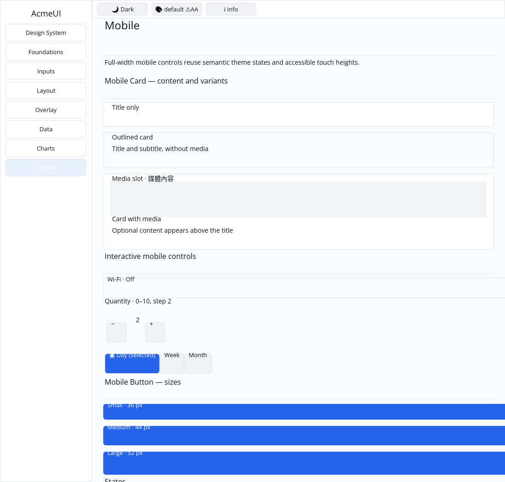

# ROADMAP 019 — Mobile card acceptance

2026-11-08, Asia/Taipei. Task `MOBILE-CARD-019`, branch
`sdk/roadmap-019-mobile-card`. Execution: **single-agent-role-passes** (Lead,
UI/UX, Verification). Review is author self-review; independent review NOT_RUN.
The owner explicitly authorized opening and merging a mergeable PR after tests
and hosted CI pass. No release or publishing is included.

## Read and audit

Read `AGENTS.md`, `.agents/README.md`, the delivery workflow and Lead/UI/UX/
Verification contracts, ownership routing, spec/plan/todos/roadmap, all ROADMAP
016 platform/rendering reports, 017 Q1 and 018 R1, and the 014 mobile report.
Inspected the existing mobile card, Card/Label primitives, layout/view bridges,
retained binding, Gallery frame/hit paths, tests, pinned toolchain, CI and
`scripts/verify_sdk.py`.

Verified the clean base and fetched `origin/master` were both
`99e8b160da10d7e69f247c438a3ca0cd4cee0ee5`; open PRs were empty and the latest
master CI/CPU workflows had succeeded. PR #13 was already merged on 2026-11-07
and was left alone.

OBSERVED: the mobile card was already implemented, not a label passthrough.
Its optional media precedes the title/subtitle Column, with existing Elevated
and Outlined Card variants. Missing acceptance coverage and Gallery examples
were confirmed. Adding media changed the unkeyed text Column's positional key.
Gallery content Card surfaces also used the unclipped quad list.

## Changes and acceptance

- Derive the internal text Column key from the card key. Media insertion/removal
  now preserves card, text Column, title and subtitle retained IDs.
- Replace three shallow card tests with four tests covering builder defaults,
  all eight subtitle/media/elevation combinations (including Traditional Chinese
  content and an interactive media node), geometry at 240/400 logical pixels,
  and retained identity across media insertion/removal. These string tests are
  not IME evidence.
- Add distinct-key title-only, outlined subtitle and media-slot cards to the
  existing Gallery Mobile page. The media row uses the semantic muted token.
- Route content Card, Button, Separator and swatch quads through the existing
  ordered clipped-quad path. This keeps content within the scroll viewport and
  preserves card-before-child paint order. Sidebar/toolbar paint is unchanged.
- Add three Gallery tests for the actual page composition/geometry, themed
  card surfaces with partial/fully-outside clips in light/dark modes, and scene
  command ordering with an interactive media button. Update the existing toggle
  clipping assertion to include its newly clipped host as well as track/thumb.
- Reconcile roadmap rows 016–018 from their reports and add 019. Mark only the
  bounded mobile-card item complete; the all-components Gallery task remains
  open with current coverage listed.

No public signatures, dependencies, manifests, lockfile, platform types or
renderer contracts changed. No widget colours were hardcoded, GPUI added,
cursor offsets changed, `cargo clean` run, or performance numbers invented.
Elevation continues to mean the existing semantic Card variant; blurred native
shadows and media/image decoding are not implemented by this slice.

## Reproductions and corrections

Raw output, command vectors, timestamps, exit codes, OS/toolchain, dirty state
and SHA-256 log hashes are preserved in [evidence.json](evidence.json) and
`logs/`. Intermediate dirty-tree checks are distinct from final commit evidence.

| Check | Before | After |
|---|---|---|
| `adding_and_removing_media_preserves_the_text_subtree_identity` | FAIL: text IDs changed from 1/2/3 to 5/6/7 | PASS with the keyed text Column |
| `card_surfaces_use_theme_tokens_and_keep_the_viewport_clip_when_scrolled` | FAIL: no clipped card surface | PASS through the clipped content path |
| `a_card_surface_is_painted_before_its_interactive_media` | FAIL after clipping only the Card: its surface followed and covered the Button | PASS when content quads share one ordered path |

The first Gallery test compile failed because a sibling test helper was private;
the new test module now owns its context helper. An intermediate full Gallery
run was 18 PASS / 1 FAIL because the old toggle assertion expected only two
clipped quads. It now requires all three (host/track/thumb), and the complete
final Gallery suite passes. Both initial failures remain in the evidence.

## Final local verification

Tested source commit: **`b22df514b5d0e415203587989ead3326886533b0`**.
Linux x86_64, Rust/Cargo **1.88.0**. Only documentation was dirty during the
final suites; each suite records its own actual dirty-state snapshot. Later
documentation/evidence commits do not turn these into local passes on a newer
SHA. Hosted CI must test the final PR head/merge separately.

| Command | Result |
|---|---|
| `cargo fmt -p acme-ui -p acme-ui-gallery -- --check` | PASS |
| `cargo test --locked -p acme-ui --all-features` | PASS: 767 tests; 2 existing ignored doctests |
| `cargo test --locked -p acme-ui --no-default-features --features mobile` | PASS: 306 tests |
| `cargo test --locked -p acme-ui-gallery` | PASS: 19 tests |
| `cargo clippy --locked -p acme-ui --no-default-features --features mobile --all-targets --no-deps -- -D warnings` | PASS |
| `cargo clippy --locked -p acme-ui -p acme-ui-gallery --all-features --all-targets --no-deps -- -D warnings` | PASS |
| `cargo check --locked --workspace --all-targets` | PASS (completed-slice integration check) |
| `cargo build --locked -p acme-ui-gallery` | PASS |
| `python3 scripts/verify_sdk.py --profile cpu --output target/roadmap-019/cpu` | PASS: actual format/test/strict-Clippy execution; not a dry run |

The host supplies `python3`, with no `python` executable. The CPU runner passed
87 tests; the frame-timing test remains ignored and no performance remeasurement
was attempted. Local workspace tests and release compilation were NOT_RUN;
hosted CI provides the workspace test gate during PR delivery.

## Gallery evidence and remaining work

This is an actual native Gallery window captured automatically on isolated Xvfb
`:92` with `WINIT_UNIX_BACKEND=x11`, `ACME_RENDER_BACKEND=cpu`, default light
theme and a 1100×1050 logical window. The executable was built from the tested
source commit. The author inspected the screenshot: title-only, outlined
subtitle and media cards are present, with media above its title/subtitle.
The screenshot is not a golden baseline or a manual human acceptance result.
Commands, dimensions and the image hash are recorded in the evidence.

Manual human Gallery review, real touch hardware, Windows 注音 composition,
physical 100/125/150/200% DPI, GPU drawing/recovery and screen-reader acceptance
remain **NOT_RUN**. Existing adjacent-control layout/typography and native
shadows are not certified by this screenshot. The project is not declared
complete or production-ready by this bounded batch.

Next bounded implementation: audit `mobile_progress` against its P3 determinate
value/total and label contract, then add tests and a Gallery demo. The historical
toggle/stepper/segmented acceptance notes also need a separate reconciliation
against the now-passing strict all-feature Clippy gate.

Delivery snapshot: local acceptance complete. Hosted CI and merging occur after
this report is committed; this snapshot does not claim they have run. Consult
the resulting PR checks and merge record for the final hosted delivery status.
