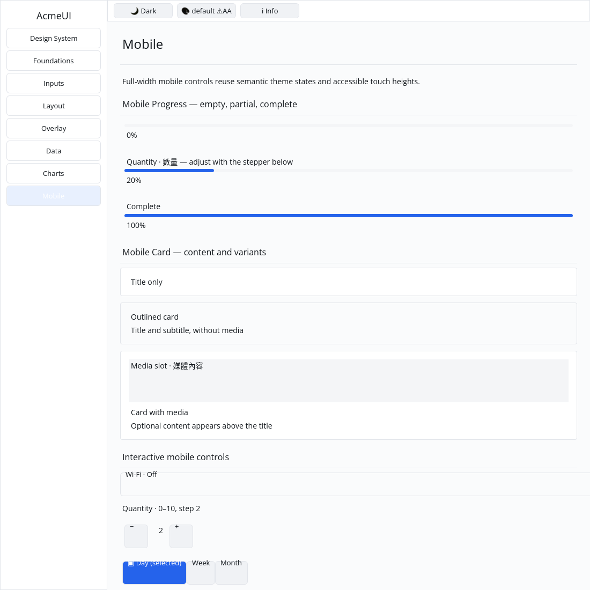

# ROADMAP 020 — Mobile determinate progress

2026-11-09, Asia/Taipei. Task `MOBILE-PROGRESS-020`, branch
`sdk/roadmap-020-mobile-progress`. Execution: **single-agent-role-passes**
(Lead, UI/UX, Verification), serialized by one author. Review is author
self-review; independent review **NOT_RUN**. The owner explicitly authorized
opening and merging a mergeable PR after passing targeted tests and hosted CI.
No release, publishing or repository-setting changes are included.

## Audit and scope

Read AGENTS/team workflow and the Lead/Rust Core/UI/UX/Verification contracts,
spec/plan/todos/roadmap, ROADMAP 019 and the 014 mobile report. Inspected the
progress builders, primitive containers/labels, semantic style/layout bridges,
retained binding, Gallery page/render/hit paths, CI and verification runner.

Fetched and fast-forwarded master: clean base remained
`9b0645f3b208bdbf6e0e13832014a0968012f5ee`. PR #27 and #13 were already MERGED
and were left alone. Open PRs were empty; latest master CI and CPU-evidence
workflows had succeeded. ROADMAP 020 was the next unused batch number.

OBSERVED and REPRODUCED: `mobile_progress` emitted percentage text inside a
6-pixel Row with no painted track or fill. `fraction()` could return NaN. The
Gallery lacked a progress example. This batch addresses this P3 contract only;
other mobile items and historical acceptance-note reconciliation remain open.

## Changes

- Keep builder signatures and public fields. Normalize invalid totals to one
  (preserving the nonpositive-total fallback and extending it to NaN/infinities).
  NaN values mean zero, infinities saturate, and fractions stay within [0, 1].
  Conversion reuses `fraction()`, including after callers edit public fields.
- Compose a responsive muted track and primary fill using semantic theme tokens.
  Fill width follows the normalized fraction; height is 6 logical pixels.
  Description is optional above the track; percentage text is separate below.
- Derive track/fill keys from the instance key. Adding/removing descriptions and
  changing values preserve their retained IDs, including the empty/full states.
- Replace three shallow component tests with four acceptance tests: builder and
  content contract, numeric boundaries, actual layout at three widths/five
  fractions, and retained identity across label/value changes. Traditional
  Chinese test strings are content evidence, not IME evidence.
- Add empty, quantity-linked partial and complete Gallery examples. The existing
  stepper updates the partial example through actual Gallery hit/activation and
  rebuild logic; no new message type is needed.
- Add four Gallery tests for composition/geometry, stepper-driven changes,
  default/Apple light/dark themed paint order and clipping, and shaped glyph
  positioning at scale 1.0/1.25/2.0.
- Correct the existing Gallery content Label path to add its shaped baseline to
  its top coordinate. Normal and colour-swatch labels share this shaping path;
  each is shaped once. Other text-origin call sites are unchanged.

No public signature, dependency, manifest, lockfile, renderer or platform contract
changed. No widget theme colours were hardcoded; no GPUI, byte-based cursor,
platform-specific public type, `cargo clean` or speculative performance rewrite
was introduced. No performance numbers or native mobile runtime support claimed.

## Reproductions and corrections

Exact commands, SHA/dirty state, OS/toolchain, timestamps, exit codes, raw logs
and SHA-256 hashes are recorded in [evidence.json](evidence.json) and `logs/`.

| Reproduction | Before | After |
|---|---|---|
| Component acceptance filter | 0 PASS / 4 FAIL (missing structure/fill) | 4 PASS |
| Dedicated NaN fraction assertion | FAIL: non-finite result | PASS |
| Shaped percentage glyph position | FAIL: ink begins at track y=33 | PASS at three scales |

An intermediate geometry assertion expected unrounded fractional widths; the
layout engine uses Taffy's default rounded edges (1% of 104 becomes 1 logical
pixel). The assertion now verifies that rounding explicitly. Initial Gallery
test compilation exposed the typed Rect/Pixel fields; the assertions now use
the existing `size.width.get()` API. Another test assumed the initial quantity
was five; source inspection confirmed the existing default is two, and the test
now verifies activation from two to four. These intermediate failures are kept.

The first native CPU capture from source `1c94a6d` exposed percentage ink
intersecting the progress track even though their layout rectangles did not
intersect. The prepared glyph offsets are relative to the first baseline;
the Gallery Label renderer had supplied a top coordinate. The new glyph test
reproduced this before the correction. The rejected capture is preserved as
[before image](logs/gallery-overlap-before.png); it is not acceptance evidence.
The final checks and capture were repeated on the corrected source below.

## Final local verification

Tested source: **`91d656f6c1e3edb9910f28c4b88450fd4ee131dd`**.
Linux x86_64, Rust/Cargo **1.88.0**. Tracked source was committed; evidence and
later documentation edits have their actual dirty states recorded per command.
Later documentation commits do not transfer these local passes to a newer SHA;
hosted CI tests the final PR head/merge separately.

| Command | Result |
|---|---|
| `cargo fmt -p acme-ui -p acme-ui-gallery -- --check` | PASS |
| `cargo test --locked -p acme-ui --all-features` | PASS: 768 tests; 2 existing ignored doctests |
| `cargo test --locked -p acme-ui --no-default-features --features mobile` | PASS: 307 tests |
| `cargo test --locked -p acme-ui-gallery` | PASS: 23 tests |
| `cargo clippy --locked -p acme-ui --no-default-features --features mobile --all-targets --no-deps -- -D warnings` | PASS |
| `cargo clippy --locked -p acme-ui -p acme-ui-gallery --all-features --all-targets --no-deps -- -D warnings` | PASS |
| `cargo check --locked --workspace --all-targets` | PASS at completed-slice milestone |
| `cargo test --locked --workspace` | PASS at completed-slice milestone |
| `cargo build --locked -p acme-ui-gallery` | PASS |
| `python3 scripts/verify_sdk.py --profile cpu --output target/roadmap-020/cpu-final` | PASS: actual format/test/strict-Clippy execution, no dry run |

The host has `python3` and no `python` executable. CPU tests: 87 PASS; the existing
frame-timing test stays ignored. Release compilation is NOT_RUN: this is a
component acceptance milestone, without release or packaging claims.

## Gallery evidence and remaining work

This is a real native Gallery window built from the tested corrected source,
captured automatically on isolated Xvfb with X11, CPU backend, default light
theme and a 1100×1100 logical window. The author inspected the final image:
0%, 20% and 100% show the expected fill widths and readable percentage text
below the tracks. It is automated virtual-display CPU evidence, not a golden
baseline, human sign-off or physical-device validation.

Author self-review covered bounds, normalization, stable keys, feature isolation,
semantic colours, parent-before-fill paint order, viewport clipping, baseline
coordinates and evidence hashes. Independent review remains **NOT_RUN**.

**NOT_RUN:** manual human Gallery review, real Windows 注音 composition and
candidate placement, physical 100/125/150/200% DPI/touch interaction, real GPU
rendering/recovery and screen-reader acceptance. Progress remains a composition
of containers and text; typed AccessKit ProgressIndicator/value semantics are
outside this bounded P3 contract. The project is not declared complete or
production-ready.

Next bounded slice: audit **`mobile_loader`** against its spinner + optional
message contract, with tests and a Gallery demo. Toggle/stepper/segmented todo
notes can be reconciled separately against the now-passing strict Clippy gate;
they were not silently marked accepted here.

Delivery snapshot: local acceptance completed before this report is committed.
Hosted CI and merging occur during PR delivery afterward; this snapshot claims
neither. Consult the resulting PR checks and merge record for final status.
