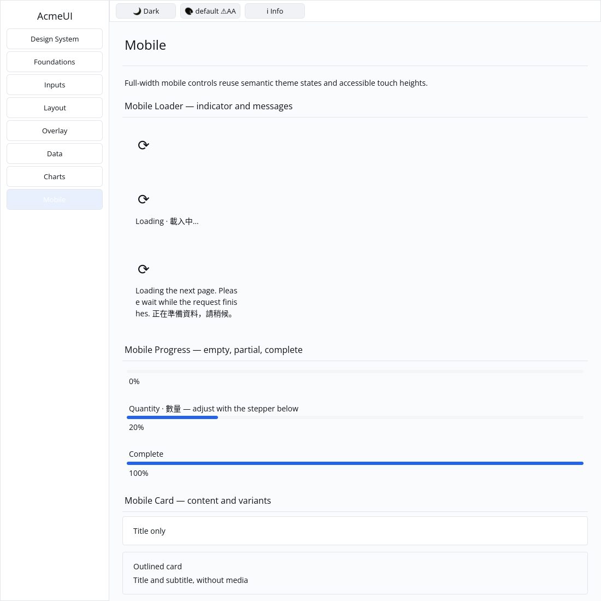

# ROADMAP 021 — Mobile loader acceptance

2026-11-09, Asia/Taipei. Task `MOBILE-LOADER-021`, branch
`sdk/roadmap-021-mobile-loader`. Execution: **single-agent-role-passes**
(Lead, UI/UX, Verification), one author and serialized writes. Review is author
self-review; independent review **NOT_RUN**. No independent-worker or model
routing claims. The owner explicitly authorized opening and merging a mergeable
PR after local targeted checks and hosted CI pass. No release is included.

## Audit and scope

Read AGENTS/team workflow, Lead/UI/UX/Rust Core/Verification contracts, ownership
routing, spec/plan/todos/roadmap and reports 020, 019 and 014 mobile. Inspected
loader/spinner/label/container code, retained/layout/text bridges, Gallery
render/hit paths, pinned toolchain, verification runner and hosted workflows.

Fetched master remained clean at `58874a32c7509de11d647de1dcab290287eb7ac2`.
PRs #29, #28, #27 and #13 were already MERGED and were left alone. There were
no open PRs; master CI and CPU renderer evidence had succeeded. ROADMAP 021
was unused. The exact acceptance/write scope is in [BRIEF.md](BRIEF.md).

OBSERVED: `mobile_loader` already produced a foundation spinner followed by an
optional message, with no message wrapping. The spinner is a static `⟳` glyph;
there is no animation timer or renderer-native spinner. Existing tests checked
only Column kind/child counts, and Gallery had no loader examples.

## Changes

- Preserve builder signatures/public fields, root keys, padding/gap and existing
  foundation indicator. Document its static limitation explicitly. Rotation
  and runtime/reduced-motion integration remain a separate unchecked todo.
- Wrap optional messages at character boundaries, including unbroken strings
  and Traditional Chinese. Character wrapping can split English words; no new
  public wrap mode or text-cursor API is introduced.
- Replace the three shallow tests with three acceptance tests: defaults,
  omission/empty/custom messages/public field edits, inherited theme colour and
  noninteractive semantics; actual text layout at 120/240/400 logical pixels;
  retained loader/indicator IDs across message changes/omission and two keyed
  instances reordered. The identity behavior already passed before changes.
- Add three distinct-key Gallery examples: indicator only, short bilingual
  message, and a narrow long message. Three Gallery tests cover composition,
  real retained binding, lack of hit actions, themed foreground, scroll clips,
  multiline glyph geometry at scales 1.0/1.25/2.0, and existing Label wrap modes
  plus explicit line height.
- Make Gallery Label shaping honour its existing wrap mode, layout width and
  line-height override. Wrapped labels use the full layout content width;
  unwrapped labels retain the existing inset and swatch path.
- Correct `FontSystem::shape` raster positions: include each visual line's
  baseline delta relative to the first baseline, scaled to physical pixels.
  Previously all prepared lines overlapped the first line even when logical
  layout wrapped correctly. The regression covers explicit newlines and
  automatic wrapping at three scales with a fractional line height, including
  unchanged first-line offsets relative to a single-line reference.
- Correct the existing Gallery progress assertion to expect Taffy's rounded
  fill width, consistent with the component test. New page content changed its
  intrinsic width and exposed the old assertion's exact-fraction assumption.

No dependency, manifest, lockfile, Scene or platform contract changed. No public
API expansion, hardcoded widget theme colours, GPUI, byte-based cursor changes,
`cargo clean`, release build or speculative performance rewrite was introduced.
No performance or native mobile runtime claim is made.

## Reproductions and intermediate corrections

Exact command vectors, SHA/dirty state, OS/toolchain, timestamps, exit codes,
raw logs and SHA-256 hashes are in [evidence.json](evidence.json) and `logs/`.

| Reproduction | Before | After |
|---|---|---|
| Long-message component acceptance | FAIL: wrap mode None | PASS at three widths |
| Gallery loader/wrap checks | 0 PASS / 3 FAIL | 3 PASS |
| Prepared multiline glyph offsets | FAIL: expected 21.5 px, actual 0 | PASS at three scales |
| Complete Gallery suite | 25 PASS / 1 FAIL: old progress rounding assertion | 26 PASS |

The first component-test compile referenced a shared helper that is registered
under another component's private test-support module; it now owns its context.
An intermediate assertion assumed auto-sized loaders always consume all
available width; it now verifies bounded intrinsic width and exact padding.
An intermediate generic Label test used a standalone auto-sized text root;
it now uses a width-constrained Column, matching the actual Gallery path.
Standalone auto-sized root-label reflow is not certified by that test. Logs
preserve these attempts rather than relabeling them as passes.

## Final local verification

Tested source: **`e958a47829eb260810a9260085a04b2d8752a820`**.
Linux x86_64, Rust/Cargo **1.88.0**. The tree was clean for the final checks
and native capture; each command records its actual dirty-state snapshot.
The documentation/evidence commit does not retroactively change the locally
tested SHA. Hosted CI separately tests the final PR head/merge.

| Command | Result |
|---|---|
| `cargo fmt -p acme-text -p acme-ui -p acme-ui-gallery -- --check` | PASS |
| `cargo test --locked -p acme-text` | PASS: 44 unit + 10 integration tests |
| `cargo test --locked -p acme-ui --all-features` | PASS: 768 tests; 2 existing ignored doctests |
| `cargo test --locked -p acme-ui --no-default-features --features mobile` | PASS: 307 tests |
| `cargo test --locked -p acme-ui-gallery` | PASS: 26 tests |
| `cargo clippy --locked -p acme-ui --no-default-features --features mobile --all-targets --no-deps -- -D warnings` | PASS |
| `cargo clippy --locked -p acme-text -p acme-ui -p acme-ui-gallery --all-features --all-targets --no-deps -- -D warnings` | PASS |
| `cargo check --locked --workspace --all-targets` | PASS at completed-slice milestone |
| `cargo test --locked --workspace` | PASS at completed-slice milestone |
| `cargo build --locked -p acme-ui-gallery` | PASS |
| `python3 scripts/verify_sdk.py --profile cpu --output target/roadmap-021/cpu-accepted` | PASS: actual CPU format/tests/strict-Clippy, no dry run |

The host has `python3`, with no `python` executable. CPU tests/goldens passed
(87 tests); the existing frame-timing test remains ignored. Release compilation
is NOT_RUN for this component slice; existing `target/` was reused and free
space stayed about 18 GB. No timing measurements were attempted.

## Gallery evidence and remaining work

The actual Gallery executable built from the tested source was captured on
isolated Xvfb, X11 CPU backend, default light theme, 1100×1100 logical pixels.
The author inspected the image: all three static indicators appear; the short
message and narrow multiline English/Chinese message remain below their
indicators without overlapping lines. This is automated virtual-display native
CPU evidence, not a golden baseline, human sign-off or physical-device result.

Author self-review covered optional content, bounded geometry, stable identity,
feature isolation, inherited colour, baseline-relative/physical coordinates,
single-line compatibility, clip propagation and evidence hashes. Independent
review remains **NOT_RUN**.

**NOT_RUN:** human Gallery review, real Windows 注音 composition/candidate
placement, physical 100/125/150/200% DPI/touch, real GPU drawing/recovery and
screen-reader acceptance. These loaders remain text/container compositions;
typed status/live-region accessibility and actual spinner animation are open.
Traditional Chinese test/capture content does not validate IME. The project is
not declared complete or production-ready.

Next bounded slice: audit **`mobile_search`** against rounded input + search
icon + clear-button behavior, with real input/message tests and a Gallery demo.
Other unfinished P3 items and the historical toggle/stepper/segmented Clippy
documentation reconciliation remain open.

Delivery snapshot: local acceptance complete. PR creation, hosted CI and merge
occur after this report is committed; this snapshot claims neither. Consult
the resulting PR checks and merge record for final hosted delivery status.
