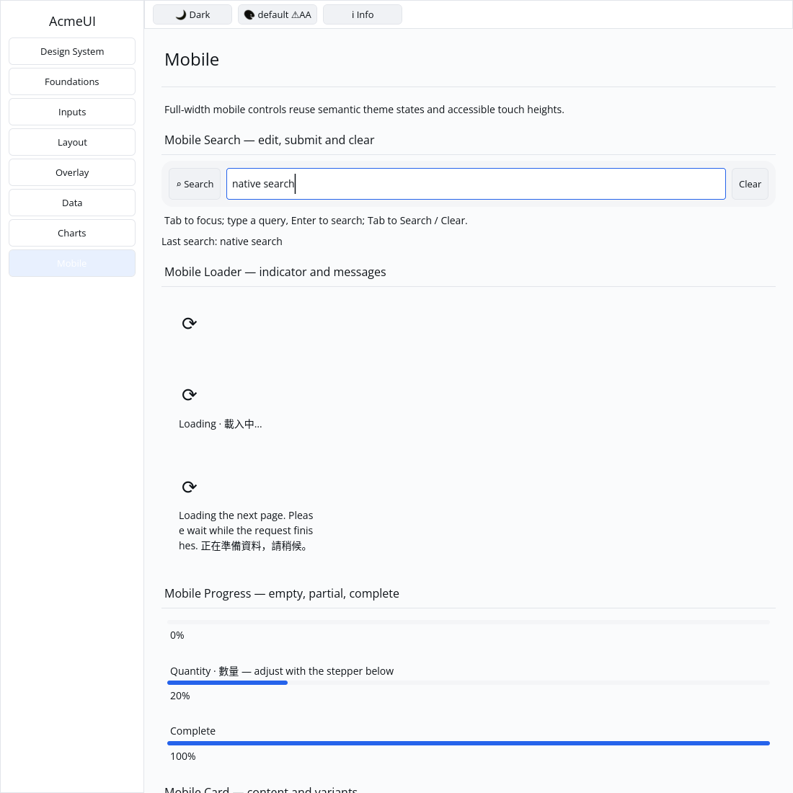

# ROADMAP 022 — Mobile search acceptance

2026-11-09, Asia/Taipei. Branch `sdk/roadmap-022-mobile-search`.
Execution: **single-agent-role-passes** (Lead, UI/UX, Rust Core, Verification),
serialized by one author. Review is author self-review; independent review
**NOT_RUN**. The owner explicitly authorizes PR creation and merge after local
checks, passing CI and GitHub MERGEABLE status. No release is included.

## Audit and acceptance

Fetched master stayed at `a993b4e24dd274b159eb2c5536eada228506e484`, clean.
PRs #30/#29/#28/#27/#13 were confirmed MERGED; no open PRs, and master CI and
CPU evidence were green. Read repository/team workflow and role contracts,
spec/plan/todos/roadmap, reports 014/019/020/021, and source/test/CI dependencies.
The bounded contract and exact file leases are in [BRIEF.md](BRIEF.md).

OBSERVED and REPRODUCED: search was an icon + placeholder Label, with a global
clear key, no real input and no rounded themed surface. TextInput ignored its
existing Style in both layout paths. Gallery lacked an input host. Follow-up
regressions reproduced TextInput glyphs above the content box, stale glyph scale
on DPI/typography changes, and Gallery action labels touching the top border.

## Changes and compatibility

- Use a real TextInput with a responsive remaining width, 44 px minimum height,
  rounded muted theme surface, search icon/action and optional clear action.
  Child keys derive from each instance; optional actions and keyed instance
  reordering preserve input identity. Submit and input-change markers are separate.
- Keep existing constructor/key/submit/clear methods and existing public fields.
  Add only controlled `value` and `on_input` fields/methods. **Compatibility note:**
  direct `MobileSearchBuilder` struct literals must initialize the two new fields;
  constructor-based callers keep working. The host owns editing state and Enter
  dispatch; the root Row retains its existing submit message.
- Honour TextInput Style in sequential/context layout paths. Fix its ordinary,
  placeholder and split composition text origins to use a shared baseline.
  Key private shaping cache by text, style, constraints and physical scale.
- Add a private Gallery search host using existing TextInputState, edit/history/
  clipboard, caret-scroll and render APIs. Support pointer focus, Tab/Shift+Tab
  through input/Search/Clear, Enter/Space actions, Unicode grapheme editing,
  undoable clear, composition guards, category/window blur and viewport clipping.
  Tab reveals an offscreen field. Candidate geometry is automated evidence only.
- Add four component acceptance tests, one foundation layout regression, two
  input-render regressions and six Gallery acceptance tests. The old shallow
  builder tests remain. Update the existing stepper hit-count assertion for the
  two new search actions, preserving its min/max message checks.
- Center Gallery content-button glyphs using shaped dimensions and baseline;
  preserve the rejected native capture and RED test before this correction.
- Reconcile P3 toggle/stepper/segmented checkboxes: their historical behavior
  work already existed, and the exact formerly failing whole-crate Clippy gate
  now passes. The 014 report remains historical evidence, not rewritten history.

No dependency, manifest, lockfile, Scene or platform API change. No GPUI,
hardcoded widget theme colours, cursor-offset arithmetic, public platform types,
`cargo clean`, release build, performance numbers or speculative rewrite.
Pointer focus is demonstrated; click-position caret placement/drag selection
and typed search-specific accessibility semantics are outside this slice.

## RED/GREEN and corrections

[evidence.json](evidence.json) records exact argv, SHA/dirty state, OS/toolchain,
timestamps, exit codes and raw-log hashes. `logs/` includes all attempts.

| Reproduction | Before | Final |
|---|---|---|
| Search surface/input/layout/identity acceptance | 3 FAIL | PASS |
| TextInput Style in both layout paths | FAIL: Auto instead of 125 px | PASS |
| Input ink baseline and DPI cache | 2 FAIL (ink y=31.5 above content y=38; stale scale) | PASS |
| Gallery action ink | FAIL: glyph top=-1 in a 44 px target | PASS |

An intermediate width used the style helper's 100-based percent convention;
the component now uses the layout engine's explicit `Length::Percent(1.0)`.
An intermediate module name conflicted with the re-exported component module;
the private host now has its own module name. A test initially inspected a
nonexistent TextPrimitive clip field; it now inspects the real Scene clip stack.
The long-query origin is intentionally left of the field while scrolled, so
its test verifies clip geometry rather than incorrectly bounding that origin.
An initial baseline correction gave split runs different baselines; the existing
composition baseline test caught it, and all split runs now share the input's
baseline. These failures and the rejected capture are preserved, not called passes.

## Final local verification

Tested source: **`119a603d80a7bd17ddc01aebab3b1cd064d6f167`**, clean for final
checks and capture. Linux x86_64, Rust/Cargo **1.88.0**. Later documentation and
evidence commits do not transfer these local passes to a newer SHA; hosted CI
separately tests the final PR head/merge.

| Check | Result |
|---|---|
| Touched-package formatting | PASS |
| Locked all-feature tests: acme-ui / acme-ui-gallery | PASS: 772 / 32; 2 existing ignored UI doctests |
| Locked tests: acme-widgets | PASS: 146 unit + 17 integration |
| Locked tests: acme-textinput | PASS: 107 unit + 61 integration |
| Locked mobile-only acme-ui tests | PASS: 311 |
| Strict touched-package all-target/all-feature Clippy | PASS |
| `cargo clippy --locked -p acme-ui --all-features --all-targets -- -D warnings` | PASS (historical blocker reconciled) |
| Strict mobile-only Clippy | PASS |
| `cargo check --locked --workspace --all-targets` | PASS at slice milestone |
| `cargo test --locked --workspace` | PASS at slice milestone; existing ignored tests remain |
| `cargo build --locked -p acme-ui-gallery` | PASS |
| `python3 scripts/verify_sdk.py --profile cpu --output target/roadmap-022/cpu-final` | PASS: actual CPU format/tests/strict Clippy, no dry run |

The host provides python3; the same required verification script was executed.
CPU tests/goldens: 87 PASS; the existing timing test stays ignored. Reused target/;
free space remained about 72 GB. Release compilation and performance measurement
are NOT_RUN for this component batch.

## Gallery evidence and limits

The real executable ran on isolated Xvfb/X11 with forced CPU rendering, default
light theme, 1100×1100 logical pixels. Scripted native keys focused the input,
typed `native search`, submitted it, then tabbed to Clear and activated it.
The author inspected the accepted screenshot and [cleared state](logs/gallery-cleared.png):
query text and last-submission text are visible; clearing restores the placeholder
without changing the last submission, and action labels stay inside their targets.
This is automated native interaction/capture evidence, not human/device sign-off
or a screenshot golden. The [rejected image](logs/gallery-before-button-fix.png)
is retained solely as reproduction evidence.

Author self-review covered identity, message separation, bounded geometry,
feature isolation, themed paint, shared baseline, scale-aware cache, composition
and focus transitions, clip balance and evidence hashes. Independent review
**NOT_RUN**.

**NOT_RUN:** human Gallery acceptance, actual Windows 注音 composition/candidate
placement, physical 100/125/150/200% DPI/touch, real GPU drawing/recovery and
screen readers. Chinese strings and injected composition events do not validate
Traditional Chinese IME. Spinner rotation, other unchecked P3 widgets and wider
runtime/release boundaries remain open. No project-complete or production-ready
claim.

Next bounded slice: **mobile_chip**, compact themed tag with distinct tap/dismiss
messages, per-instance keys, state/retained/layout tests and a Gallery demo.

Delivery snapshot: local acceptance complete. PR creation, hosted CI and merge
follow this committed report; consult the PR record for final delivery status.
