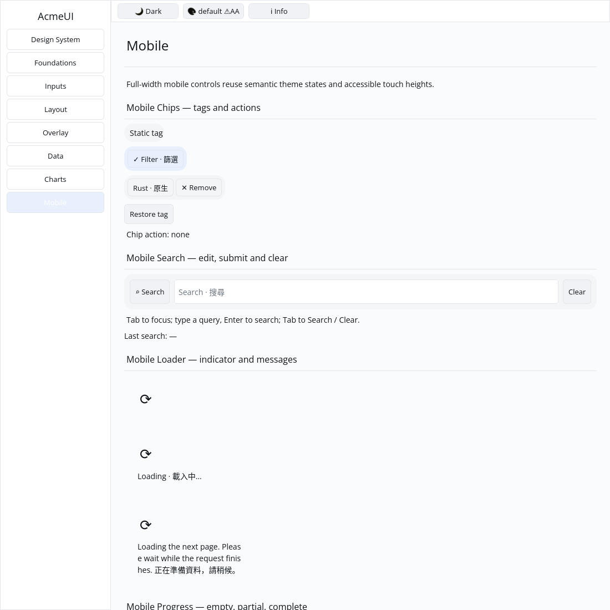

# ROADMAP 023 — Mobile chip acceptance

2026-11-09, Asia/Taipei; branch `sdk/roadmap-023-mobile-chip`. Execution:
**single-agent-role-passes** (Lead, UI/UX, Verification), serialized writes;
author self-review, independent review **NOT_RUN**. Owner-authorized PR/merge
requires local checks, green hosted CI and GitHub MERGEABLE status.

## Audit and change

Base `d1bbe5d4fd901ceeaffe072a129ae5e6146f26c8` is the fetched merge of PR #31,
whose 10 hosted checks passed. Preserved 022 search work; read current report,
P3 contract, component source, team/spec/plan/todos and Gallery dependencies.
[BRIEF.md](BRIEF.md) records acceptance and exact sole-writer leases.

OBSERVED: chip was an unstyled Row with a global close key and a parent tap
message that Gallery did not activate. A regression reproduced the missing
themed surface (1 FAIL / 3 PASS); all four acceptance tests now pass.

- Rounded semantic Muted/Accent surfaces preserve the existing selected `✓`
  marker. Static tags remain Labels; tappable tags use a keyed child Button.
- Tap and optional `✕ Remove` are sibling Buttons with per-instance `__tap` and
  `__dismiss` keys. No ancestor message can turn a dismissal into a tap.
- **Compatibility:** constructor, public fields and methods are unchanged;
  tree consumers must dispatch the child Buttons instead of the former Row tap
  message. The default close key changes from global to per-instance.
- Four acceptance tests cover optional-action combinations, defaults, empty/
  Unicode text and public edits, real nonoverlapping layout and retained root/
  tap identity across selected/dismiss changes and keyed instance reorder.
- Gallery adds static, selected filter and removable tags with restore/status.
  Three tests exercise actual pointer events/hit/activation/rebuild, retained
  bindings, semantic colours, paint order and scroll clips at three scales and
  default/Apple light/dark themes.
- Existing search pointer tests now subtract the actual scroll offset and
  reveal the field first. The stepper ghost-hit test measures its full baseline
  hit count, so adding Gallery examples no longer invalidates a fixed total.

No dependency, manifest, Scene/platform contract, public API expansion, text
engine change, hardcoded widget colours, GPUI or cursor arithmetic. No routine
cargo clean, release build, speculative rewrite or performance claim.

## Verification

Final tested source: **`486baee734b195a3c02e01f65790502d09ecf271`**, clean for
final checks and native capture. Linux x86_64; Rust/Cargo **1.88.0**.
[evidence.json](evidence.json) preserves actual argv, SHA/dirty state,
OS/toolchain, timestamps, exits and raw-log hashes. Later documentation commits
do not transfer local passes to a newer SHA; hosted CI tests the final PR.

| Gate | Result |
|---|---|
| Touched-package formatting | PASS |
| `cargo test --locked -p acme-ui -p acme-ui-gallery --all-features` | PASS: 776 UI, 35 Gallery; 2 existing ignored UI doctests |
| `cargo test --locked -p acme-ui --no-default-features --features mobile` | PASS: 315 |
| Strict all-target/all-feature touched-package Clippy | PASS |
| Strict mobile-only Clippy | PASS |
| `cargo check --locked --workspace --all-targets` | PASS, completed-slice milestone |
| `cargo test --locked --workspace` | PASS, completed-slice milestone; existing ignored tests remain |
| Gallery debug build | PASS |
| `python3 scripts/verify_sdk.py --profile cpu --output target/roadmap-023/cpu-final` | PASS: actual format/tests/strict Clippy, not a dry run |

CPU: 87 tests/goldens PASS, existing timing test ignored. Reused target/; no
release compilation or performance measurement. The environment has python3.

## Native evidence and limits

Isolated Xvfb/X11, forced CPU backend, default light theme, 1100×1100 logical
pixels, actual executable. Scripted native pointer clicks toggle the filter and
remove the tag. The author inspected the initial image and
[action result](logs/gallery-chip-actions.png): selected marker disappears,
the tag is removed, and the status reads `tag dismissed`. Raw capture commands
and image hashes are recorded. This is automated native-window interaction
and author inspection, not human acceptance or a screenshot golden.

Self-review covered distinct messages, child keys/identity, retained binding,
optional actions, visible status, themed paint order/clips and evidence hashes.
Independent review **NOT_RUN**. Arbitrarily long-tag truncation and a new general
Gallery keyboard-navigation framework are non-goals; compact child action heights
are covered by layout tests, not a physical touch-target certification.

**NOT_RUN:** human Gallery, Windows 注音 IME/candidates, physical DPI/touch,
real GPU/recovery and screen readers. Chinese text is not IME evidence. Spinner
rotation and remaining P3 widgets remain open; no complete/production-ready claim.

Next slice: **mobile_avatar** — circular initials/empty-image placeholder and
size variants, with real layout and Gallery paint/retained evidence.

Delivery snapshot: local acceptance complete. PR/hosted CI/merge occur after this
report is committed; consult the resulting PR checks and merge record.
