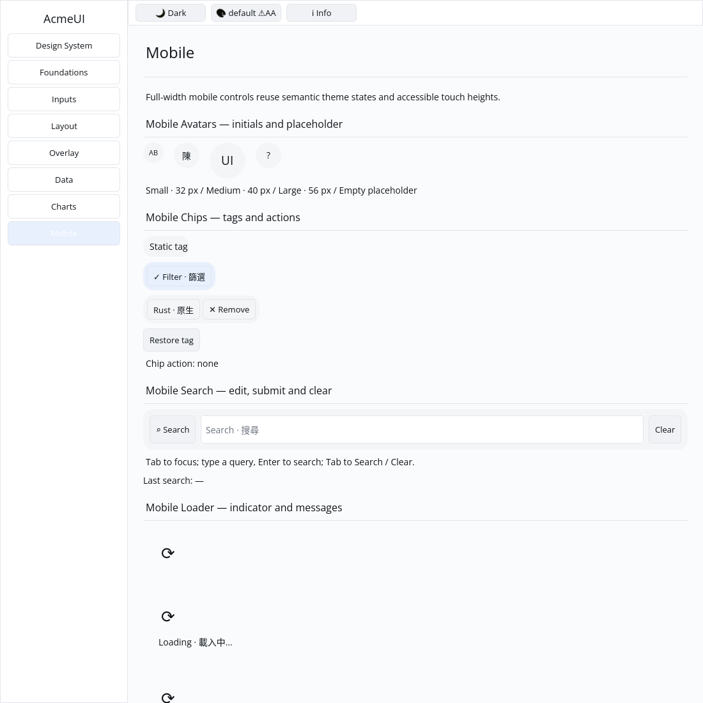

# ROADMAP 024 — Mobile avatar acceptance

2026-11-09, Asia/Taipei; branch `sdk/roadmap-024-mobile-avatar`. Execution:
**single-agent-role-passes** (Lead, UI/UX, Verification), serialized writes;
author self-review, independent review **NOT_RUN**. Owner-authorized merge
requires local acceptance, green hosted CI and GitHub MERGEABLE status.

## Scope and audit

Fetched base `7171d4b2d492f44075cbe029f3ee037a2d5188d4` is the merge of
[PR #32](https://github.com/stevenke1981/AcmeUI-Native/pull/32), all ten hosted
checks PASS. Earlier in this session,
[PR #31](https://github.com/stevenke1981/AcmeUI-Native/pull/31) delivered search
and was also merged after all checks passed. No earlier merged PR was reopened.
Read the latest report, P3 contract, component source and existing team/spec/
plan/todos/CI dependencies. [BRIEF.md](BRIEF.md) records acceptance and file leases.

OBSERVED: avatar was a fixed Stack with a Label, with no circle, centered text
or empty-content placeholder. Label ignored its existing layout Style; Gallery
only painted Row backgrounds and ignored text alignment.

## Changes

- Preserve public builder fields/methods, default Md and Sm/Md/Lg diameters
  32/40/56 px. Add a circular semantic Muted surface and proportional initials.
  Empty/whitespace initials display a neutral `?` placeholder; nonempty Unicode
  text is preserved without cursor arithmetic or byte slicing. Actual image
  loading/decoding remains outside this builder.
- Put the centered text box inside the circle with an inset. Honour existing
  Label width/height/style in both layout paths; preserve defaults when the
  Style is empty. No new layout property or widget kind is introduced.
- Gallery paints styled Stacks through its existing themed/clipped surface
  path. Single-line Center/Right Labels use existing alignment and a content-box
  clip, bounding long text. Existing wrapped/default-left Label paint stays on
  its original path; general per-line multiline alignment is not claimed.
- Three component acceptance tests cover all sizes, defaults/public edits,
  empty/Unicode content, exact real layout, inherited foreground, passive
  semantics and retained IDs across size/text changes and keyed instance reorder.
- Add one Label sizing regression and three Gallery tests for all examples,
  complete retained binding, lack of actions, circle-before-ink paint order,
  bounds, theme tokens, Center/Right clipping and scales 1.0/1.25/2.0 across
  default/Apple light/dark themes.

No dependency, manifest, public API expansion, Scene/platform contract, hardcoded
widget theme colours, GPUI or cursor changes. No cargo clean, release build,
performance claim or speculative architecture rewrite.

## Reproductions and checks

[evidence.json](evidence.json) records actual command vectors, SHA/dirty state,
OS/toolchain, timestamps, exits and raw-log hashes.

| Reproduction | Before | Final |
|---|---|---|
| Avatar circle and inset layout | 2 FAIL / 1 PASS | 3 PASS |
| Label dimensions in both layout paths | FAIL: Auto vs 28 px | PASS |
| Gallery circle and aligned text clip | 2 FAIL / 1 PASS | 3 PASS |

The first Gallery compile needed an explicit TextAlign import (it is not in the
style prelude); that attempt is preserved separately. Actual assertion-based
Gallery RED was then obtained before changing painting. No failed gate was waived.

Final tested source: **`f3fc6d9ddb0e16761de983284d1e19ca00c5ab32`**, clean for
final checks and capture. Linux x86_64; Rust/Cargo **1.88.0**. Later documentation
commits do not transfer these local passes to a newer SHA; hosted CI tests the
final PR head/merge separately.

| Gate | Result |
|---|---|
| Touched-package formatting | PASS |
| Locked all-feature acme-ui / Gallery tests | PASS: 779 / 38; 2 existing ignored UI doctests |
| Locked acme-widgets tests | PASS: 147 unit + 17 integration |
| Locked mobile-only acme-ui tests | PASS: 318 |
| Strict all-target/all-feature touched-package Clippy | PASS |
| Strict mobile-only Clippy | PASS |
| `cargo check --locked --workspace --all-targets` | PASS at completed-slice milestone |
| `cargo test --locked --workspace` | PASS at completed-slice milestone; existing ignored tests remain |
| Gallery debug build | PASS |
| `python3 scripts/verify_sdk.py --profile cpu --output target/roadmap-024/cpu-final` | PASS: actual CPU format/tests/strict Clippy, no dry run |

CPU tests/goldens: 87 PASS, existing timing test ignored. The environment has
python3. Existing target/ was reused; about 72 GB remained free. Release build
and performance measurement are NOT_RUN for this slice.

## Gallery evidence and remaining work

Actual executable, isolated Xvfb/X11, forced CPU backend, default light theme,
1100×1100 logical pixels. Author image inspection confirms circular surfaces,
three sizes, centered Latin/Chinese initials and the neutral empty-name
placeholder, alongside preserved chip/search examples. This is an automated
native-window capture, not a golden baseline or human/physical-device acceptance.

Author self-review covered fixed geometry, text clipping/placement, inherited
tokens, passive semantics, stable identity, default Label compatibility, paint
order and evidence hashes. Independent review **NOT_RUN**.

**NOT_RUN:** human Gallery acceptance, actual Windows 注音 composition/candidate
placement, physical 100/125/150/200% DPI/touch, real GPU/recovery and screen
readers. Chinese text/captures do not validate IME. Actual image loading, spinner
rotation and other unchecked SDK/P3/runtime/release work remain open. No project
completion or production-readiness claim.

This is the third bounded slice this session. Next recommended slice:
**mobile_banner** — full-width themed alert with icon, text and optional action.

Delivery snapshot: local acceptance complete. PR, hosted CI and merge follow this
committed report; consult the resulting PR checks/merge for final delivery status.
