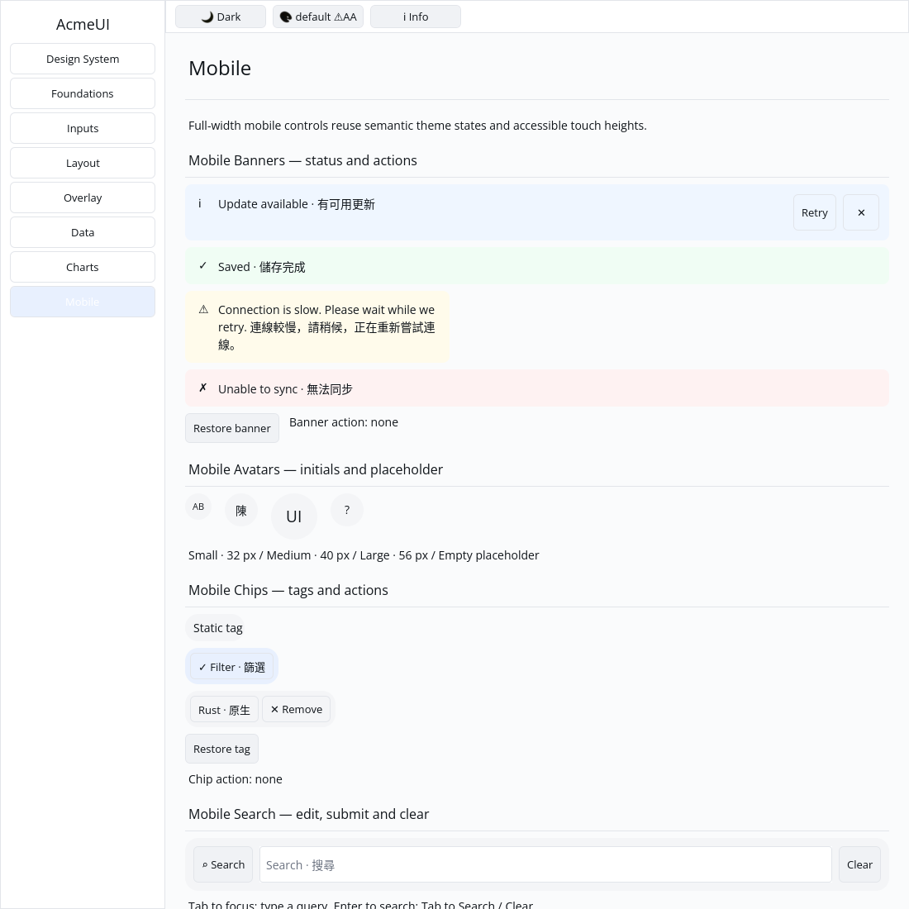
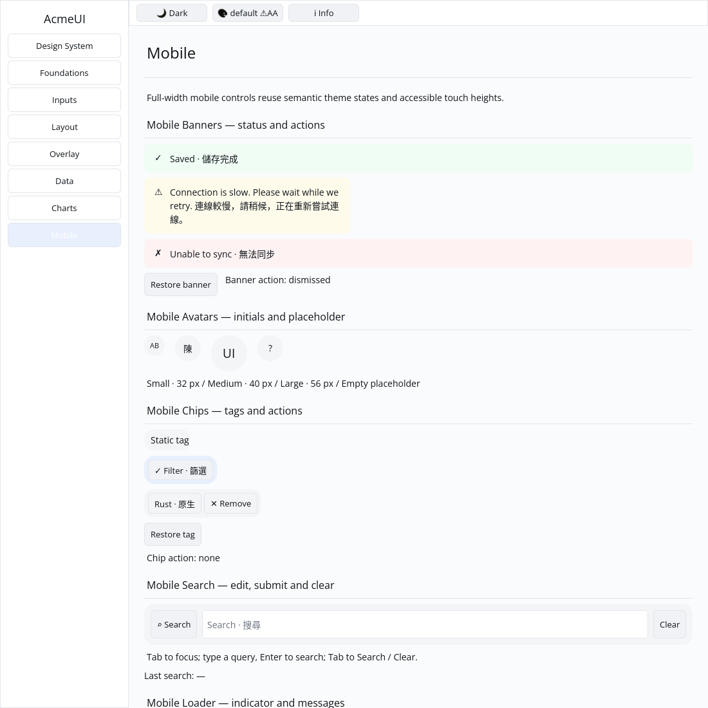

# ROADMAP 025 — Mobile banner acceptance

2026-11-10, Asia/Taipei; branch `sdk/roadmap-025-mobile-banner`. Execution
**single-agent-role-passes** (Lead, UI/UX, Verification), sole writer, author
self-review; independent review **NOT_RUN**. Owner authorizes merge after local
checks, all hosted CI PASS and GitHub MERGEABLE. No Codex review wait or release.

## Audit and changes

Fetched master was clean at `51022116707860313010e54adcd4d60fd250d93a`, merge
of PR #33, with no open PRs. Base master CI and CPU evidence passed. PRs #31–33
were already merged and left alone. Read AGENTS/team workflow and role contracts,
spec/plan/todos/roadmap, 021/024 reports and the relevant source/CI paths.
[BRIEF.md](BRIEF.md) defines acceptance and exact file leases.

OBSERVED: banner already combined an icon, text and optional buttons, but lacked
a full-width themed surface and wrapping. Buttons used constant keys across
instances; existing tests checked only kind/counts. Gallery had no examples.

- Preserve all builder signatures/public fields/defaults and Info/Success/
  Warning/Danger icons. Add semantic InfoSoft/SuccessSoft/WarningSoft/DangerSoft
  surfaces; no widget colour literals. Keep inherited theme foreground.
- Use the layout engine's percentage convention for full width. Text grows and
  shrinks within the remaining space, wrapping at character boundaries. Keep
  the icon fixed and actions at 44 px height, with a 44×44 dismiss target.
- Derive `__action`/`__dismiss` keys from the instance key. Action/dismiss remain
  siblings with independent messages; no ancestor click handler.
- Three component tests cover default/public-field optional combinations, all
  tones, empty/Unicode text, 240/400/640 px layouts, no overlaps, passive text /
  focusable buttons and retained IDs through action insertion and keyed reorder.
- Add four Gallery tone examples including narrow bilingual long text, plus
  retry/dismiss/restore state. Two tests cover actual pointer event dispatch,
  removal of stale action hits, other-banner identity, complete retained binding,
  themed paint order and viewport clips at scales 1/1.25/2 in default/Apple
  light/dark themes. No Gallery rendering rewrite was needed.

No public API expansion, dependency/manifest/lockfile, Scene/platform contract,
GPUI or cursor change. No performance claim, cargo clean or local release build.
Native shadows and typed alert/live-region semantics remain outside this slice.

## Reproductions and verification

[evidence.json](evidence.json) records exact SHA/dirty state, argv, OS/toolchain,
timestamps, exits and raw-log hashes, including failed attempts.

- Initial component RED: 2 FAIL / 1 PASS (missing surface/full width).
- An intermediate `w_full()` attempt produced 24000 px for 240 px available.
  Existing `Styled::w_full()` uses Percent(100), while layout uses a fraction;
  this slice follows existing mobile-search's Percent(1.0). General helper
  reconciliation is an explicit unchecked follow-up in todos.
- An intermediate missing shrink override overflowed long text. Explicit
  flex-shrink fixes the Label default of zero; real geometry now passes.
- First Gallery compile had an import/private-module name collision; the
  private module now has a distinct name. Failed attempts remain in evidence.

Final tested source: **`d26cc112427a3a21833aeecae0ba1cfe884aae19`**.
Linux x86_64, Rust/Cargo **1.88.0**. Tracked source was unchanged during final
checks/capture. Some command snapshots include the evidence helper's generated
untracked Python cache (subsequently removed); capture lists an untracked PNG.
These states are preserved rather than claimed clean. Later documentation
commits do not inherit local passes; hosted CI tests the final PR head/merge.

| Gate | Result |
|---|---|
| Touched-package formatting | PASS |
| `cargo test --locked -p acme-ui -p acme-ui-gallery --all-features` | PASS: 779 UI / 40 Gallery; 2 existing ignored UI doctests |
| Locked mobile-only UI tests | PASS: 318 |
| Strict all-target/all-feature UI/Gallery and mobile-only Clippy | PASS |
| `python3 scripts/verify_sdk.py --profile cpu --output target/roadmap-025/cpu-final` | PASS: actual CPU format/tests/strict Clippy, no dry run |
| `cargo check --locked --workspace --all-targets` | PASS at completed-slice milestone |
| `cargo test --locked --workspace` | PASS at completed-slice milestone; existing ignored tests remain |
| Gallery debug build | PASS |

CPU tests/goldens: 87 PASS, existing timing test ignored. Existing target/ reused;
about 71 GB free. Release build and performance measurements **NOT_RUN**.

## Gallery and remaining work

Actual built Gallery, isolated Xvfb/X11, forced CPU backend, default light theme,
1100×1100 logical window. Author inspected both captures: four status surfaces,
wrapped bilingual text, separate retry/close controls; after native pointer
clicks, the info banner is removed and status reads dismissed while the other
tones remain. Automated virtual-display evidence is not a golden baseline,
human acceptance or physical-device validation.

Author self-review covered optional combinations, numeric geometry, themed
surfaces, stable keys, message separation, feature isolation, clips and evidence
hashes. Independent review **NOT_RUN**; no independent-agent evidence claimed.

**NOT_RUN:** human Gallery acceptance, actual Windows 注音 composition/candidate
placement, physical 100/125/150/200% DPI/touch, real GPU/recovery and screen
readers. Chinese text does not validate IME. Spinner animation and other open
SDK/runtime/release work remain pending. No production-readiness claim.

Next bounded slice: **mobile_notification** — title/body toast card, separate
actions and truthful host-managed lifetime/auto-dismiss hint.

Delivery snapshot: local acceptance complete. PR creation, hosted CI and merge
follow this committed report; consult the resulting PR checks/merge record.
