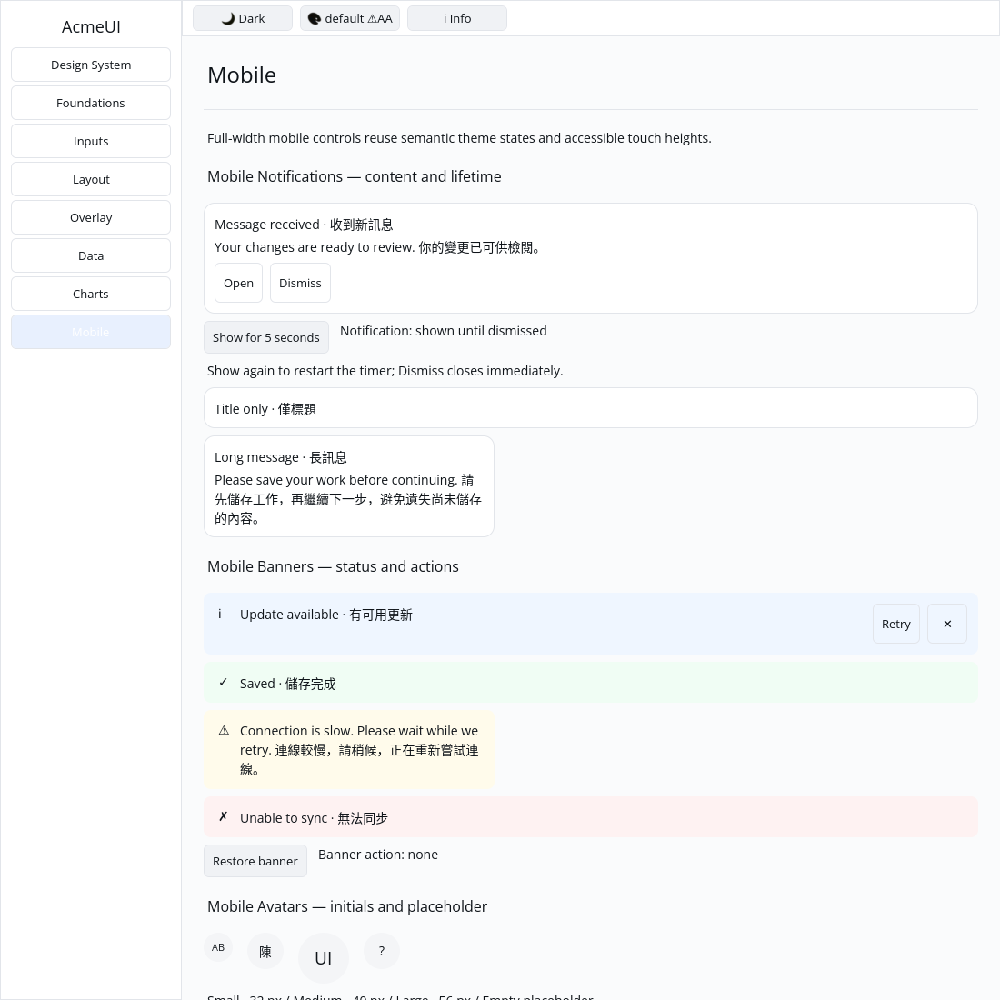
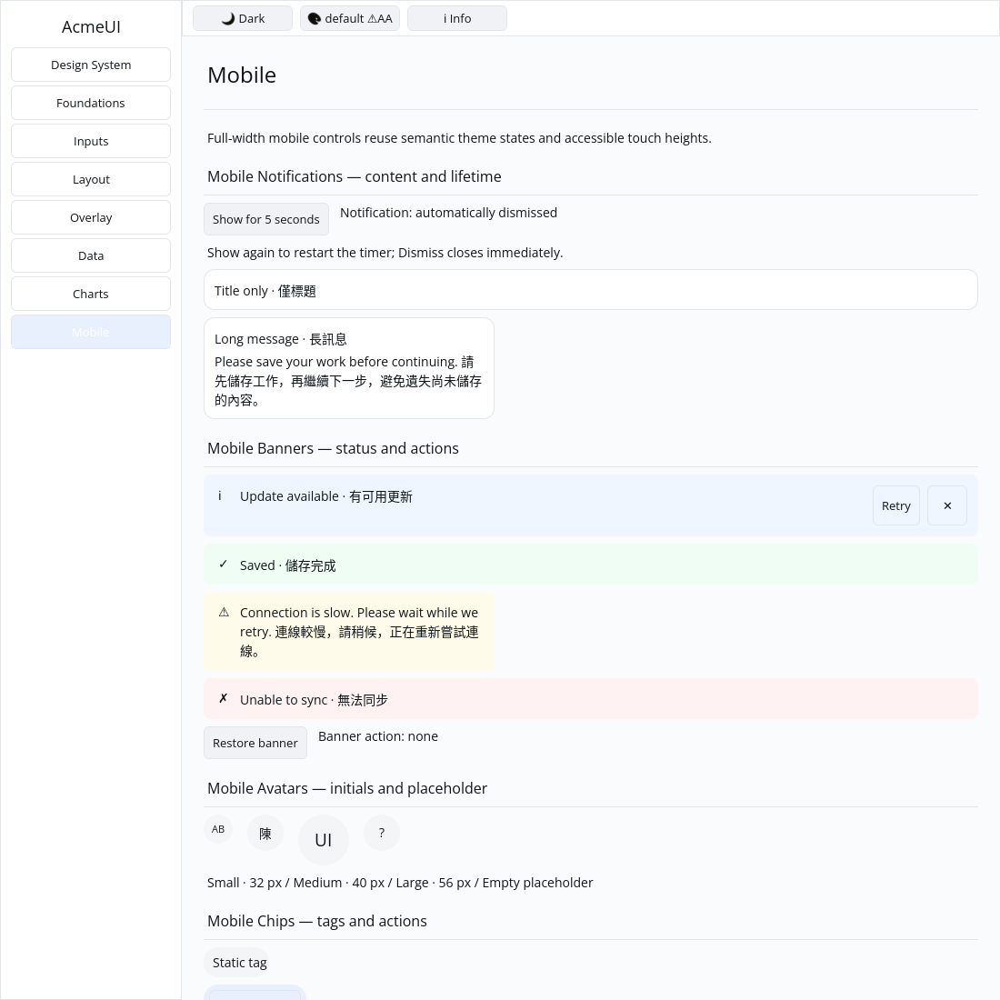

# ROADMAP 026 — Mobile notification acceptance

2026-11-10, Asia/Taipei; branch `sdk/roadmap-026-mobile-notification`.
Execution **single-agent-role-passes** (Lead, UI/UX, Verification), sole writer,
author self-review; independent review **NOT_RUN**. Owner-authorized merge
requires local acceptance, all hosted checks PASS and GitHub MERGEABLE.

## Audit and changes

Base **`9728f967df4526b3e275d30a9bd629e6bb86116c`**, fetched merge of
[PR #34](https://github.com/stevenke1981/AcmeUI-Native/pull/34) after all ten
hosted checks passed. No earlier merged PR was reopened. Existing task/team/
role/spec/plan/todos/P3/roadmap and 025 report read; source, platform scheduling
and CI paths audited. [BRIEF.md](BRIEF.md) records scope and file leases.

OBSERVED: the builder already made an elevated Card, but title/body did not
wrap, actions used constant keys and Gallery had no lifecycle example. There
is no duration field in this public builder. The existing Application background
polling interface supports an application-owned deadline without platform changes.

- Preserve all public fields/builders and the default elevated semantic Card.
  Wrap title/body at character boundaries, use available width and keep footer
  actions below the text. Keys for content/footer/action/dismiss derive from the
  instance. Action/dismiss are independent 44 px buttons; dismiss has a text name.
- Three component tests cover public-field/optional/empty/Unicode combinations,
  180/320/600 px real layouts, footer placement and retained title/content/dismiss
  IDs across body/action changes and keyed instance reorder.
- Fix a measured dependency defect: both Card layout paths ignored existing
  Style. A crate-private layout helper applies it over original padding/gap.
  One RED/GREEN widgets regression covers dimensions, min/max width, padding,
  shrink, true geometry and unchanged empty-style defaults in both paths.
  No public method/property is added.
- Gallery has interactive, title-only and narrow long-message examples. The
  stateless component schedules no timer: Gallery owns visibility, a five-second
  monotonic deadline, restart/cancel behavior and explicit lifetime hints. The
  existing background callback polls every 100 ms only while a deadline exists.
  A deadline is cleared on manual/automatic dismissal; idle Gallery does not poll.
- Four Gallery tests cover actual pointer action/dismiss/show dispatch, expiry
  through the real Application callback, exact deadline/restart/cancel boundaries,
  no stale action hits, stable neighboring cards, complete retained binding,
  themed paint order/viewport clips at scales 1/1.25/2 in default/Apple light/dark.
- New asynchronous removal must cancel press/hover indices: a held dismiss
  press otherwise survives card removal and can refer to a different action.
  A separate regression fails before clearing this state and passes afterward.

No dependency, manifest, lockfile, Scene/platform contract, new public API, GPUI,
widget colour literals or text-cursor change. No local release build, cargo clean
or speculative performance rewrite. Native OS notification services, shadows and
typed live-region semantics are outside this slice.

## Reproductions and verification

[evidence.json](evidence.json) preserves exact SHA/dirty state, argv, OS/toolchain,
timestamps, exits, raw logs and SHA-256 hashes, including intermediate failures.

| Reproduction | Before | Accepted |
|---|---|---|
| Component acceptance | 3 FAIL: unkeyed content/footer and intrinsic overflow | 3 PASS |
| Card existing layout Style | FAIL: Auto instead of 180 px | PASS in both paths |
| Held pointer during automatic removal | FAIL: pressed index survived | PASS: press/hover canceled before hit rebuild |

The first full strict Clippy gate rejected a nonminimal deadline boolean. It was
rewritten using `Option::is_none_or`; the accepted gate passes without exceptions.
The initial component attempt after wrapping still exposed the ignored Card Style
(179 px intrinsic versus 180 px required); this drove the dependency fix.

Final tested source: **`c20131adadec1ee6e122d02fc3281887b13d5506`**.
Linux x86_64, Rust/Cargo **1.88.0**; clean tree for the final checks. Tracked source
also remained unchanged during capture (the second capture lists its existing
untracked PNG). Later documentation commits do not inherit these local passes;
hosted CI tests the final PR head/merge independently.

| Gate | Result |
|---|---|
| Touched-package formatting | PASS |
| Locked all-feature widgets/UI/Gallery tests | PASS: widgets 148 unit + 17 integration; UI 779; Gallery 44; 2 existing ignored UI doctests |
| Locked mobile-only UI tests | PASS: 318 |
| Strict all-target/all-feature touched-package and mobile-only Clippy | PASS |
| `python3 scripts/verify_sdk.py --profile cpu --output target/roadmap-026/cpu-final-accepted` | PASS: actual CPU format/tests/strict Clippy, no dry run |
| `cargo check --locked --workspace --all-targets` | PASS at completed-slice milestone |
| `cargo test --locked --workspace` | PASS at completed-slice milestone; existing ignored tests remain |
| Gallery debug build | PASS |

CPU tests/goldens: 87 PASS, existing timing test ignored. Existing target/ reused;
about 71 GB free. Release compilation and performance measurements **NOT_RUN**.

## Gallery and remaining work

Actual built Gallery on isolated Xvfb/X11, forced CPU backend, default light theme,
1100×1100 logical window. Author inspected both images: card text/actions fit,
narrow bilingual body wraps; a native pointer click on Show-for-five-seconds
followed by a six-second wait removes only the active card and displays
automatically dismissed. Capture timestamps/argv/hashes are preserved. This is
automated native virtual-display evidence, not a golden baseline, human sign-off
or physical-device acceptance.

Author self-review covered state ownership/deadlines, cancellation, no idle polling,
optional fields, bounds, existing-style compatibility, inherited colours, identity,
feature isolation, stale hits/presses and evidence hashes. Independent review
**NOT_RUN**; no independent-worker/model-routing claims.

**NOT_RUN:** human Gallery acceptance, actual Windows 注音 composition/candidate
placement, physical 100/125/150/200% DPI/touch, real GPU/recovery and screen readers.
Chinese test content does not validate IME. General `w_full()` unit reconciliation,
spinner rotation and other unchecked SDK/runtime/release work remain open.
No project completion or production-readiness claim.

Next bounded slice: **mobile_list_item** — responsive title/detail/trailing icon
with a real Gallery on-tap workflow and honest input/semantics coverage.

Delivery snapshot: local acceptance complete. PR, hosted CI and merge follow this
committed report; consult the resulting PR checks and merge record for delivery.
