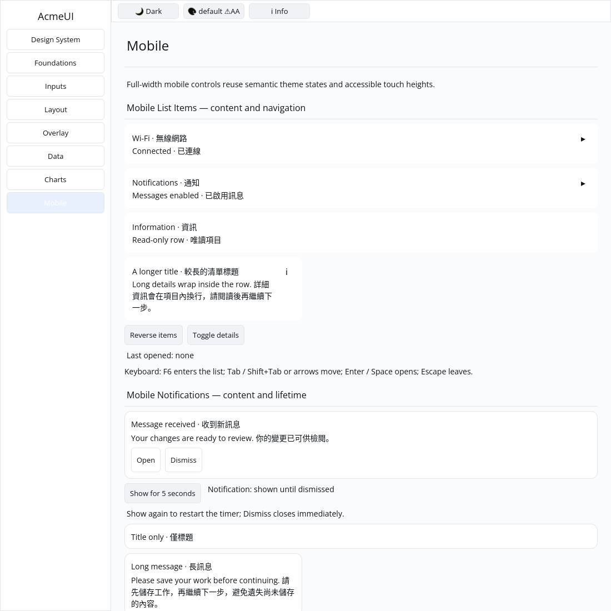
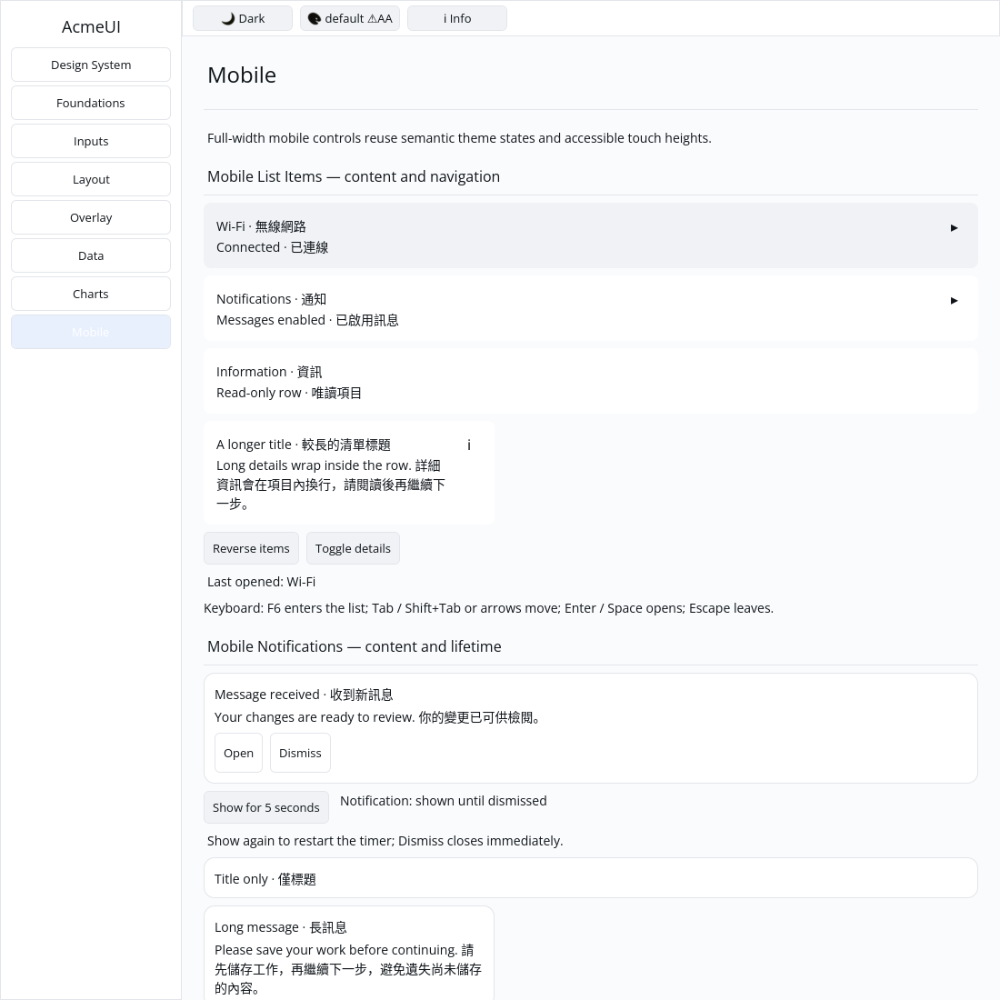
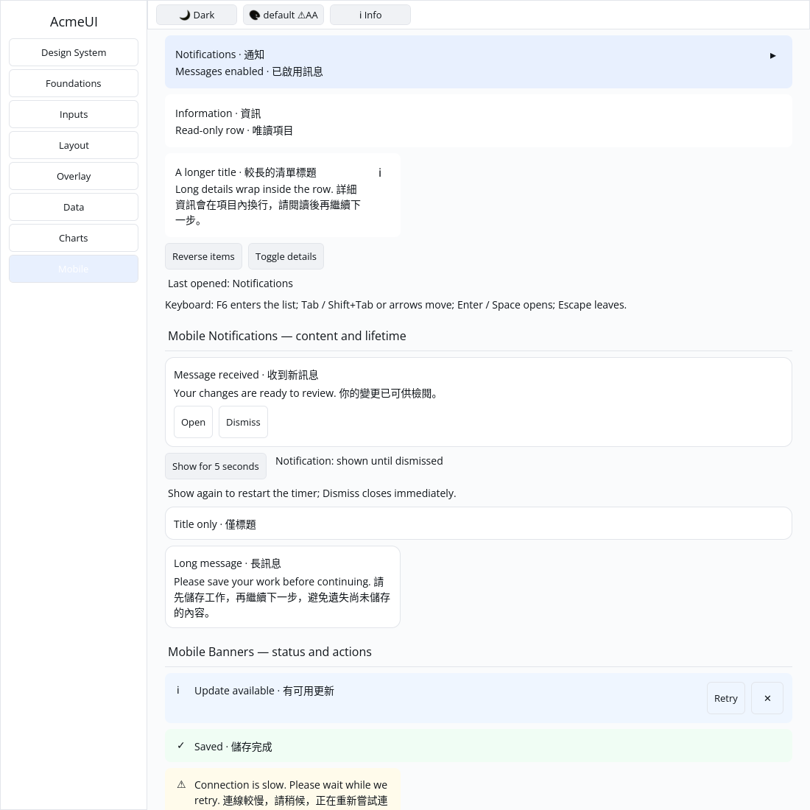

# ROADMAP 027 — Mobile list item acceptance

2026-11-10, Asia/Taipei; branch `sdk/roadmap-027-mobile-list-item`. Execution
**single-agent-role-passes** (Lead, UI/UX, Rendering, Verification), sole writer,
author self-review; independent review **NOT_RUN**. Owner-authorized merge
requires local checks, all hosted CI PASS and GitHub MERGEABLE. No Codex review
wait or release. This is the third and final slice this session.

## Audit and changes

Base **`60b3d7e91094e40ff9ed09b1c234d021b07160c1`**, fetched merge of
[PR #35](https://github.com/stevenke1981/AcmeUI-Native/pull/35) after all ten
hosted checks passed. Existing team/role/spec/plan/todos/P3/roadmap and 026 report
read; source, input/render paths and CI audited. [BRIEF.md](BRIEF.md) records
acceptance and exact file leases. Prior PRs #13 and #27–33 were verified merged
and were not reopened or re-merged.

OBSERVED: list items already composed title/detail/icon and an optional Row
message, but lacked a full-width surface, wrapping and a bounded trailing icon.
Gallery only collected Button hit areas, so it had no working list-item example.
The view bridge/accessibility layer still treats these Rows as nonfocusable
Groups: general retained focus/typed list actions are an explicit open follow-up.

- Preserve constructor/public fields/Row root and optional on_tap message. Add
  semantic Surface, 44 px minimum height, full available width, character-wrapped
  Unicode title/detail in an instance-keyed flexible column and a 20 px icon box.
- Replace four shallow tests with three acceptance tests covering defaults,
  public/optional/empty/Unicode combinations, 180/320/640 px actual layout,
  no overlaps, inherited foreground and retained root/text/title IDs across
  detail/icon/tap changes and keyed reorder. The resulting UI test count drops
  by one; the old cases are covered by the new combinations.
- Gallery shows two tappable rows, passive information and a narrow long-text
  row, plus detail/reorder controls and action status. A private classifier
  recognizes only this demo's row messages, so the search host's parent submit
  marker is not reinterpreted. Hit collection and rendering share this classifier;
  rows consume an interactive index before following buttons and use semantic
  hover/press colours. Passive rows consume no index and emit no action.
- Explicit Gallery keyboard host: F6 enters/reveals the list; Tab/Shift+Tab or
  arrows navigate; Enter/Space dispatch the same actions; Escape leaves. Focus
  follows data identity through reorder. Active search composition keeps F6.
  This host is private to Gallery, not a framework-wide focus/a11y implementation.
- Four Gallery tests cover actual pointer/key events, details/reorder and stable
  neighboring identities, passive hits, complete binding, theme/viewport clips,
  following-button index/paint state and the actual Scene's scrolled text clips.
  Theme/paint cases use default/Apple light/dark and scales 1/1.25/2.

## Native scrolling defect and minimal bridge fix

Native keyboard scrolling exposed an existing rendering bug: TextRun.clip was
set correctly in Frame but silently discarded by scene_from_frame. Scrolled
page glyphs painted over the toolbar. The fix wraps each clipped text command
in balanced PushClip/PopClip commands. Unclipped runs stay unclipped; glyph data,
uploads, origins, text order and Scene public contracts are unchanged.

A bridge regression checks fractional clips, unclipped runs after clipped runs,
zero-width clips, balanced state and Scene validity. A real Gallery Scene test
checks that offscreen text retains the [200,40,900,1060] viewport clip. Native
CPU pixel comparison confirms that the toolbar is unchanged after keyboard scroll:
**762 / 36000 changed pixels before the fix, 0 / 36000 after**. This is a bounded
pixel regression under the recorded host/font/scenario, not a general golden
baseline, GPU parity or performance measurement.

No dependency/manifest/lockfile, Scene/platform contract, public API expansion,
GPUI, hardcoded widget colours or text-cursor changes. No cargo clean, local
release build or speculative performance rewrite.

## Reproductions and checks

[evidence.json](evidence.json) preserves exact SHA/dirty state, argv, timestamps,
OS/toolchain, exits and raw-log/image hashes, including failures.

| Reproduction | Before | Accepted |
|---|---|---|
| Component surface/width acceptance | 2 FAIL / 1 PASS; 225 px for 180 px available | 3 PASS |
| Gallery pointer/keyboard/paint-index acceptance | 3 FAIL: missing row hit, no activation, index count 1 vs 2 | PASS |
| Frame→Scene text clip and actual Gallery Scene | FAIL: no clip | PASS |
| Native toolbar pixels after scroll | FAIL: 762 changed pixels | PASS: 0 changed pixels |

The initial bridge/Gallery clip tests needed `.get()` for typed logical pixel
coordinates; those compile failures and the subsequent assertion-based RED are
preserved separately. The first pixel-check script used a deprecated Pillow
iterator; the accepted script compares raw RGB bytes without that warning.

The first native keyboard attempt left Xvfb input focus on the root window and
produced the same image as the pointer capture. It is **not** native keyboard
acceptance. The corrected harness explicitly focuses the Gallery window and
sends XTEST keys. Both the unfocused attempt and the later focused-but-unclipped
image/metadata are preserved under logs/ with acceptance status FAIL in evidence.
Capture status PASS means image capture succeeded, not that every input worked.

Final tested source: **`b284352d0f385d90c74769e399818bf7ac73e930`**.
Linux x86_64, Rust/Cargo **1.88.0**. Tracked source stayed unchanged during final
checks/capture; dirty snapshots list generated, untracked docs/evidence files.
Later documentation commits do not inherit these local passes; hosted CI tests
the final PR head/merge independently.

| Gate | Result |
|---|---|
| Touched-package formatting | PASS |
| Locked all-feature wgpu/UI/Gallery tests | PASS: wgpu 72 + 2 existing ignored; UI 778; Gallery 48; existing ignored doctests remain |
| Locked mobile-only UI tests | PASS: 317 |
| Strict all-target/all-feature touched-package and mobile-only Clippy | PASS |
| `python3 scripts/verify_sdk.py --profile cpu --output target/roadmap-027/cpu-final-accepted` | PASS: actual CPU format/tests/strict Clippy, no dry run |
| `cargo check --locked --workspace --all-targets` | PASS at completed-slice milestone |
| `cargo test --locked --workspace` | PASS at completed-slice milestone; existing ignored tests remain |
| Gallery debug build / native toolbar pixel check | PASS / PASS |

CPU tests/goldens: 87 PASS, existing timing test ignored. Existing target/ reused;
about 71 GB free. Release compilation and performance measurements **NOT_RUN**.

## Gallery and remaining work

Actual built Gallery on isolated Xvfb/X11, forced CPU backend, default light theme,
1100×1100 logical window. Author inspected the accepted images: title/details/
trailing icons fit; long bilingual content wraps; pointer opens Wi-Fi; focused
F6/Down/Space input opens Notifications and reveals its highlight, while toolbar
pixels remain byte-identical to the unscrolled capture. This is automated native
virtual-display evidence, not human/physical-device acceptance.

Author self-review covered optional fields, geometry, inherited colours, identity,
scoped action/index accounting, keyboard/composition boundaries, clip-stack
balance, unchanged Scene contracts and evidence hashes. Independent review
**NOT_RUN**; no independent-worker or model-routing claims.

**Open:** framework-wide Row retained focus/typed AccessKit list actions,
general w_full percentage-unit reconciliation, spinner rotation, mobile_action,
mobile_sheet_handle and other unchecked SDK/runtime/release work.

**NOT_RUN:** human Gallery acceptance, actual Windows 注音 composition/candidate
placement, physical 100/125/150/200% DPI/touch, real GPU/recovery and screen readers.
Chinese content/synthetic preedit does not validate IME. No project completion
or production-readiness claim.

Next recommended bounded slice: **mobile_action**, then mobile_sheet_handle.

Delivery snapshot: local acceptance complete. PR, hosted CI and merge follow this
committed report; consult the resulting PR checks/merge record for final delivery.
