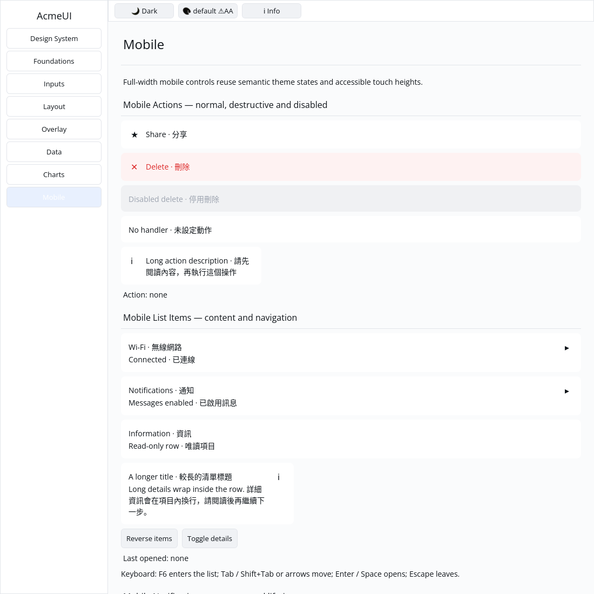
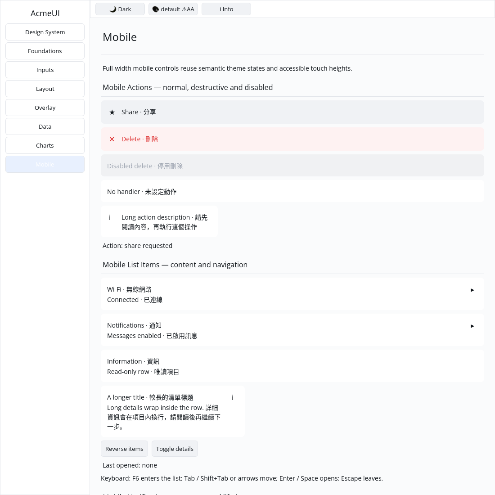

# ROADMAP 028 — Mobile action acceptance

2026-11-10 Asia/Taipei. Execution **single-agent-role-passes** (Lead, UI/UX,
Verification), one writer; author self-review, independent review **NOT_RUN**.
Base `d8204517821d70075356911fe6783c58699a951b`, fetched clean master and merged
PR #36 (all ten hosted checks PASS); no prior PR reopened. Owner explicitly
authorizes PR/merge after local checks and hosted CI. [Contract](BRIEF.md).

## Result

Preserve the public builder/fields, Row root/key and optional message. Disabled
rows suppress messages and use DisabledBg/DisabledText; destructive rows use
DangerSoft/Danger. Normal rows use Surface/Foreground. All colours resolve from
the active theme, including icons. Rows fill available width, retain at least
44 px height, wrap Unicode labels beside a fixed 20 px icon, and use an
instance-keyed label column to preserve identity across icon changes/reorder.

Gallery adds normal, destructive, disabled, passive and narrow examples, action
status and scoped Row hit routing. Existing list/search routing remains intact.
The Gallery now honours existing Label style.text_color tokens. Destructive
rows retain danger-soft colour during hover/press. Generic Row focus/typed
AccessKit semantics remain open; these are host-dispatched compositions.

Three component acceptance tests replace four shallow tests; two Gallery tests
exercise pointer dispatch, disabled hit exclusion, real layout, retained IDs,
paint indexing, live themes at three scales and viewport clips.

## Evidence

Tested source **`3175bd09de426aeae2de3a66a16a8f380f4d2551`**, clean tracked tree,
Linux x86_64, Rust/Cargo 1.88.0. Later docs do not inherit source checks; hosted
CI tests the final PR separately. [evidence.json](evidence.json) and logs/
record actual argv, source/dirty state, timestamps, exits, OS/toolchain and hashes.

RED: original conversion had no surface, unstable label slot and 366 px width
for 180 px available. Gallery initially had zero action hits. All three
component/two Gallery acceptance tests now PASS. Logs preserve initial test
compile errors (moved test value, nonexistent Label key/context default) and a
pointer harness correction (send PointerMoved before press/release); these are
not claimed as behavior failures. Label identity uses a keyed column because
Label has no public key field.

| Final gate | Result |
|---|---|
| Touched formatting | PASS |
| Locked all-feature UI / mobile-only UI / Gallery | PASS: 777 / 316 / 50; two existing ignored UI doctests |
| Strict all-feature touched and mobile-only Clippy, all targets | PASS |
| Actual `python3 scripts/verify_sdk.py --profile cpu --output target/roadmap-028/cpu-final` | PASS: CPU 87 tests, existing timing test ignored; no dry run |
| Locked workspace check all targets / workspace tests | PASS at completed-slice milestone; existing ignores remain |
| Gallery debug build / automated native CPU capture | PASS / PASS |

Author inspected actual built Gallery on isolated Xvfb/X11, forced CPU backend,
default light, 1100×1100: danger and disabled colours differ, long bilingual
label wraps without overlap, and a real XTEST pointer click changes status to
share requested. This is automated virtual-display evidence, not human sign-off.
No manual touch, performance or native-mobile claim. About 70 GB free, existing
target reused; no release build, cargo clean, API expansion or dependency change.

Self-review covered bounds, Unicode, disabled dispatch, optional messages,
retained identity, live colour tokens, hit/paint order, clips and raw evidence.
**NOT_RUN:** human Gallery, Windows 注音 composition/candidate placement,
physical DPI/touch, real GPU/recovery and screen readers. Chinese text/synthetic
events do not prove IME. Framework Row focus/typed actions and spinner animation
remain open; no project-completion or production-readiness claim.

Next slice: **mobile_sheet_handle**. Delivery snapshot: local acceptance
complete; PR creation, hosted CI and merge occur after this report. Consult the
resulting PR for final hosted checks and merge status.
