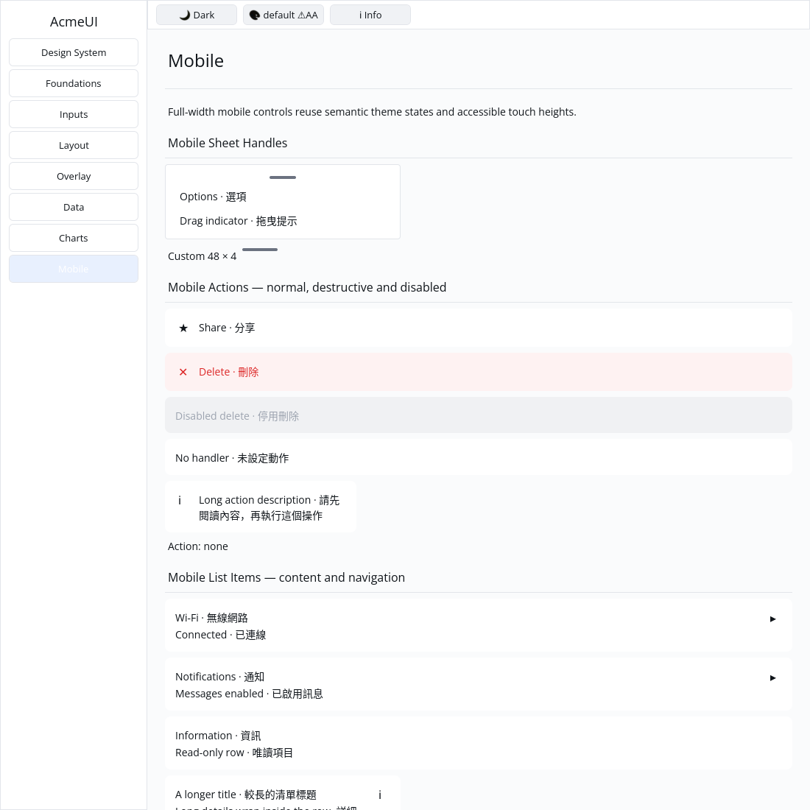

# ROADMAP 029 — Mobile sheet handle acceptance

2026-11-10 Asia/Taipei. **single-agent-role-passes** (Lead, UI/UX, Verification),
sole writer, author self-review; independent review **NOT_RUN**. Base
`aad58f0889fb7b0f753694b91982e1538b369d57`, fetched clean master after PR #37
merged with ten hosted checks PASS. [Task and exact write scope](BRIEF.md).
Owner authorizes PR/merge after local checks and hosted CI; no release.

Preserve the public builder, Row root/key, default 36×4 and custom width. Add a
MutedForeground semantic surface, radius 2, minimum dimensions and no shrink.
Negative widths clamp to zero; NaN/infinities fall back to 36 even after public
field edits. The handle has no children or messages. It is a visual decoration;
it installs no drag recognizer. No bottom_sheet or public contract rewrite.

Three acceptance tests replace three shallow tests: numeric/public/default
states, actual constrained layout, and retained IDs across resize/keyed reorder.
Gallery adds a centered handle in a sheet-like Card and a 48 px example. Its
regression checks actual bar quads, centering, live default/Apple light/dark
colours at three scales, clips and following-button hit/paint indices.

## Verification

Tested source **`0f97bf52a7093167f911da43085ad45bd9f7034b`**, clean tracked tree,
Linux x86_64, Rust/Cargo 1.88.0. [evidence.json](evidence.json)/logs preserve
actual argv, SHA/dirty state, times, exits, toolchain/OS and hashes. Documentation
commits do not inherit source checks; hosted CI tests the final PR separately.

Original conversion: component semantic surface test FAIL; Gallery expected two
bar quads but got zero (FAIL). Accepted: three component/one Gallery tests PASS.
Two component checks (size with siblings, retained identity) already passed
before implementation. The first log named component-red.txt actually runs the
old shallow tests and records PASS: a preceding no-match search prevented test
creation; it is baseline evidence, not a red reproduction. The later
component-acceptance-red.txt is the actual failing acceptance test.

| Final gate | Result |
|---|---|
| Touched fmt | PASS |
| Locked UI all-feature / mobile-only / Gallery tests | PASS: 777 / 316 / 51; two existing ignored UI doctests |
| Strict touched all-feature/all-target and mobile-only Clippy | PASS |
| Actual `python3 scripts/verify_sdk.py --profile cpu --output target/roadmap-029/cpu-final` | PASS: 87 CPU tests; existing timing test ignored, no dry run |
| Locked workspace all-target check / tests | PASS at completed-slice milestone; existing ignores remain |
| Gallery debug build / native CPU capture | PASS / PASS |

Author inspected the built executable on isolated Xvfb/X11, forced CPU backend,
default light, 1100×1100: the default rounded bar is visible and centered above
Options; the custom bar is wider. This is automated virtual-display evidence,
not physical-device or human acceptance. Existing target reused, about 70 GB
free. Release build and performance measurements NOT_RUN; no cargo clean,
dependency change, hardcoded widget colour or public API expansion.

Self-review: numeric bounds, fixed layout, optional width/key compatibility,
retained identity, semantic colour, decorative behavior, centering/clips and raw
evidence. **NOT_RUN:** human Gallery, Windows 注音 composition/candidate placement,
physical DPI/touch, GPU/recovery and screen readers. No IME, actual dragging,
project-completion or production-readiness claim. Spinner animation and generic
Row focus/typed semantics remain open.

Next slice: P3 builder contract tests, reconciling the historical “16 modules”
count against the actual 15 mobile_* builders / 20 public mobile modules.
Delivery snapshot: local acceptance complete; PR, hosted CI and merge follow
this report. Consult the resulting PR for final hosted delivery status.
