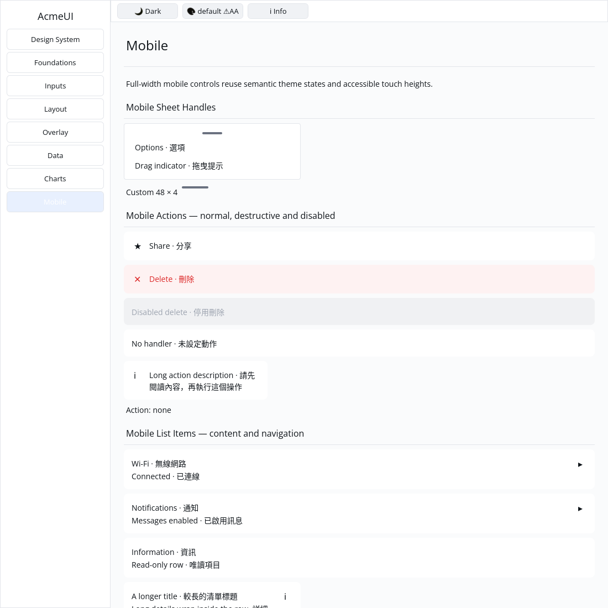

# ROADMAP 030 — Mobile builder contract coverage

2026-11-10 Asia/Taipei. **single-agent-role-passes** (Lead, UI/UX, Verification),
one writer, author self-review; independent review **NOT_RUN**. Base
`913abe681b690bf69568395ec823b2dec2304d5f`, fetched clean master after PR #38
merged with ten hosted checks PASS. [Task/write scope](BRIEF.md). Owner
explicitly authorizes PR/merge after local checks and hosted CI; no release.
Third/final slice of this session, after ROADMAP 028/029.

## Inventory and scope

The historical P3 “all 16 modules” count was stale: P3 lists 15 mobile_* builders;
mobile/mod.rs exports 20 modules, including five other legacy composites. Rather
than inventing a sixteenth P3 component, the suite covers all 20. Existing
behavior tests remain intact. Production widget code, public APIs, manifests,
Scene/platform contracts and dependencies are unchanged.

One registry generates 20 named tests plus an inventory guard comparing its
entries with public mod declarations. Each named test checks every public
builder default field (including required constructor values), the themed-context
layout kind and both widget/layout root child counts. The two nested legacy
builders ActionItem and BottomNavItem also have defaults checked. Inventory
changes now require an explicit corresponding contract.

All rows below have a PASS named test under
`mobile::mobile_contract_tests::<module>`; count is immediate root children with
the listed default/constructor inputs, not the total descendant count.

| Module | Layout kind | Root children |
|---|---|---:|
| mobile_action | Row | 1 |
| mobile_avatar | Stack | 1 |
| mobile_banner | Row | 2 |
| mobile_button | Leaf | 0 |
| mobile_card | Column (Card) | 1 |
| mobile_chip | Row | 1 |
| mobile_list_item | Row | 1 |
| mobile_loader | Column | 1 |
| mobile_notification | Column (Card) | 1 |
| mobile_progress | Column | 2 |
| mobile_search | Row | 2 |
| mobile_segmented (two segments) | Row | 2 |
| mobile_sheet_handle | Row | 0 |
| mobile_stepper | Row | 3 |
| mobile_toggle | Stack | 2 |
| action_sheet (empty actions) | Column (Card) | 1 |
| bottom_nav (empty items) | Row | 0 |
| bottom_sheet | Column (Card) | 1 |
| pull_to_refresh | Column | 1 |
| search_bar | Row | 2 |

A Gallery regression finds exactly one representative keyed root for each of the
15 P3 builders, verifies its real retained layout ID/kind and finite rectangle,
and preserves those IDs across default-light/Apple-dark/default-light at scales
1/1.25/2. It does not certify overflow-free geometry or physical DPI. The P5
Gallery todo is explicitly scoped to these 15 builders; legacy demos are not
claimed. Per-component optional-state/input/layout evidence remains in prior
014/019–029 reports and current suites.

## Verification

Tested source **`6d75f40604d9955457326932faf41b4b17c4bdc3`**, clean tracked tree,
Linux x86_64, Rust/Cargo 1.88.0. [evidence.json](evidence.json) and logs preserve
actual argv, SHA/dirty state, timestamps, OS/toolchain, exits and hashes. Later
documentation does not inherit source checks; hosted CI tests the final PR.

The 21 new component checks and one Gallery check passed on their first run.
This is coverage work; no existing behavior bug/RED reproduction is claimed.

| Final gate | Result |
|---|---|
| Touched fmt | PASS |
| Locked UI all-feature / mobile-only / Gallery | PASS: 798 / 337 / 52; two existing ignored UI doctests |
| Strict all-feature touched/all-target and mobile-only Clippy | PASS |
| Actual `python3 scripts/verify_sdk.py --profile cpu --output target/roadmap-030/cpu-final` | PASS: CPU 87 tests; existing timing test ignored, no dry run |
| Locked workspace all-target check / tests | PASS at completed-P3-test milestone; existing ignores remain |
| Gallery debug build / fresh native CPU smoke capture | PASS / PASS |

Author inspected this build on isolated Xvfb/X11, forced CPU, default light,
1100×1100. The visible sheet-handle/action/list examples remain present and
readable; the capture is a smoke check, not a screenshot of all 15 examples or a
new golden/human sign-off. Earlier per-component reports retain their respective
captures. Existing target reused, about 71 GB free. Release build/performance
measurements NOT_RUN; no cargo clean, GPUI, public API expansion or widget colour
changes. Self-review checked independent expected defaults, macro registry,
feature isolation, cardinality and retained/layout matching.

## Open work

Structural/default PASS does not establish legacy behavior completeness:
action_sheet selection/disabled handling, bottom_nav selection/routing,
bottom_sheet open/close/overlay behavior, pull_to_refresh gestures and search_bar
real input/live-theme behavior remain unaudited acceptance work. Their existing
compositional implementations are not rewritten or marked interactive here.
General Styled::w_full percentage units, Row retained focus/typed AccessKit
actions, spinner animation and actual sheet dragging remain open.

**NOT_RUN:** human Gallery, Windows 注音 composition/candidate placement, physical
100/125/150/200 percent DPI/touch, GPU/recovery and screen readers. Synthetic
Unicode tests do not validate IME. No project-completion or production-readiness
claim. Next recommended bounded slice: reconcile **Styled::w_full() percentage
units** with Length::Percent (the measured 24000 px versus 240 px case is already
recorded in ROADMAP 025/P5), with compatibility/real-layout regressions.

Delivery snapshot: local acceptance complete. PR, hosted CI and merge follow
this report; consult the resulting PR for final hosted delivery status.
