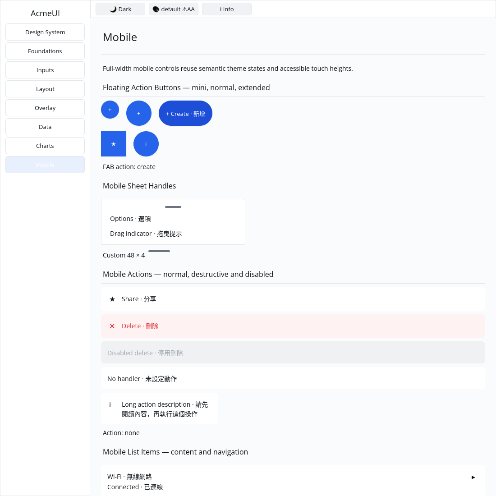

# ROADMAP 032 — Floating action button acceptance

2026-11-11 Asia/Taipei. Execution **single-agent-role-passes**, sole writer,
Lead/UI/UX/Verification passes and author self-review; independent review
NOT_RUN. [Scope/leases](BRIEF.md). Owner explicitly authorizes PR and merge
once local tests, all hosted CI and MERGEABLE pass.

The interrupted FAB work was preserved on its existing branch. Fetch found PR
#40 already merged at `931c7b83646da8f3fdf96cc4a2a9f0f4b28fef7a`; that batch
uses 031 for render reliability. The original uncommitted FAB brief was moved
to 032, without overwriting 031 or reopening merged PRs.

## Behavior and compatibility

Reuse overlay::float_button: mini 40 px, normal 56 px, extended 56 px high with
icon and label. A semantic elevated Card contains one primary Button with an
instance-derived key; circular/square shapes, optional content and messages
are covered. Long labels remain inside bounded geometry. Placement remains
host metadata; there is no automatic viewport anchor or expandable group.
The new FloatButtonSize/size selector is needed by the documented variants;
adding the public size field requires existing exhaustive builder struct
literals to supply it. Constructor/method callers retain their entrypoints.
The previous Stack root becomes Card + Button, an intentional tree change.

Gallery now honours existing Button radius/border styles and clips button
labels to their bounds intersected with the scroll viewport. Elevated Cards
use four clipped layers from the theme shadow token: an approximation, not a
renderer blur. A passive button no longer compares absent hit indices as a
hover/press. Existing Gallery assertions were updated to enforce viewport
containment and explicit shadow-before-surface order. No widget colors are
hardcoded; no dependency, manifest, Scene/platform or cursor changes.

## Verification

Tested source **`c76800dcdb3daa8de23bc41a67a14c56bcfe1516`**, Rust/Cargo
1.88.0, Linux x86_64. Source was committed; documentation/evidence were dirty
or untracked as captured per command. [evidence.json](evidence.json) contains
argv, SHA/status, OS/toolchain, timestamps, exits and raw-log hashes.
Documentation commits do not inherit a new locally tested SHA.

| Gate | Result |
|---|---|
| Touched fmt | PASS |
| Locked UI all features / overlay+foundations | PASS: 797 / 270 tests; two existing all-feature doctests ignored |
| Locked Gallery | PASS: 55 tests |
| Strict all-feature touched/all-target Clippy | PASS |
| Locked workspace all-target check / tests | PASS at completed-slice milestone; existing ignores preserved |
| Actual `python3 scripts/verify_sdk.py --profile cpu` | PASS: actual format/tests/strict Clippy, no dry run |
| Debug Gallery build and automated native CPU window | PASS |

Initial resumed Gallery compilation failed on the unfinished shadow field
name and incomplete synthetic pointer events; both corrected. First full
Gallery run: 49 PASS / 6 FAIL because old tests required viewport-equal button
clips and omitted new shadow layers. During assertion correction two compile
attempts used the wrong Rect accessors/type inference; corrected. These logs
are retained. No baseline behavior RED from the interrupted run is claimed.

Author inspected actual native CPU Gallery on isolated Xvfb, 1100×1100,
default light: mini, normal, extended and square controls visible, and pointer
click changes status to `create`. The first capture clicked outside the
button and produced no change; preserved as missed-click evidence, not action
acceptance. A fresh correctly targeted capture supplies the shown result.
This is automated virtual-display evidence, not human sign-off or a golden.

Existing target reused, about 70 GB free. No release/performance run, cargo
clean, GPUI or speculative optimization. **NOT_RUN:** human Gallery, Windows
注音 IME/candidate placement, physical DPI/touch, GPU for these controls and
screen readers. No project-completion or production-readiness claim.
Next bounded slice: Snackbar via the existing toast builder, optional action
and host-owned bottom placement/expiry.

Delivery snapshot: local acceptance complete; PR creation, final hosted CI
and merge follow this report. Use the resulting PR record for delivery status.
