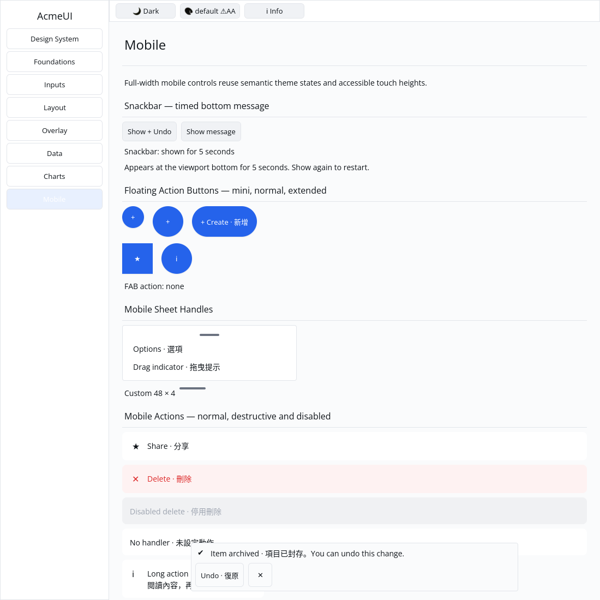

# ROADMAP 033 — Snackbar acceptance

2026-11-11 Asia/Taipei. **single-agent-role-passes**, Lead/UI/UX/Verification,
sole writer and author self-review; independent review NOT_RUN. [Scope](BRIEF.md).
Base `1e3817fc0ac7596221d82e357311f65d8b5e6e30`, after FAB
[PR #41](https://github.com/stevenke1981/AcmeUI-Native/pull/41) merged with all
ten hosted checks PASS. Owner authorizes PR/merge after local and hosted checks.

## Behavior

The existing design mapping already points Snackbar to overlay::toast. Extend
that builder with key/action/on_dismiss instead of introducing a duplicate API.
Preserve constructor, tone icons, 3000 ms default, duration and dismissible
options. Messages wrap at character boundaries; a separately keyed footer
contains independent 44 px action and dismiss Buttons. Long actions shrink and
are clipped by the host. Default close without a handler remains passive.
Root/body/footer keys derive from the instance. Optional-action insertion,
message changes and keyed instance reorder preserve content/dismiss identities.
Body/footer composition intentionally changes the old root's child structure.
No widget theme colors, platform types, dependencies or cursor representation
are introduced. Duration remains metadata: building the widget starts no timer.

Gallery owns bottom positioning, visibility and a restartable five-second
deadline. It displays with/without Undo, handles dismiss/expiry, cancels stale
press/hover state, and blocks pointer hits/focus through the opaque surface.
The overlay appends a separate Scene after page/input text to preserve painter
order. It stays at the viewport bottom while the page scrolls. This is a
Gallery host, not a new global overlay/timer service or native mobile runtime.

## Evidence

Tested source **`490450382162b4a1b686311a64df1d6df7d1269d`**, Rust/Cargo
1.88.0, Linux x86_64. Source committed, docs/evidence dirty or untracked;
[evidence.json](evidence.json) preserves actual command vectors, source/status,
timestamps, toolchain, exits and raw log hashes. Later docs do not acquire
an unrun source check. Existing target reused, about 70 GB free.

| Check | Result |
|---|---|
| Wrapping regression before/after | RED: None versus Character / GREEN; original test source retained |
| Locked UI all-feature / overlay+foundations | PASS: 801 / 274 tests, existing two all-feature ignored doctests |
| Locked Gallery | PASS: 58 tests |
| Touched fmt and strict all-feature/all-target Clippy | PASS |
| Locked workspace all-target check / tests | PASS at completed-slice milestone; existing ignores remain |
| Actual `python3 scripts/verify_sdk.py --profile cpu` | PASS, no dry run |
| Debug Gallery build / actual native CPU captures | PASS / PASS |

Component tests cover six tone icons, optional action/close combinations,
zero/large duration metadata, Unicode wrapping, 120/240/600 px real layout,
action bounds and retained IDs. Gallery tests cover action/plain/dismiss/expiry,
restart/cancel, stale presses, bottom positioning, scroll independence, opaque
hit blocking, Scene painter order and live theme colours across default/Apple
light/dark at scales 1/1.25/2. These logical scales do not certify physical DPI.

Author inspected isolated Xvfb/X11 CPU 1100×1100 captures: bottom message with
Undo and close, action status `undone`, a plain message and timed removal with
status `automatically dismissed`. Escape is a neutral input before the final
5.5-second wait; it does not dismiss this Snackbar. Screenshot timestamps and
commands record the wait interval; this is not a latency benchmark, golden or
human sign-off. Pointer dismiss is covered by the real Gallery event test.

**NOT_RUN:** human Gallery, Windows 注音 IME/candidate placement, physical
touch/DPI, GPU for this component and screen readers/live-region semantics.
Global timer/overlay management and animation remain separate work. No release,
performance measurement, cargo clean, GPUI or production-readiness claim.
Next bounded slice: SwipeActions with backend-neutral controlled gesture state,
keyed actions and a real Gallery pointer reveal flow.

Delivery snapshot: local acceptance complete; final hosted CI and merge occur
after this report. Consult the resulting PR for final delivery status.
