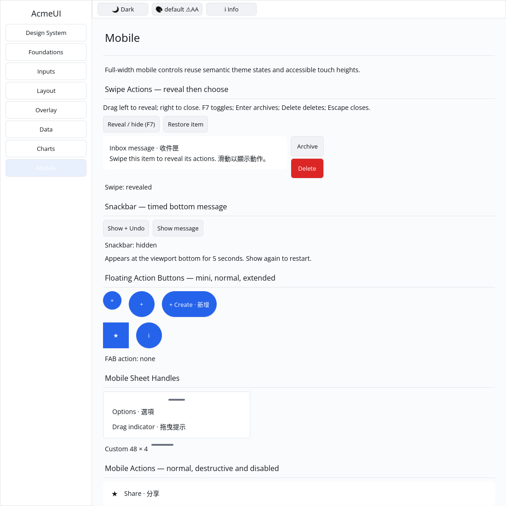

# ROADMAP 034 — SwipeActions acceptance

2026-11-11 Asia/Taipei. **single-agent-role-passes**, sole writer,
Lead/UI/UX/Verification passes and author self-review; independent review
NOT_RUN. [Acceptance/leases](BRIEF.md). Base
`343a3f55985655f7bbbaac1a6194657d46657e7b`, fetched master after Snackbar
[PR #42](https://github.com/stevenke1981/AcmeUI-Native/pull/42) merged with ten
hosted checks PASS. Third/final slice; owner authorizes merge after local tests,
all hosted CI PASS and MERGEABLE. No release or other-repository work.

## Component and state

Audit found no existing swipe implementation. Add mobile::swipe_actions with
controlled revealed state, keyed content and optional trailing Archive/Delete
Buttons. Actions are absent while closed; revealing invokes neither action.
The content identity survives reveal/options/reorder. The trailing column uses
72×44 logical-pixel targets, leaving wrapping content beside it; real layout
acceptance covers 240/360/600 px. Callers provide wrapping content.

SwipeActionsState uses logical coordinates and no platform types. A host begins
inside visible hit bounds and supplies matching pointer movement/release. A
12 px horizontal lock rejects vertical-first movement; release left by 48 px
reveals and right by 48 px closes. Short movements, cancel, release without
begin, nonfinite coordinates and overflowing deltas preserve visibility. The
host owns pointer identity/capture, cancellation and controlled visibility.
This is threshold reveal on release, not continuous translation or animation.

Gallery implements a scoped primary-pointer host, matching pointer releases,
window-leave/focus/scroll/resize cancellation, separate action/remove/restore,
and F7/Enter/Delete/Escape alternative. Composition blocks the shortcut; this
synthetic guard is not IME validation. Already-visible keyboard targets keep
the scroll position. Generic framework gesture/focus services remain separate.

The new module has a default/layout contract in the mobile registry (21 public
modules). Both READMEs now count 200 public component-module declarations in
the eight category mod.rs files, excluding test/support modules; previous
*.rs wording became ambiguous as test files grew. This is inventory, not a
claim of 200 accepted interactive components. No dependencies, manifests,
Scene/platform contracts or widget theme colors changed.

## Verification

Tested source **`b21aed0e91068435be2f21f938bba31ae14f805b`**, Linux x86_64,
Rust/Cargo 1.88.0. Source committed, docs/evidence dirty/untracked as captured
per command. [evidence.json](evidence.json) retains command vectors, source/status,
timestamps, environment, exits and raw-log hashes. Later documentation commits
do not inherit a newly tested local SHA.

| Gate | Result |
|---|---|
| Locked UI all-feature / mobile-only | PASS: 807 / 343 tests; two existing ignored all-feature doctests |
| Locked Gallery | PASS: 62 tests |
| Touched fmt / strict all-feature/all-target Clippy | PASS / PASS |
| Locked workspace all-target check / tests | PASS at completed-slice milestone; existing ignores remain |
| Actual `python3 scripts/verify_sdk.py --profile cpu` | PASS, no dry run |
| Debug Gallery build and native CPU drag/action captures | PASS / PASS |

The first new component suite passed. First full Gallery run: 61 PASS / 1 FAIL.
F7 scrolled even when the item was visible, moving Restore offscreen and
preventing the subsequent Delete workflow. The host now scrolls only when the
row is outside its viewport. The failed implementation/test sources and log are
preserved; the regression explicitly checks no scroll for a visible row. This
is a failure of the initial new implementation, not a pre-existing API bug.

Gallery tests cover pointer reveal/right-close/archive/delete/restore,
vertical/cancel/unmatched-pointer paths, keyboard action/composition guard,
live default/Apple light/dark at scales 1/1.25/2, paint states/indices and clips.
These logical scales do not validate physical DPI or touch hardware.

Author inspected actual Xvfb/X11 CPU 1100×1100 captures: closed row, left drag
reveals readable Archive/Delete controls, separate Archive click removes the
item and sets `archived`; Restore, another left drag and Delete click set
`deleted`. Commands and images are preserved with the capture script. This is
automated virtual-display native input evidence, not a golden or human sign-off.

Existing target reused, about 70 GB free. No release/performance run, cargo
clean, GPUI, byte-based cursor or public platform-type changes. **NOT_RUN:**
human Gallery, Windows 注音 IME/candidate placement, physical DPI/multitouch,
GPU for these components and screen readers. General gesture/capture services,
continuous translation/animation, spinner animation and manual acceptance
remain open. The project is not declared complete or production-ready.

Next recommended bounded slice: reconcile Styled::w_full() percentage units
with Length::Percent, using the historical 24000 versus 240 px reproduction in
ROADMAP 025/P5; MobileTabBar remains the next unchecked new mobile component.

Delivery snapshot: local acceptance complete; final hosted CI and merge follow
this report. Consult the resulting PR for final delivery status.
