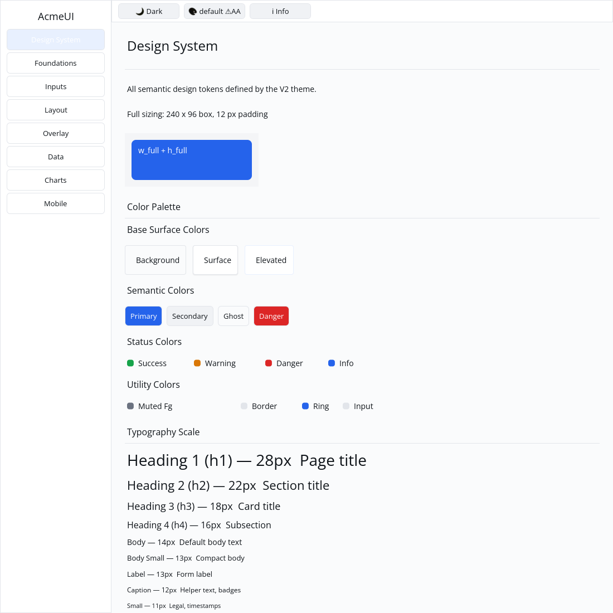

# ROADMAP 035 — Full sizing percentage correction

2026-11-11 Asia/Taipei. **single-agent-role-passes**, Lead/Rust Core/UI/UX/
Verification; sole writer and author self-review, independent review NOT_RUN.
[Acceptance and exact leases](BRIEF.md). Base `7d385ebac8f0285a10b404218143bd802c4a12e7`;
master fetched clean, PRs through #43 already merged. Owner authorizes merge
only after local targeted checks, all hosted CI PASS and MERGEABLE.

## Behavior

REPRODUCED before fixing: a Styled::w_full root in a 240 px viewport measured
24000 px; a padded full-size child measured 21600 x 9600 instead of 216 x 96.
The same real-layout regression failed for mobile_button at 24000 vs 240 px.
Styled::{w_full,h_full}, Tailwind {w,h}::{full,screen} and Button.full_width now
emit Percent(1.0). The layout engine's fractional convention is unchanged and
is documented on Length::Percent. No signatures, dependencies, manifests,
Scene/platform contracts or widget theme colors changed.

Explicit Button style width still overrides full_width. Full sizing resolves
to the containing content box in both dimensions, tested at three sizes.
Tailwind screen() is documented as a parent-relative alias, not a viewport
unit. Existing callers compensating for overflow should remove workarounds;
[CHANGELOG](../../CHANGELOG.md) documents the geometry correction.

Gallery Design System includes a fixed 240 x 96 parent with 12 px padding;
the full child is 216 x 72. Tests check real layout, live light/dark colors,
three logical scales and preserved scroll clips. An initial new demo attempted
Styled on a Label enum (compile failure), then used Column backgrounds that
Gallery does not paint (62 PASS / 1 FAIL); the final demo uses the existing
styled Row path. No generic Column painting expansion is included. Initial
failures are retained in the logs.

## Verification

Tested source **`78627821f99277725310ee3d5de727fecc9b4e30`**, Linux x86_64,
Rust/Cargo 1.88.0. Source committed, docs/evidence dirty as recorded per command.
[evidence.json](evidence.json) preserves command vectors, SHA/status, environment,
timestamps, exit codes, raw logs and hashes. Later documentation commits do not
inherit a newly tested local source SHA; hosted CI tests final PR head/merge.

| Check | Result |
|---|---|
| Locked style / layout / widgets | PASS: 13 / 8 / 166 tests |
| Locked all-feature UI / Gallery | PASS: 807 / 63 tests |
| Touched fmt / strict all-feature all-target Clippy | PASS / PASS |
| Actual CPU verification profile (python3, no dry run) | PASS: 87 tests; existing timing ignore remains |
| Workspace all-target check / workspace tests | PASS / PASS at slice milestone; existing ignores remain |
| Debug Gallery build / native CPU capture | PASS / PASS |

Author inspected the actual Xvfb/X11 CPU Gallery capture at 1100 x 1100:
the blue full-size child stays within its padded neutral parent, with readable
text. Capture script and commands are preserved. This is automated native
virtual-display evidence, not a golden, human sign-off or physical-DPI result.

Existing target reused, about 69 GB free. No release, performance claim,
cargo clean, GPUI or text-cursor changes. **NOT_RUN:** human Gallery, Windows
注音 IME/candidate placement, physical DPI/touch, real GPU and screen readers.
Project completion and production readiness are not claimed.

Next small automatable slice: Paper square variant (open P8 item, verified
absent in the existing builder). DataList density remains an open P9 item.
Spinner runtime/reduced-motion animation and generic Row focus/typed actions
remain open. Delivery snapshot: local acceptance complete; consult the resulting
PR for final hosted CI and merge status.
