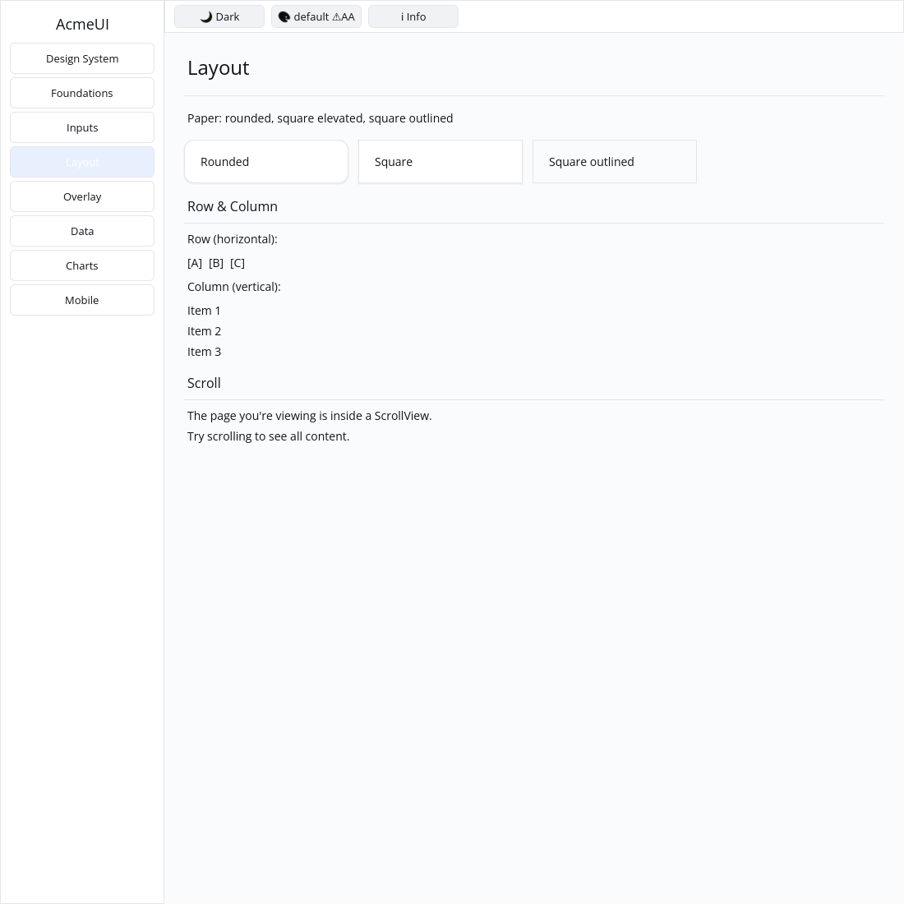

# ROADMAP 036 — Paper square corners

2026-11-11 Asia/Taipei. **single-agent-role-passes**, Lead/Architecture/UI/UX/
Verification; sole writer and author self-review, independent review NOT_RUN.
[Acceptance and leases](BRIEF.md). Base `2ad3e8841fff1c591433f92fd7590542cddc5f9f`,
fetched master after [PR #44](https://github.com/stevenke1981/AcmeUI-Native/pull/44)
merged with all ten hosted CI checks PASS. Owner authorizes merge after local
acceptance, all hosted CI PASS and MERGEABLE.

## Behavior and compatibility

OBSERVED: P8 square variant was unchecked. PaperElevation::E0 already produces
zero radius; the missing behavior is independently requesting square corners
at another elevation. Add square(bool), default false. Conversion forces zero
radius when true and keeps the prior elevation radius otherwise. Keys,
children, 16 px padding and outlined/elevated semantics stay unchanged.

[ADR 0003](../../adr/0003-paper-square.md), written before implementation,
records the small public addition and compatibility: external PaperBuilder
struct literals must add square: false, or use paper() and setters. Existing
constructor users retain their defaults. No new WidgetNode/Scene/platform
contract, dependency, hardcoded widget color or actual shadow-level system.
Gallery continues using its existing theme-token layered shadow approximation.

Tests cover seven elevations x square x outline, setter reversal/order and
public edits, real 240/400 px layout and retained content IDs across toggles.
Gallery compares rounded, square elevated and square outlined surfaces; paint
checks cover default/Apple light/dark, three logical scales and clips.

## Verification and discovered feature gap

Tested source **`20f3ae654abcf861e186e7529ec969be708359cb`**, Linux x86_64,
Rust/Cargo 1.88.0. Source committed; docs/evidence dirty per command.
[evidence.json](evidence.json) retains command vectors, source/status, environment,
timestamps, exits and raw-log hashes. Documentation commits do not inherit a
newly tested local SHA; hosted CI tests the final PR head/merge separately.

| Check | Result |
|---|---|
| Locked UI all-feature / Gallery | PASS: 809 / 64 tests; existing doctest ignores |
| Locked UI layout,foundations,inputs | PASS: 502 tests |
| Touched fmt / strict all-feature all-target Clippy | PASS / PASS |
| Actual CPU profile, no dry run | PASS: 87 tests; existing timing ignore |
| Workspace all-target check / tests, slice milestone | PASS / PASS |
| Debug Gallery build / native CPU capture | PASS / PASS |
| Additional layout-only / layout,foundations probes | FAIL: pre-existing feature dependencies, reproduced below |

The initial test registration used the wrong module path (compile failure);
a path attribute corrected it. The next test-first run failed because square
was absent, then the implemented Paper suite passed. Both logs are retained.

The additional layout-only probe fails on root IconName and Form's
inputs::form_message; adding foundations alone still lacks form_message.
A controlled baseline check temporarily restored paper.rs from base 2ad3e88,
leaving the new tests unreferenced; all other tracked UI sources matched base.
It failed identically. The script restores exact original bytes in finally;
its source and baseline hash are retained. These are **FAIL**, not silently
skipped or counted as passes. Explicitly enabling layout,foundations,inputs
passes. The manifest is outside this Paper slice; the observed dependency gap
is now an open P5 item and the next bounded ROADMAP 037 priority.

Author inspected the real 1100 x 1100 Xvfb/X11 CPU Gallery capture: rounded
left, square elevated middle and square outlined right, readable text and
consistent padding. Automated virtual-display evidence is not a golden,
human sign-off, hardware test or native MUI parity claim. Capture script retained.

Existing target reused, about 69 GB free. No release/performance run, cargo
clean, GPUI or cursor changes. **NOT_RUN:** human Gallery, Windows 注音 IME,
physical DPI/touch, real GPU and screen readers. Project completion and
production readiness are not claimed. DataList density, spinner scheduling/
reduced-motion animation and generic Row focus/typed actions remain open.
Delivery snapshot: local Paper acceptance complete; consult the resulting PR
for final hosted CI and merge status.
