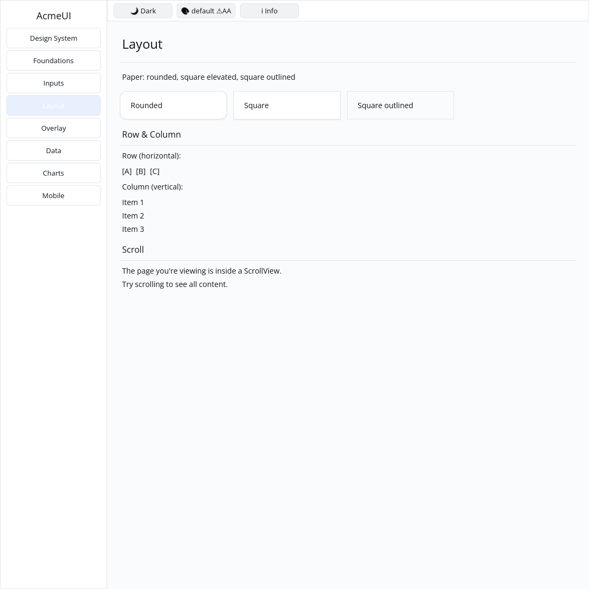

# ROADMAP 037 — UI minimal feature dependencies

2026-11-11 Asia/Taipei. Execution **single-agent-role-passes** (Lead,
Architecture, Rust Core, Verification), sole writer and author self-review;
independent review NOT_RUN. [Acceptance and leases](BRIEF.md). Base
`72c0f7914294b8634d14f4ead1e40b8c6e792964`, after PR #45. Run 032 preserved
the existing source commit, documentation edits and native Gallery capture.
Owner authorizes merge after local checks, all hosted CI PASS and MERGEABLE.

## Problem and change

REPRODUCED on the base: selecting `inputs` without defaults cannot import
foundation IconName. Selecting `layout` additionally lacks Form's
`inputs::form_message`. Declare `inputs = ["foundations"]` and
`layout = ["inputs"]`, reflecting those existing dependencies. No widget,
public API, lockfile or default/full feature behavior changes are introduced.

Integration tests compile as consumers of the public crate: an inputs-only
icon Button preserves its typed activation, and a layout-only Form retains
its required label, content and validation message. Hosted Linux CI now runs
both isolated feature suites in addition to the existing workspace/all-feature
gates. SDK guide and changelog document the dependency closure. Other isolated
optional-feature families are outside this certification.

## Verification

Tested source **`3b0e8062794b756d0e4dea51eede3e74578b37e9`**, Linux x86_64,
Rust/Cargo 1.88.0. Source committed, documentation/evidence dirty as recorded
per command. [evidence.json](evidence.json) preserves the original RED/GREEN
checks, command vectors, timestamps, environment, status and raw-log hashes.
The resumed run verified the existing log hashes and repeated both isolated
suites and the actual CPU profile. Later documentation commits do not change
the locally tested SHA; hosted CI tests the final PR head/merge separately.

| Check | Result |
|---|---|
| Initial inputs / layout without defaults | FAIL / FAIL, preserved as reproductions |
| Locked inputs-only UI | PASS: 406 unit + 1 consumer test, also repeated in run 032 |
| Locked layout-only UI | PASS: 502 unit + 2 consumer tests, also repeated in run 032; existing ignored doctest |
| Locked UI without features | PASS: 9 tests |
| Locked all-feature UI / Gallery | PASS: 809 + 2 consumer / 64 tests; existing ignored doctests |
| Touched fmt, strict inputs/layout/all-feature all-target Clippy | PASS |
| Workspace all-target check / tests at slice milestone | PASS / PASS |
| Actual CPU profile, no dry run | PASS, also repeated in run 032: 87 tests; existing timing ignore |
| Debug Gallery build / native CPU capture | PASS / PASS |

Author inspected the preserved actual Xvfb/X11 CPU Gallery capture: Layout
shows rounded, square and square outlined Paper with readable content. The
capture uses the tested source and its image hash is verified. No UI flow was
added for this manifest-only change. This is automated virtual-display evidence,
not human or hardware acceptance. Capture script and raw logs are retained.

No release/performance run, cargo clean, GPUI, hardcoded widget colors or text
cursor changes. Existing target reused. **NOT_RUN:** human Gallery, Windows
注音 IME/candidate placement, physical DPI/touch, real GPU and screen readers.
Project completion and production readiness are not claimed.

Next small automatable slice: the still-open P9 DataList compact/relaxed density
variants. Spinner runtime/reduced-motion animation and generic Row focus/typed
AccessKit actions remain open and require their own bounded contracts.

Delivery snapshot: local acceptance complete. Consult the resulting PR for
the final hosted checks and merge record; this pre-delivery report does not
claim those checks have already run.
