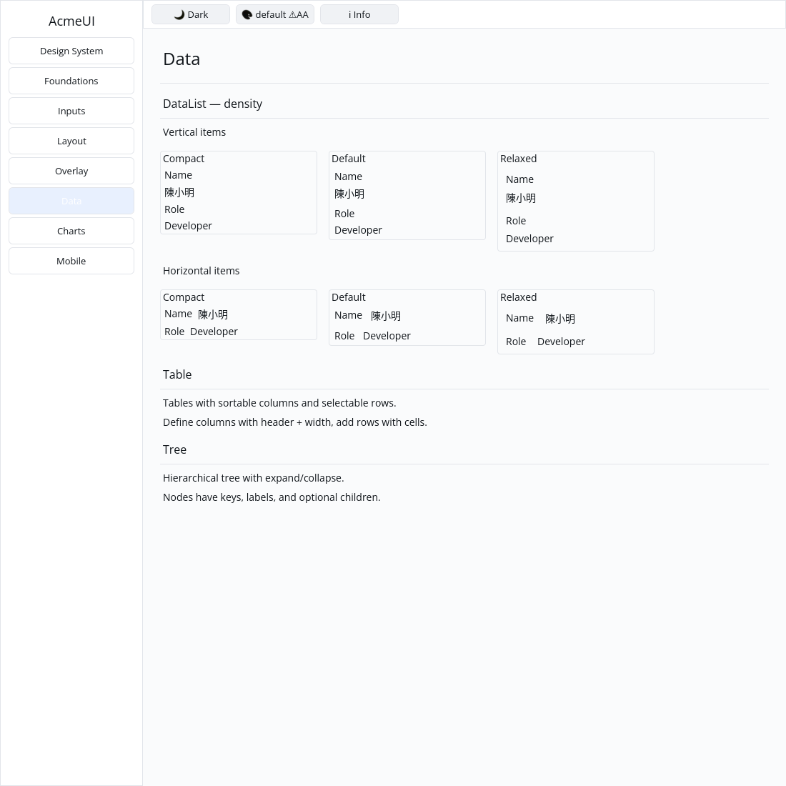

# ROADMAP 038 — DataList density

2026-11-11 Asia/Taipei. Execution **single-agent-role-passes** (Lead,
Architecture, UI/UX, Verification), sole writer and author self-review;
independent review NOT_RUN. [Acceptance and leases](BRIEF.md). Base
`ac6171fa02787b9c84ff074c61ac6e723f87628d`, after
[PR #46](https://github.com/stevenke1981/AcmeUI-Native/pull/46) merged with all
ten hosted CI checks PASS. Owner authorizes merge after local checks, all
hosted CI PASS and MERGEABLE.

## Behavior and compatibility

OBSERVED: P9 DataList compact/relaxed density was still unchecked; the source
offered orientation and fixed spacing only. Add DataListDensity and a density
setter/public field. Compact/Default/Relaxed change spacing independently of
orientation; Default preserves all previous values. [ADR 0004](../../adr/0004-data-list-density.md)
records the API and exact logical-pixel values before implementation.
DataListBuilder already contains a private phantom field, so external struct
literals were unavailable. Constructor users keep their existing behavior.

Three new component acceptance tests cover default/empty/Unicode/public-field
behavior, actual geometry at 240/400 px and scales 1/1.25/2 for both orientations,
and all retained root/item/label IDs across density changes and keyed list
instance reorders. Existing tests remain. Content, typography and inherited
colors are preserved. No new wrapping, widget/Scene/platform contract,
manifest or lockfile change is included.

Gallery Data shows six samples: three densities for vertical items and three
for horizontal items. A retained-layout paint regression verifies increasing
list extents, all six surfaces, text, live default/Apple light/dark palettes,
three logical scales and the scroll clip. The first Gallery test compile used
the wrong card constructor signature; correcting it to card().key(...) passed.
That failure and the test-first missing-density API failure are preserved.

## Verification

Tested source **`ffa63a054cf46c826e43e6b7a04305276a33ab91`**, Linux x86_64,
Rust/Cargo 1.88.0. Source committed, documentation/evidence dirty as recorded
per command. [evidence.json](evidence.json) preserves commands, timestamps,
environment, status, raw logs and hashes. Later documentation commits do not
change the locally tested source SHA; hosted CI tests final PR head/merge.

| Check | Result |
|---|---|
| Focused component / Gallery acceptance | PASS: 6 / 1 tests after preserved initial failures |
| Locked foundations-only UI | PASS: 203 tests |
| Locked all-feature UI / Gallery | PASS: 812 + 2 consumer / 65 tests; existing ignored doctests |
| Touched fmt / strict foundations and all-feature all-target Clippy | PASS / PASS |
| Actual CPU profile, no dry run | PASS: 87 tests; existing timing ignore |
| Workspace all-target check / tests, slice milestone | PASS / PASS |
| Debug Gallery build / native CPU capture | PASS / PASS |

Author inspected the actual 1100 x 1100 Xvfb/X11 CPU Gallery capture: both
orientations show compact, default and relaxed spacing in increasing extents,
with readable English/Chinese content. Capture script and image hash are
retained. This is automated virtual-display evidence, not a golden, human
sign-off or physical-device result.

Existing target reused, about 68 GB free. No release, performance numbers,
cargo clean, GPUI, hardcoded widget colors or cursor changes. **NOT_RUN:** human
Gallery, Windows 注音 IME/candidate placement, physical DPI/touch, real GPU and
screen readers. Project completion and production readiness are not claimed.

Next small automatable slice: P12 Gallery theme-pack swatches on Design System,
verified absent from the current page. Spinner scheduling/reduced-motion
animation and generic Row focus/typed AccessKit actions remain open.

Delivery snapshot: local acceptance complete. Consult the resulting PR for
the final hosted checks and merge record; this pre-delivery report does not
claim those checks have already run.
