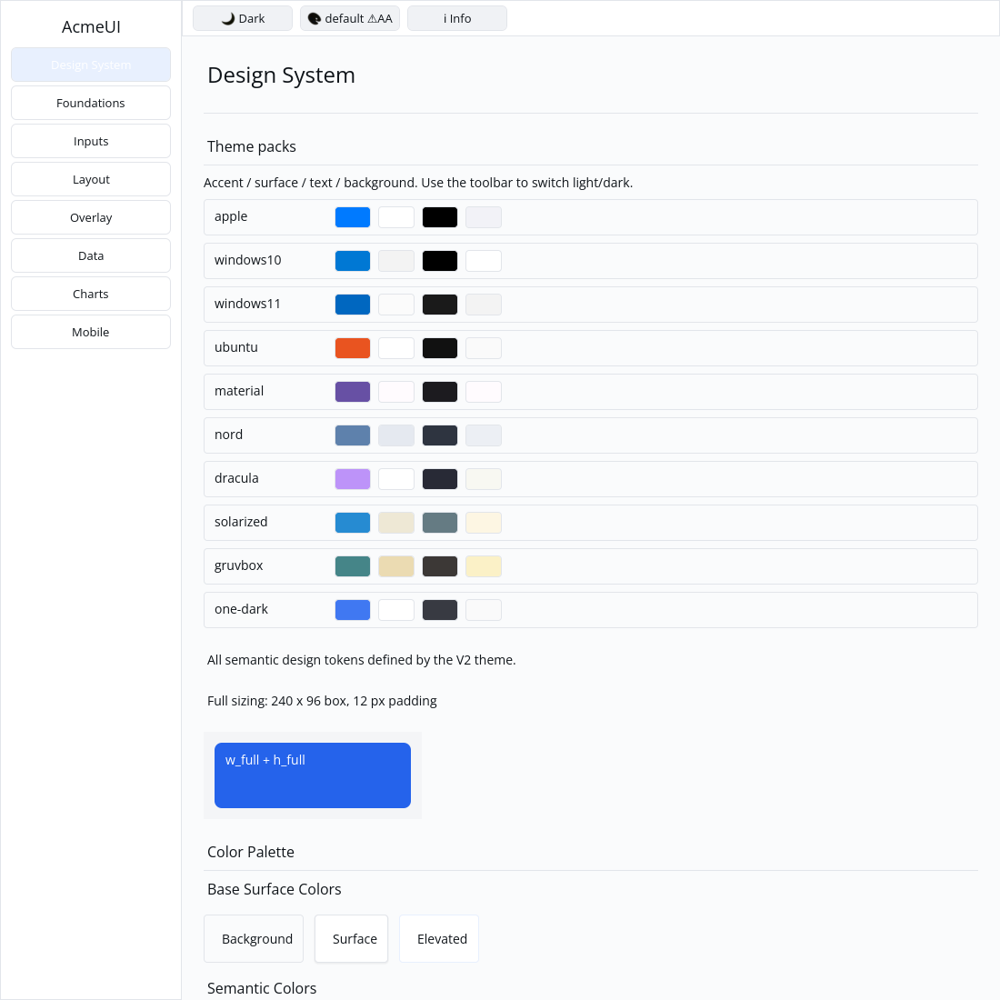
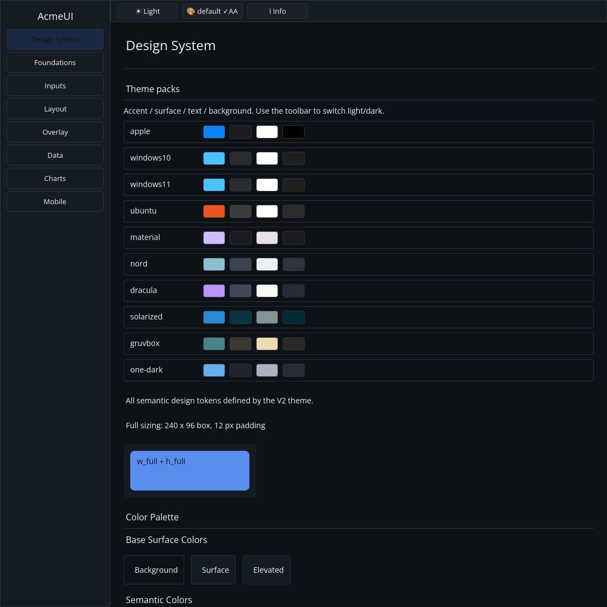

# ROADMAP 039 — Gallery theme-pack swatches

2026-11-11 Asia/Taipei. Execution **single-agent-role-passes** (Lead,
Architecture, UI/UX, Verification), sole writer and author self-review;
independent review NOT_RUN. [Acceptance and leases](BRIEF.md). Base
`c524c69ec35ffac70703b02f4f61cfc4d8b89890`, after
[PR #47](https://github.com/stevenke1981/AcmeUI-Native/pull/47) merged with all
ten hosted CI checks PASS. Owner authorizes merge after local checks, all
hosted CI PASS and MERGEABLE. Third/final slice of run 032.

## Behavior and scope

OBSERVED: P12's Gallery theme-pack swatches remained unchecked. Design System
displayed current-theme semantic samples only. Add a registry-driven preview
of all ten packs near the top of that page, showing primary/accent, surface,
foreground/text and background. The existing toolbar light/dark toggle updates
every preview; cycle-theme continues to select the host application's palette.

Each pack and swatch has a derived stable key. Palette colors come directly
from theme_by_name(pack, mode); borders, names and surrounding surfaces use
the current application theme. Existing Card/Row/Label painting is sufficient.
The previews are read-only. No new SDK public API/ADR, theme colors, runtime
action, semantic role, dependency, manifest, Scene or platform change is needed.

Two new acceptance regressions cover every registered name, noninteractive
composition, exact rendered palette colors in light/dark mode, default/Apple
host themes, 360/800 px real layout, three logical scales, bounded 40 x 24 px
tiles, scroll clips and all retained IDs across host-theme/mode changes. The
test-first missing-preview-method compile failure is preserved.

## Verification

Tested source **`2e737261af7cc19894071cecf1c37de3a2cc3364`**, Linux x86_64,
Rust/Cargo 1.88.0. Source committed; documentation/evidence dirty as recorded
per command. [evidence.json](evidence.json) retains exact commands, environment,
source/status, timestamps, exit codes, raw logs and hashes. Later documentation
commits do not change the locally tested SHA; hosted CI tests final PR head/merge.

| Check | Result |
|---|---|
| Focused preview regressions | PASS: 2 tests after preserved test-first failure |
| Locked Gallery suite | PASS: 67 tests |
| Touched fmt / strict all-feature all-target Clippy | PASS / PASS |
| Actual CPU profile, no dry run | PASS: 87 tests; existing timing ignore |
| Workspace all-target check / tests, slice milestone | PASS / PASS |
| Debug Gallery build / native CPU captures | PASS / PASS |

Author inspected both actual 1100 x 1100 Xvfb/X11 CPU Gallery captures: all
ten labeled palettes are visible; the actual toolbar toggle changes their
surface/text/background variants and host styling. Capture script, commands
and image hashes are retained. This is automated virtual-display evidence,
not a golden, human sign-off or physical-device result.

Existing target reused. No local release or performance run, cargo clean,
GPUI, hardcoded widget palette colors or cursor changes. **NOT_RUN:** human
Gallery, Windows 注音 IME/candidate placement, physical DPI/touch, real GPU
and screen readers. These swatches do not certify contrast/accessibility of
every palette. High-contrast variants and theme JSON import/export remain open.
Project completion and production readiness are not claimed.

Next recommended bounded work: define and implement foundation spinner runtime
rotation with reduced-motion policy (the existing static spinner/mobile loader
follow-up). Generic retained Row focus/typed AccessKit actions also remain open.

Delivery snapshot: local acceptance complete. Consult the resulting PR for
the final hosted checks and merge record; this pre-delivery report does not
claim those checks have already run.
