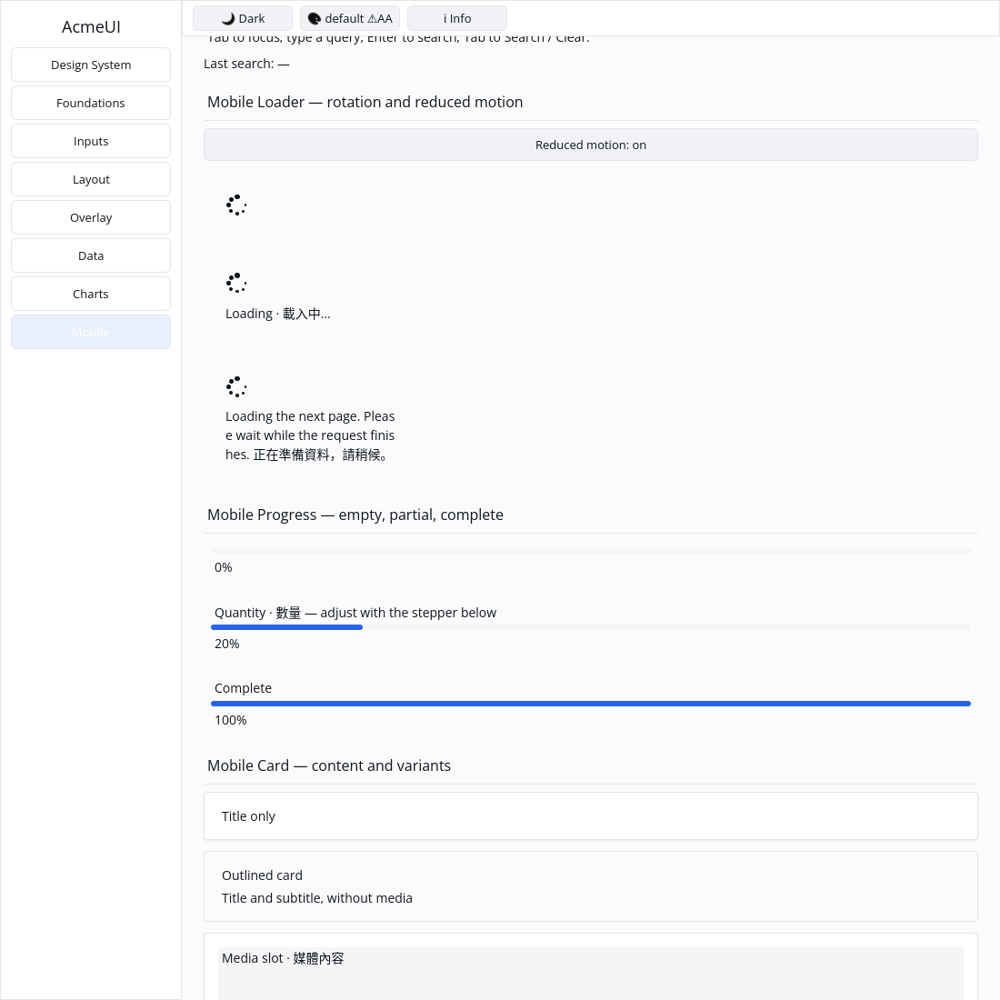

# ROADMAP 040 — Spinner rotation and reduced motion

2026-11-11 Asia/Taipei. Execution **single-agent-role-passes** (Lead,
Architecture, UI/UX, Accessibility, Verification), sole writer and author
self-review; independent review NOT_RUN. [Acceptance and leases](BRIEF.md).
Fetched clean master `b881ecbde71cc870b257883ceb912a31ebdb3f52`; PR #48 was
already merged, no open PRs. Owner authorizes merge after local checks, all
hosted CI PASS and MERGEABLE. First slice of run 033.

## Behavior and compatibility

OBSERVED: foundation spinner was a static font glyph, and mobile_loader had
no clock/policy input. Application already supported background polling.
Add `animation(Duration, reduced_motion)` to both existing builders, with
private state and no changed existing signatures/public fields. The host owns
time, scheduling and motion preference. No clock means a fixed initial pose.
[ADR 0005](../../adr/0005-spinner-motion.md) records this API before implementation.

The spinner now composes seven themed circular Rows in a fixed-size Stack,
with a tapered tail and a gap. Positions rotate clockwise once per second;
integer-second reduction avoids precision loss for long-running clocks.
Reduced motion ignores elapsed time and returns exactly the initial pose.
All six tones use semantic tokens. Representation changes from Label to Stack,
so consumers inspecting the old internal Label must adjust. No WidgetNode,
Scene, platform, dependency, manifest, lockfile or animation-engine change.

Gallery forwards its clock and explicit reduced-motion toggle to all three
loader examples. Only indicators inside the Mobile scroll viewport request
33 ms polling. Leaving the page, scrolling them out or enabling reduced motion
stops spinner polling. Notification and Snackbar expiry remain independent.
The toggle is a demo preference, not OS motion-preference detection.

Tests cover periodic/quarter-turn geometry, Duration::MAX, all sizes and tones,
bounded real layout, optional message wrapping, all dot retained IDs across
message/phase/policy/reorders, live theme colors/clips at three scales and actual
Gallery viewport/pointer/polling behavior. The preserved test-first compile
failure reports the missing animation method (and Duration import); one
intermediate Gallery compile used `background` instead of Quad's `color` field.
Both are corrected without suppressing diagnostics.

## Verification

Tested source **`938ab0e0d7aa612e71370ca63b0ec27a766afae1`**, Linux x86_64,
Rust/Cargo 1.88.0. Source committed, documentation/evidence dirty as recorded
per command. [evidence.json](evidence.json) retains command vectors, source and
status, environment, timestamps, exits, raw logs and hashes. Later documentation
commits do not change the locally tested SHA; hosted CI tests final PR head/merge.

| Check | Result |
|---|---|
| Locked all-feature UI / Gallery | PASS: 813 + 2 consumer / 69 tests; existing ignored doctests |
| Locked mobile-only UI | PASS: 347 tests |
| Touched fmt / strict all-feature all-target Clippy | PASS / PASS |
| Actual CPU profile, no dry run | PASS: 87 tests; existing timing ignore |
| Workspace all-target check / tests, slice milestone | PASS / PASS |
| Debug Gallery build | PASS |

## Native Gallery evidence

Automated Xvfb/X11 CPU window evidence, not human sign-off or physical-device
validation. Author inspected both final images: all three indicators and wrapped messages
are visible. Two normal captures 230 ms apart change 180 pixels in the first
indicator region; two reduced-motion captures change zero pixels (the full
reduced screenshots also have identical hashes). These are observations, not
performance measurements. Capture script, commands and hashes are retained in logs.
The initial capture overscrolled past the indicators; it is preserved as
`logs/native-scroll-before.png` and is not spinner acceptance evidence.

Existing target reused; no release, benchmark/performance claim, cargo clean,
GPUI, hardcoded widget colors or cursor changes. **NOT_RUN:** OS preference
integration, human Gallery, Windows 注音 IME/candidate placement, physical
DPI/touch, real GPU and screen readers. Project completion and production
readiness are not claimed.

Next bounded slice: generic retained container/Row focus eligibility and typed
AccessKit activation, with passive/disabled/nested/reorder regressions.

Delivery snapshot: local acceptance complete. Consult the resulting PR for
final hosted checks and merge record; this pre-delivery report does not claim
those checks have already run.
