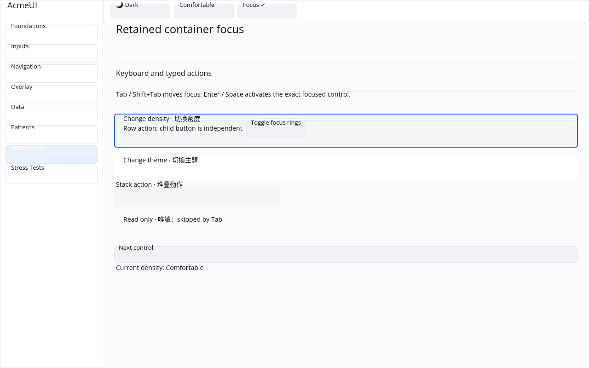
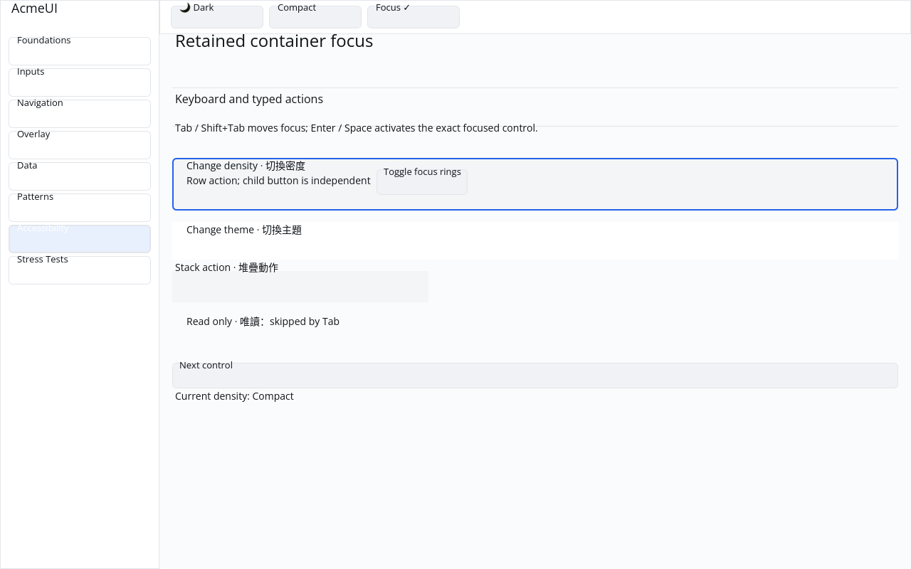
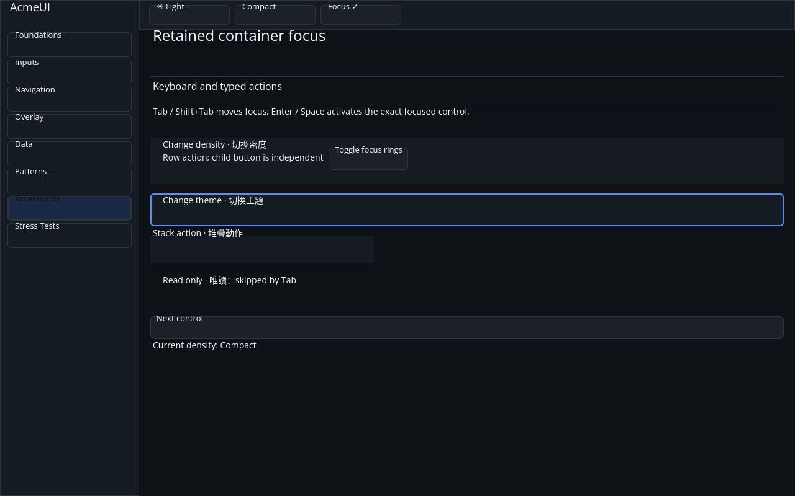

# ROADMAP 041 — Retained container focus and typed activation

2026-11-11 Asia/Taipei. Execution **single-agent-role-passes** (Lead,
Architecture, Rust Core, Accessibility, UI/UX, Verification), sole writer and
author self-review; independent review NOT_RUN. [Brief and exact leases](BRIEF.md).
Continued the owner's existing uncommitted work on
`sdk/roadmap-041-container-actions`, based on master
`6b8f0f61daa34987d1fb3e3809b401fcb31bafee` after PR #49. No open PRs at audit.
The owner authorizes a merge commit after local targeted checks, all hosted CI
PASS and GitHub MERGEABLE; manual hardware acceptance is a separate boundary.

## Behavior and compatibility

Existing Row/Column/Stack containers with activation messages now register as
retained focus candidates. Their AccessKit nodes expose Button/Focus/Click,
with a name composed from nonempty Labels through passive containers and Cards.
Nested controls retain independent names and actions. Passive containers remain
Groups, including their existing context-specific Cell role. No disabled
container field or new widget variant was added; handler suppression remains
the builder's way to make a container passive. Existing Button disabled behavior
is preserved.

[ADR 0006](../../adr/0006-container-activation.md) records the additive
`AccessibilityAction::activation_message(root, binding)` API. Click/Activate
returns the exact current Button/container's typed message, with no pointer
event synthesis, ancestor bubbling or child-coordinate fallback. The caller
must supply a complete binding from the same current, successfully reconciled
description and dispatch a returned message once. Unsupported actions,
passive/disabled targets, missing/synthetic IDs, foreign descriptions and
partial bindings return None. This is an opt-in resolver, not a replacement for
every host's input router; existing `route_action` remains compatible.

The original `acme-gallery` Accessibility/Focus page uses the resolver for
Enter/Space after rebuilding/reconciling the current description. The newer
`acme-ui-gallery` host was not changed. The demo includes a Row with a separate
child Button, Column, Stack, passive Row and following Button. Keyboard focus
survives density rebuilds, and AccessKit focus names the same retained ID.

Actual-frame tests reproduced three related Gallery defects: the content painter
repainted the whole root starting at hit slot 11; active containers did not
consume their own paint slots; and the data-widget hit pass duplicated active
containers after the ordinary hit pass. Restrict painting to the scroll subtree,
consume the same pre-order slots as hit testing, remove duplicate hit
registration, and clip every page primitive to the viewport. This also preserves
the independent child Button's pointer action.

The unrelated deletion of `crates/acme-render-cpu/src/coverage/analytic_tests.rs`
was restored with `git checkout --` for that file only. It remains required by
its parent module and has no diff in this slice. Existing work was preserved;
no reset, stash/drop, force-push or cargo clean was used.

## Verification

Tested implementation **`0175b05c80aafe8915621cd390c7ec762bfa1475`** (full SHA in [evidence.json](evidence.json)),
Linux x86_64, Rust/Cargo 1.88.0. Source committed; documentation/evidence dirty
as recorded per command. Later documentation commits do not change the tested
implementation SHA. Evidence records command vectors, dirty status, environment,
timestamps, exit codes, raw logs and hashes; the actual CPU profile has its own
[report](logs/cpu/report.json). Python 3 invokes the repository runner because
this environment has no `python` alias. No dry run is counted as evidence.

| Check | Result |
|---|---|
| Locked widgets / accessibility | PASS: 150 + 17 integration / 127 tests |
| Locked original Gallery / layout | PASS: 39 (one existing measurement ignore) / 8 tests |
| Locked all-feature UI | PASS: 813 + 2 consumer tests; two existing ignored doctests |
| Touched fmt / strict all-target Clippy | PASS / PASS |
| Actual CPU profile | PASS: 87 tests; one existing timing ignore |
| Workspace all-target check / tests, slice milestone | PASS / PASS |
| Debug original Gallery build | PASS |
| Release original Gallery build | PASS |

Four Gallery regressions cover real keyboard dispatch, stale cached hit-message
rejection, retained accessibility focus, parent/child pointer independence,
exactly five demo focus stops and matching ring indices, both themes, scales
1.0/1.25/2.0 and viewport clips. Widget/accessibility tests cover keyed reorder,
handler changes/removal, focus eligibility removal, exact requests, bounds and
rejected targets. Initial regression logs are retained, including the inherited
missing-import compile failure and a continuation-only FrameContext move error;
these are corrected. The eight-versus-five focus-stop failure was a real duplicate
hit registration, corrected without reducing the expected control count.

## Native Gallery evidence

Automated Xvfb/X11 **CPU window** evidence, not human sign-off. The author
inspected all three images: the Row's ring is visible before/after Enter,
Comfortable changes to Compact, and the Column ring uses the live dark theme
after Tab/Tab/Space. The [capture script](logs/capture.py) and
[record](logs/native-window.json) retain real input commands, source/status,
window geometry, image hashes and backend logs. Existing Gallery text alignment
and sidebar styling are outside this slice's acceptance.

No dependency, manifest, lockfile, Scene contract or platform integration change;
no performance, release or production-readiness claim. **NOT_RUN:** real
AccessKit platform adapter, human Gallery, Windows 注音 IME/candidate placement,
physical DPI/touch, GPU drawing and real screen readers.

Delivery snapshot: local acceptance complete. Consult the PR for final
hosted checks and merge record; this report does not claim hosted checks ran
before PR creation. Next possible bounded task: separately wire a host to the
existing typed resolver; real platform adapter and manual acceptance stay open.
