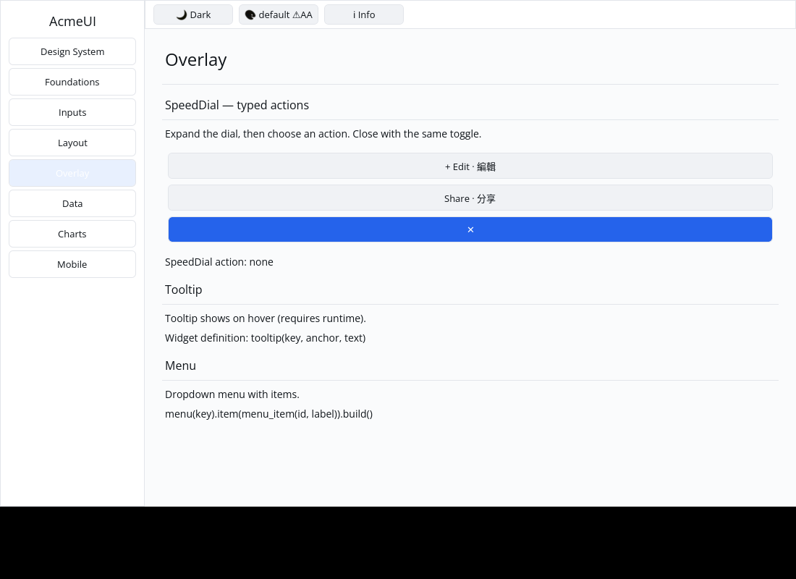

# ROADMAP 042 — SpeedDial typed action conversion

2026-11-11 Asia/Taipei. Execution **single-agent-role-passes** (Lead,
Architecture, UI/UX, Verification), sole writer, author self-review;
independent review NOT_RUN. [Scope and leases](BRIEF.md). Base
`097fb7de73ce04d97d2f993ecaa69aaf06fea416`, after PR #50 merged with ten
hosted checks PASS and MERGEABLE. Second slice of this run; selected from P5
builder-conversion coverage. Owner authorizes merge commit after local checks,
all hosted CI PASS and MERGEABLE.

## Change

REPRODUCED: `SpeedDialBuilder::on_action` stored the callback but converting an
open dial always produced passive Labels. The old callback test checked only
the stored function and did not prove that any control could emit its message.

With a callback, open actions now become full-width secondary Buttons carrying
the zero-based indexed messages. Their keys derive from the existing instance
key and action index. Icons and Unicode labels are preserved. Without a callback,
actions remain passive Labels. Closed dials still contain only the existing
primary toggle; the original root/toggle keys and all public fields/signatures
remain unchanged. Message callbacks run while constructing the description,
as other typed builder callbacks do; hosts still dispatch the resulting message.

The newer Gallery Overlay page demonstrates opening, choosing Edit/Share and
closing through existing pointer dispatch. Choosing an action leaves closing to
the host; the demo records the choice and stays open. Closed stale actions are
rejected. This does not add directional expansion, global overlay positioning,
animation, automatic dismissal or a keyboard router.

Four new conversion regressions assert actual typed messages, icon/label content,
passive fallback, root/toggle IDs through open/close and keyed instance reorder,
and finite bounded text-measured layout at 240/600 px. Two Gallery regressions
cover actual pointer open/select/close, closed stale-action rejection, independent
messages, matching hit/paint slots, both themes, scales 1.0/1.25/2.0 and clips.
The initial layout fixture used the legacy context-free conversion, which gives
Buttons no text measurement; it was corrected to the actual host's contextual
conversion before the final checks. All initial failing logs are retained.

## Verification

Tested implementation **`5e3981d690fc2479a2dbf117d93fa16035f0df5e`**,
Linux x86_64, Rust/Cargo 1.88.0. Documentation/evidence dirty as recorded per
command. [Evidence](evidence.json) records source/status, command vectors,
timestamps, environment, exits, raw logs and hashes. Later documentation commits
do not replace this local tested SHA; hosted CI tests the final PR head/merge.

| Check | Result |
|---|---|
| Locked all-feature UI / external consumer tests | PASS: 817 / 2 |
| Locked Gallery | PASS: 71 |
| Touched formatting | PASS |
| Strict all-target touched Clippy | PASS |
| Actual CPU profile | PASS: 87 tests; one existing timing ignore |
| Workspace all-target check / tests, slice milestone | PASS / PASS |
| Debug newer Gallery build | PASS |
| Release newer Gallery build | PASS |

## Native evidence

Automated real Xvfb/X11 CPU window input, not human sign-off. Capture script,
source/status, input commands, backend logs, geometry and image hashes are
retained in [capture record](logs/native-window.json). The author inspected both
final images: both action Buttons are visible, and selecting Share changes only
the status while the dial stays open. This verifies the demo's pointer path,
not real screen-reader, physical input or hardware acceptance.

No new public API, dependency, manifest, lockfile, Scene or platform changes.
Existing target reused; no cargo clean, GPUI, widget color literals, destructive
git operation or force-push. **NOT_RUN:** human Gallery, Windows 注音 IME/candidate
placement, physical DPI/touch, GPU drawing and screen readers. No project
completion, release or production-readiness claim.

Delivery snapshot: local acceptance complete. Consult the PR for final
hosted checks and merge record. Remaining P5 conversion coverage is still open;
SpeedDial directional expansion remains a separate P8 enhancement.
