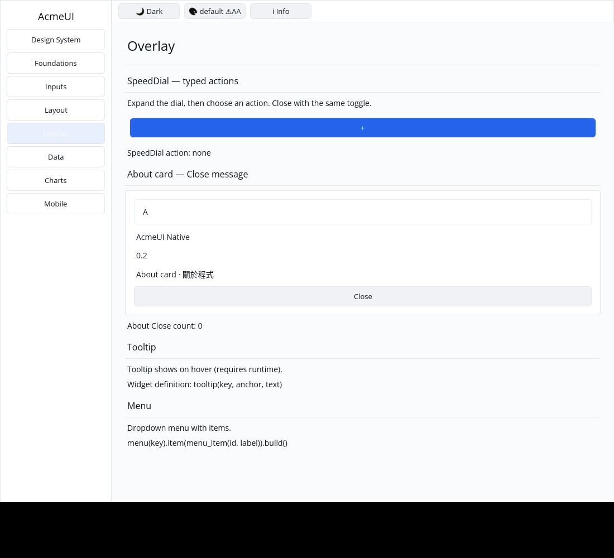
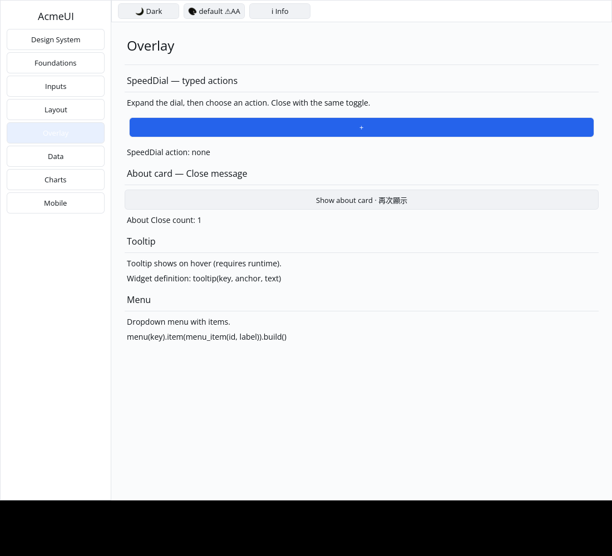

# ROADMAP 043 — AboutDialog Close message conversion

2026-11-11 Asia/Taipei. Execution **single-agent-role-passes** (Lead,
Architecture, UI/UX, Verification), sole writer, author self-review;
independent review NOT_RUN. [Brief and leases](BRIEF.md). Base
`bc7304d8c971083b343cba2b77314c0e7de75dca`, after PR #51 merged with ten
hosted checks PASS and MERGEABLE. Third and final slice of this run, selected
from P5 builder-conversion coverage. Owner authorizes merge commit after local
checks, all hosted CI PASS and MERGEABLE.

## Change and boundary

REPRODUCED: AboutDialog accepted `on_close(message)` but constructed its Close
Button without the message. Existing tests checked the button's label only.
Bind the existing configured message during conversion. With no message, the
button remains passive. Card/label structure, keys, root appearance and public
fields/signatures remain unchanged; there is no new API or dependency.

Two conversion regressions inspect the real converted Button, current message,
passive fallback and Unicode/name structure; they verify Close's retained ID
while optional description/credits are inserted and removed. Two Gallery tests
cover real pointer close/restore, exactly-once close and stale-close rejection,
both themes, three scales, clipped paint and matching hit slots. Initial unit
and Gallery failures are preserved with the passing checks.

The Gallery example is an inline about card. Its host removes/restores the
composition and counts Close messages. This repair does not implement the
legacy `open` field's visibility policy, modal placement/focus trapping, Escape,
or a real platform accessibility adapter. Those remain separate; it is not full
dialog or screen-reader acceptance.

## Verification

Tested implementation **`eca0da8fcfb17faf4ea9eecf71c964dff627cacf`**,
Linux x86_64, Rust/Cargo 1.88.0. Documentation/evidence dirty as recorded per
command. [Evidence](evidence.json) retains exact source/status, command vectors,
timestamps, environment, exits and raw-log hashes. Later documentation commits
do not replace this locally tested SHA; hosted CI tests final PR head/merge.

| Check | Result |
|---|---|
| Locked all-feature UI / consumer | PASS: 819 / 2 tests |
| Locked Gallery | PASS: 73 tests |
| Touched formatting / strict all-target Clippy | PASS / PASS |
| Workspace all-target check | PASS |
| Workspace tests, slice milestone | PASS |
| Debug Gallery build | PASS |
| Release Gallery build | PASS |
| Actual CPU profile | PASS: 87 tests; one existing timing ignore |

## Native evidence

Automated Xvfb/X11 CPU-window pointer evidence, not human sign-off. The
[capture record](logs/native-window.json) preserves source/status, actual input
commands, geometry, environment, image hashes and backend output. The author inspected both final images: the
Close Button is visible initially; after the real click the card is removed,
Show is available, and the counter reads 1. Real modal/keyboard behavior is not
claimed.

Existing target reused; no cargo clean, destructive git operation, force-push,
GPUI, widget color literals, manifest/lockfile, Scene or platform changes.
**NOT_RUN:** human Gallery, Windows 注音 IME/candidate placement, physical
DPI/touch, real GPU and screen readers. No project completion, release or
production-readiness claim.

Delivery snapshot: local acceptance complete. Consult the PR for final
hosted checks and merge record. Remaining P5 builder conversions and AboutDialog
visibility/modal behavior stay open.
