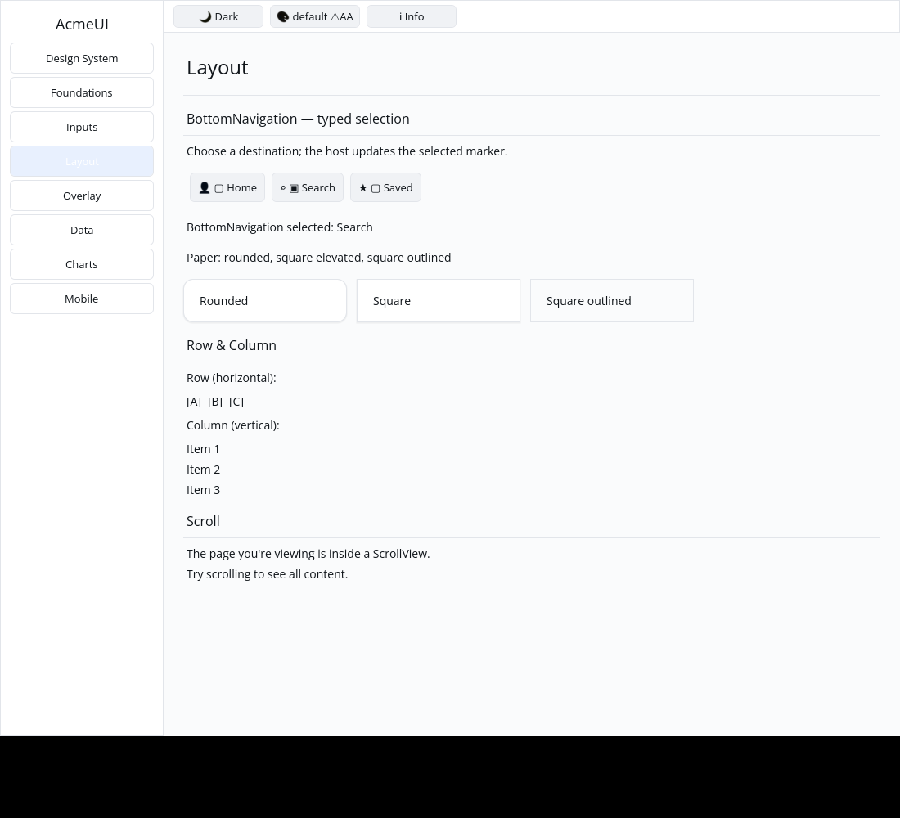

# ROADMAP 044 — BottomNavigation typed selection conversion

2026-11-11 Asia/Taipei. Execution **single-agent-role-passes** (Lead,
Architecture, UI/UX, Verification), sole writer, author self-review;
independent review NOT_RUN. [Brief and exact leases](BRIEF.md). Base
`aeeda7c57d5d697b1c39cedf3906730fbb23de83`, after PR #52.
Owner authorizes merge commit after local checks, all hosted CI PASS and
GitHub MERGEABLE; no Codex review wait.

## Change and boundary

REPRODUCED: BottomNavigation stored `on_select(fn(usize)->M)` but converted
every action to a Label, losing configured messages and focus eligibility.
The configured path now creates instance-keyed Buttons carrying the current
callback's zero-based messages. The no-callback path still produces the same
passive Labels. Icon/label/selected-marker text, root identity and fixed 56 px
height, public fields/signatures and host-owned selection are preserved.
No public API or dependency was added.

Four conversion regressions cover actual Button messages, callback replacement,
label/icon-only display, missing callback, empty actions, out-of-range selected
index, finite nonoverlapping 240/600 px layout and retained root/action IDs
through selection, label visibility and keyed instance reorders. Configured
actions enter retained focus; passive Labels do not. Two Gallery regressions
exercise real pointer selection, repeat selection, invalid-index rejection,
both themes, three scales, clipped paint and matching hit slots. Initial unit
and Gallery failures are retained with the passing checks.

The Gallery Layout page demonstrates three destinations and a host-owned
selected marker/status. This is Button-based selection, not a new TabList or
navigation accessibility role, keyboard host or viewport anchoring system.
Those remain separate; screen-reader and human keyboard acceptance are not
established by focus eligibility tests.

## Verification

Tested implementation **`6c0b4a97502f03392f743be2e9e898645410100d`**,
Linux x86_64, Rust/Cargo 1.88.0. Documentation/evidence dirty as recorded per
command. [Evidence](evidence.json) retains source/status, command vectors,
timestamps, environment, exit codes and raw-log hashes. The host provides
`python3`; the actual CPU profile used that interpreter, without a dry run.
Later documentation commits do not replace this locally tested SHA; hosted CI
tests the final PR head/merge.

| Check | Result |
|---|---|
| Locked all-feature UI / consumer | PASS: 823 / 2 tests |
| Locked Gallery | PASS: 75 tests |
| Touched formatting / strict all-target Clippy | PASS / PASS |
| Workspace all-target check | PASS |
| Workspace tests, slice milestone | PASS |
| Debug / release Gallery builds | PASS / PASS |
| Actual CPU profile | PASS: 87 tests; one existing timing ignore |

## Native evidence

Automated Xvfb/X11 CPU-window pointer evidence, not human sign-off. The
[capture record](logs/native-window.json) retains source/status, actual input
commands, geometry, environment, backend output and image hashes. The author
inspected both final images: Home is initially marked; a real Search click
moves the marker to Search and changes the status to Search.

Existing target reused; no cargo clean, destructive git operation, force-push,
GPUI, widget color literals, manifest/lockfile, Scene or platform changes.
**NOT_RUN:** human Gallery, Windows 注音 IME/candidate placement, physical
DPI/touch, real GPU and screen readers. No project completion, release or
production-readiness claim.

Delivery snapshot: local acceptance complete. Consult the PR for final hosted
checks and merge record. Remaining P5 builder conversions and full navigation
semantics stay open.
