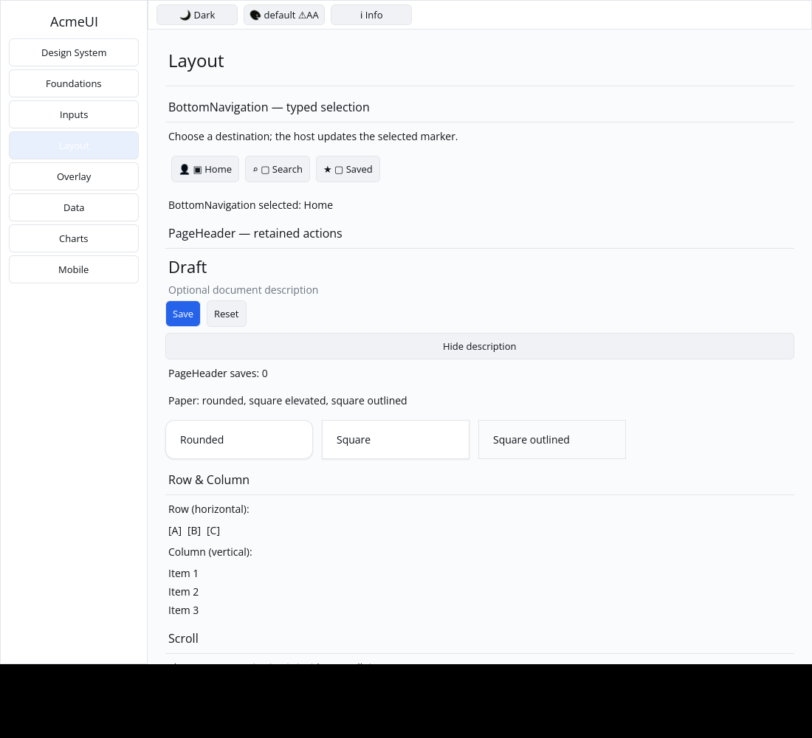
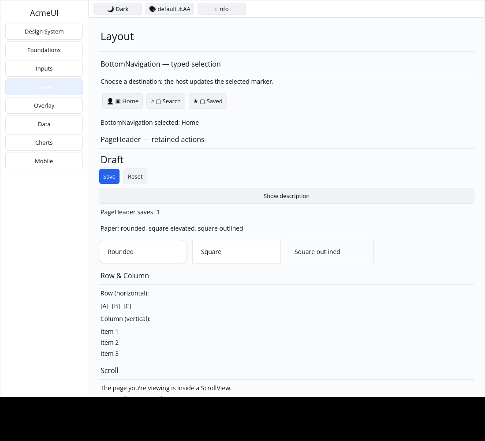

# ROADMAP 045 — PageHeader action identity

2026-11-11 Asia/Taipei. **single-agent-role-passes** (Lead, Architecture,
UI/UX, Verification), sole writer, author self-review; independent review
NOT_RUN. [Brief and leases](BRIEF.md). Base
`b8df270e1b124412f854df04f6c789b72ea036cf`, after PR #53 merged with ten
hosted checks PASS and MERGEABLE. Second slice of this run, selected from P5
layout-builder conversion coverage. Owner authorizes merge commit after local
acceptance, all hosted CI PASS and GitHub MERGEABLE; no Codex review wait.

## Change and boundary

REPRODUCED: adding/removing PageHeader's optional description changed its
unkeyed action Row's positional key. Reconciliation replaced the Row and even
explicitly keyed descendant Buttons; FocusManager lost the focused action.
Give that existing Row an instance-derived stable key. No other production
behavior, public field/signature or dependency changes.

The retained regression covers root/Row/Button IDs, focused Save, updated typed
messages and primary/secondary variants through description insertion/removal
and keyed header reorders. A second test preserves no-action and passive-action
composition. Gallery tests exercise actual pointer Save/reset and description
toggles, clearing stale pointer state when geometry changes, both themes, three
scales, real action bounds and matching clipped paint/hit slots. The initial
focus-loss failure is preserved with the passing checks.

The Gallery demonstrates host-owned save count and optional subtitle state.
Retained focus is proven with the real tree and FocusManager, not by the native
pointer capture. Generic Gallery keyboard hosting, human focus usability,
screen-reader acceptance and the existing PageHeader typography/color policy
remain separate.

## Verification

Tested implementation **`105f0d8edebb8c952a05f8bb954bb488036eb44d`**,
Linux x86_64, Rust/Cargo 1.88.0. Documentation/evidence dirty as recorded per
command. [Evidence](evidence.json) retains source/status, exact command vectors,
timestamps, environment, exits and raw-log hashes. CPU profile ran through the
available python3 interpreter, without a dry run. Documentation commits do not
replace this locally tested SHA; hosted CI tests the final PR head/merge.

| Check | Result |
|---|---|
| Locked all-feature UI / consumer | PASS: 825 / 2 tests |
| Locked Gallery | PASS: 77 tests |
| Touched formatting / strict all-target Clippy | PASS / PASS |
| Workspace all-target check / milestone tests | PASS / PASS |
| Debug / release Gallery builds | PASS / PASS |
| Actual CPU profile | PASS: 87 tests; one existing timing ignore |

## Native evidence

Automated Xvfb/X11 CPU-window pointer evidence, not human sign-off. The
[capture record](logs/native-window.json) preserves source/status, actual input
commands, geometry, environment, image/log hashes and backend output. The
author inspected both final images: the initial optional description is
visible with save count 0; after actual Save and Hide description clicks, the
description is absent, Save/reset remain visible and the count reads 1.

Reused target/; no cargo clean, destructive git operations, force-push, GPUI,
widget color literals, manifest/lockfile, Scene or platform changes.
**NOT_RUN:** human Gallery, Windows 注音 IME/candidate placement, physical
DPI/touch, real GPU and screen readers. No project completion or readiness
claim. Local acceptance is complete; consult the PR for final hosted checks
and merge record. Other P5 conversions remain open.
