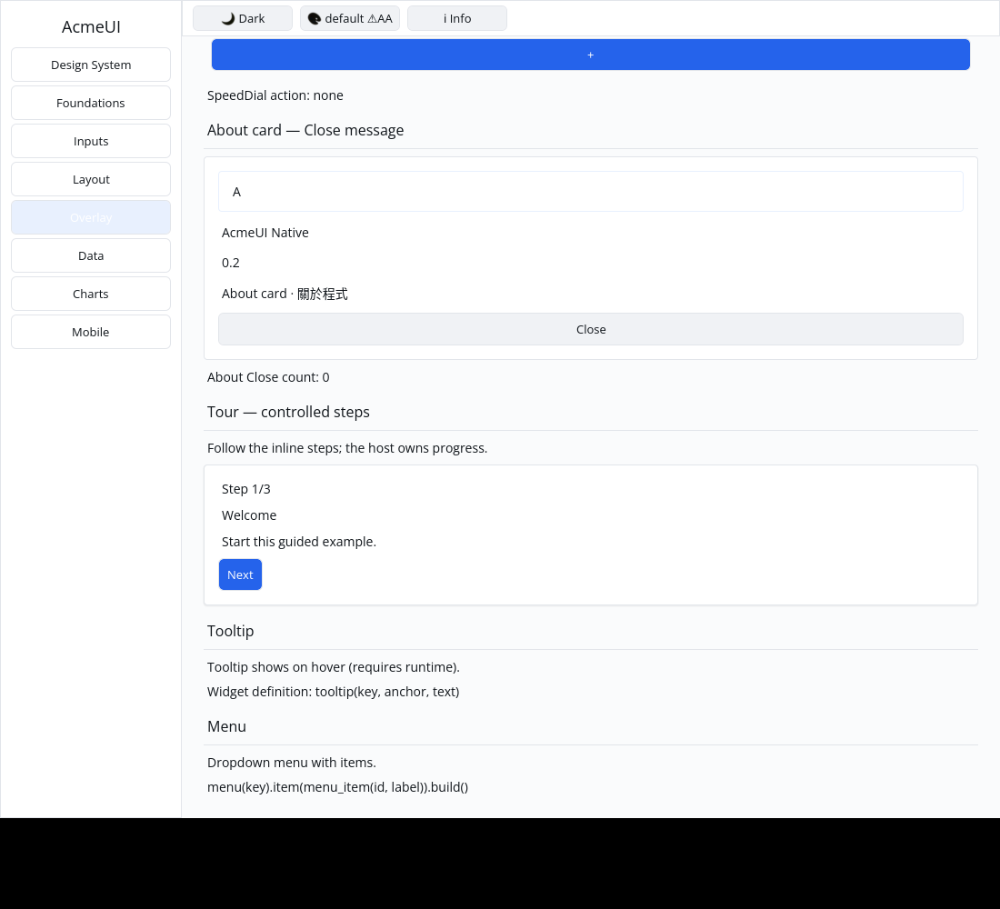
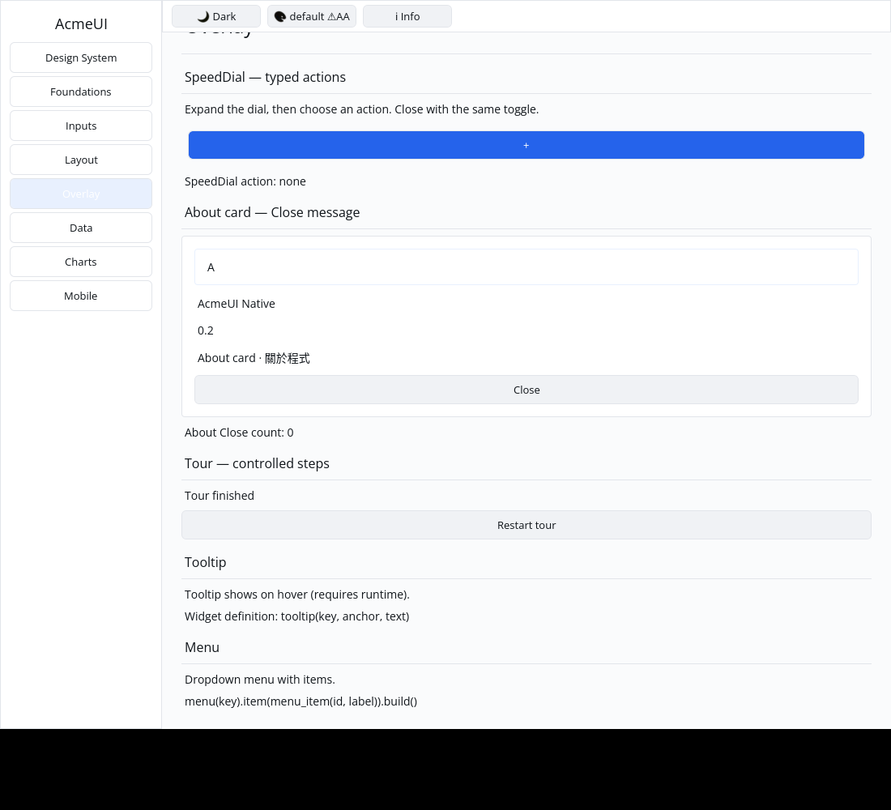

# ROADMAP 046 — Tour conversion bounds

2026-11-11 Asia/Taipei. **single-agent-role-passes** (Lead, Architecture,
UI/UX, Verification), sole writer, author self-review; independent review
NOT_RUN. [Brief and leases](BRIEF.md). Base
`9b340b3880796aa7b982b2023f3dc0aef5bb0214`, after PR #54 merged with ten
hosted checks PASS and MERGEABLE. Third and final slice of this run, selected
from P5 overlay-builder conversion coverage. Owner authorizes merge commit
after local acceptance, all hosted CI PASS and GitHub MERGEABLE; no Codex review
wait.

## Change and boundary

REPRODUCED: `current=usize::MAX` overflowed during last-step arithmetic. Empty
or out-of-range steps could expose Previous/Finish without a current step.
Validate the current step before content/navigation conversion and return the
existing keyed Elevated Card when invalid. Last-step comparison runs only for
valid steps. Public fields/signatures, valid counter/title/description,
Button labels/messages, optional callbacks and host-owned state are preserved.
Invalid-step behavior is deliberately corrected; no API or dependency added.

Four conversion regressions cover the panic, phantom actions, valid first/
middle/last typed navigation, Unicode/optional content, passive callbacks,
retained Card identity and finite real layout through valid/invalid transitions.
Gallery tests exercise actual pointer Previous/Next/Finish/restart, stale
message rejection, both themes, three scales, clipped paint/hit agreement and
real-frame toolbar geometry. The original overflow/phantom-action failures are
preserved with the passing checks.

The demo is an inline tour with host-owned progress. Target spotlight/scroll
placement, full overlay behavior, navigation focus continuity and real platform
accessibility integration remain separate.

## Verification

Final tested source **`46adf080f027f01e5c392a07c14c337811e5d4b5`**,
Linux x86_64, Rust/Cargo 1.88.0. Documentation/evidence dirty as recorded per
command. [Evidence](evidence.json) retains source/status, exact argument vectors,
timestamps, environment, exits and raw-log hashes. Initial component checks ran
at `72f69accc54018443d43b5bac2d5460b28d84c3b`; a later geometry test prompted
the final checks, retained separately under `final-*` and `cpu-final/`.
The available python3 interpreter ran actual CPU profiles, without dry runs.
Documentation commits do not replace this locally tested SHA; hosted CI tests
the final PR head/merge.

| Final check | Result |
|---|---|
| Locked all-feature UI / consumer | PASS: 829 / 2 tests |
| Locked Gallery | PASS: 80 tests |
| Touched formatting / strict all-target Clippy | PASS / PASS |
| Workspace all-target check / milestone tests | PASS / PASS |
| Debug / release Gallery builds | PASS / PASS |
| Actual CPU profile | PASS: 87 tests; one existing timing ignore |

## Native evidence and remaining observation

Automated Xvfb/X11 CPU-window evidence, not human sign-off. The
[capture record](logs/native-window.json) retains exact source/status, scroll
and click commands/coordinates, geometry, environment and image/log hashes.
The author inspected both final images: Step 1/3 and Next are visible initially;
real Next/Next/Finish clicks show Tour finished and Restart tour.

**OBSERVED, unresolved:** the scrolled first-step image clips Gallery toolbar
text; the shorter finished-state image shows the toolbar normally. The initial
layout-shrink hypothesis was **NOT_REPRODUCED**: the real-frame geometry probe
passes with a 40 px toolbar and correct viewport bounds at 760/900 px in both
states. The passing probe is historically named `toolbar-red`; it is not RED
evidence of a layout regression. No toolbar layout fix was made. Initial
[images/record](logs/native-window-initial.json) are preserved. Investigate the
paint difference separately; these captures establish Tour pointer flow, not
whole-window visual acceptance.

Reused target/; no cargo clean, destructive git operations, force-push, GPUI,
widget color literals, manifest/lockfile, Scene or platform changes.
**NOT_RUN:** human Gallery, Windows 注音 IME/candidate placement, physical
DPI/touch, real GPU and screen readers. No project completion or readiness
claim. Consult the PR for final hosted checks and merge record. Other P5
conversions and the recorded paint follow-up remain open.
