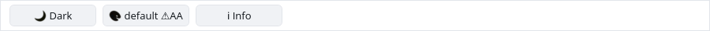
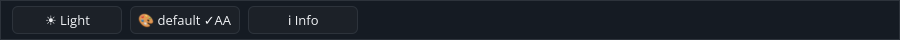

# ROADMAP 047 — Gallery toolbar paint investigation

2026-11-12 Asia/Taipei. Base `5f3c13af3bfc942357753ce658d36560750b88d9`.
Execution **single-agent-role-passes** (Lead, UI/UX, Rendering, Verification),
sole writer and author self-review; independent review NOT_RUN.
[Brief and exact leases](BRIEF.md).

## Finding and change

**NOT_REPRODUCED:** the toolbar clipping difference described in ROADMAP 046.
The original first/finished PNGs have byte-identical pixels throughout the
900 × 40 toolbar region (x=200..1100, y=0..40). Both have SHA-256
`d9cade02a1359385bb519838b2addd3484177a8c1715d1a350464775d56f59ba`
for that region's RGB bytes. New light/dark native captures agree. Earlier
visual descriptions of differing toolbar clipping are unsupported by the
stored pixels; this investigation supersedes that observation, without
rewriting the historical report. No runtime defect or layout/paint fix is claimed.

Added two Gallery tests: real-frame toolbar draw commands remain invariant
through initial Mobile → Overlay, first/middle/last/finished/restarted Tour
states, four scroll requests, two themes, three scales and two heights;
toolbar Button geometry and all emitted glyph bounds stay within 40 logical px.
Pointer movement still resolves each toolbar message above scrolled content.
Atlas uploads are excluded from paint equality because transport changes when
glyphs are cached. Sidebar selection is excluded because switching categories
intentionally changes its highlight. These are test-only additions: no public
API, runtime implementation, manifest, lockfile, Scene or platform change.

The initial geometry/glyph probes passed. The first expanded comparison failed
because it included the sidebar highlight; its correction is test-authoring
work, not RED evidence of a product bug. Both initial failing checks and passing
probes remain in [evidence.json](evidence.json).

## Verification

Exact tested source **`8b8df69d60623ad4a3c5aee2731ec3b63adf9e82`**,
Linux x86_64, Rust/Cargo 1.88.0. Documentation/evidence dirty status is retained
per command. [Evidence](evidence.json) records argument vectors, timestamps,
OS/toolchain, source SHA, exits and raw-log hashes. Documentation commits do
not replace this tested source; hosted CI checks the final PR head/merge.

| Check | Result |
|---|---|
| Locked Gallery suite | PASS: 82 tests |
| Touched formatting / strict all-target Clippy | PASS / PASS |
| Workspace all-target check / milestone tests | PASS / PASS |
| Gallery debug / release builds | PASS / PASS |
| Actual CPU profile | PASS: 87 tests; one existing timing ignore |
| X11 CPU-window Tour flow / toolbar pixel comparison | PASS in light and dark |

The available `python3` interpreter executed `scripts/verify_sdk.py --profile cpu`
without a dry run; [CPU report](logs/cpu/report.json) retains exact provenance.
No broad gate was run between individual test edits; the workspace checks ran
at the slice milestone. Existing target/ was reused.

## Native evidence and limits

The details are exact 900 × 40 crops of the new Xvfb/X11 CPU-window captures.
The author inspected them and the Tour finished state. Full light
[first](gallery-toolbar-light-first.png)/[finished](gallery-toolbar-light-finished.png)
and dark [first](gallery-toolbar-dark-first.png)/[finished](gallery-toolbar-dark-finished.png)
frames show actual Next/Next/Finish pointer flow. The reproducible
[capture script](logs/capture.py) and [record](logs/native-window.json) retain
commands, coordinates, binary hash, geometry, source/status and image hashes.
All three original/new toolbar comparisons have no differing pixels.

This establishes automated CPU-window evidence for the investigated scenario.
It does not establish whole-window human acceptance or a universal clipping
absence. Tour spotlight/scroll placement and full overlay/focus behavior remain
separate. Human Gallery, Windows 注音 IME/candidate placement, physical DPI/touch,
GPU and screen-reader validation remain **NOT_RUN**. No project completion or
release-readiness claim. Consult the PR for hosted checks and merge record.

Next bounded candidate: audit the ignored Collapsible on_toggle conversion and
disabled-header behavior under the existing P5 conversion-coverage todo.
