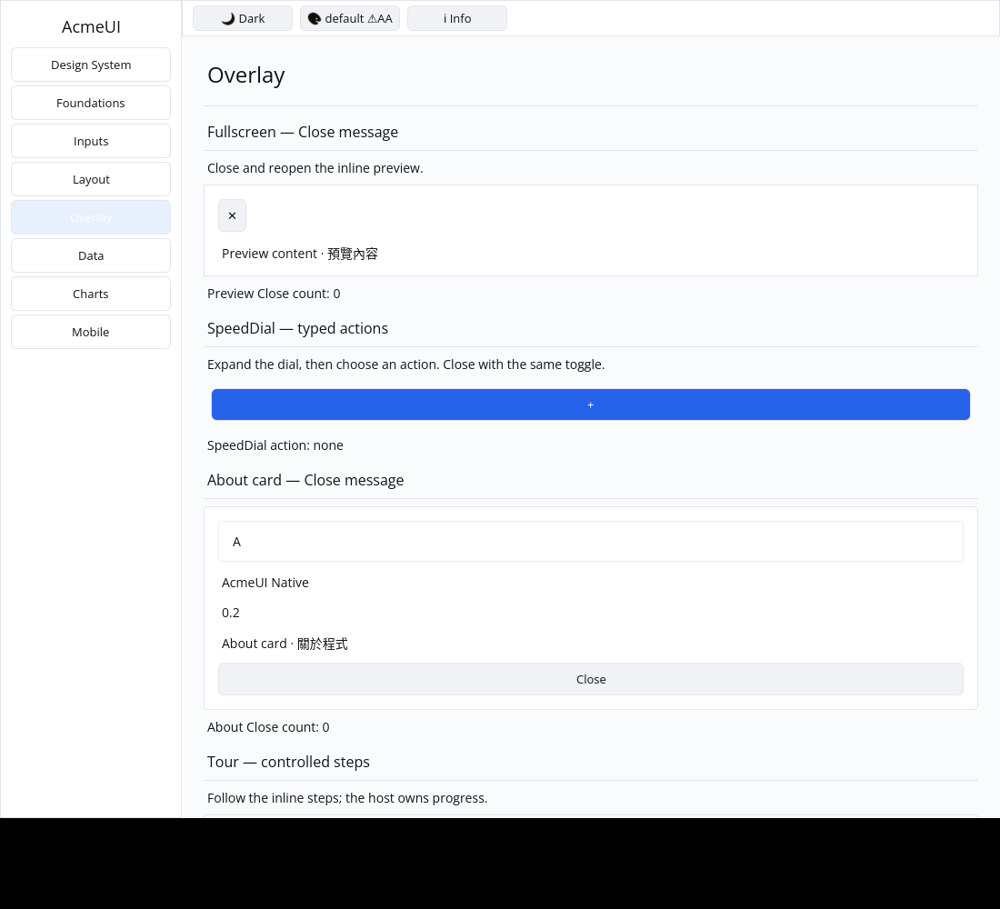
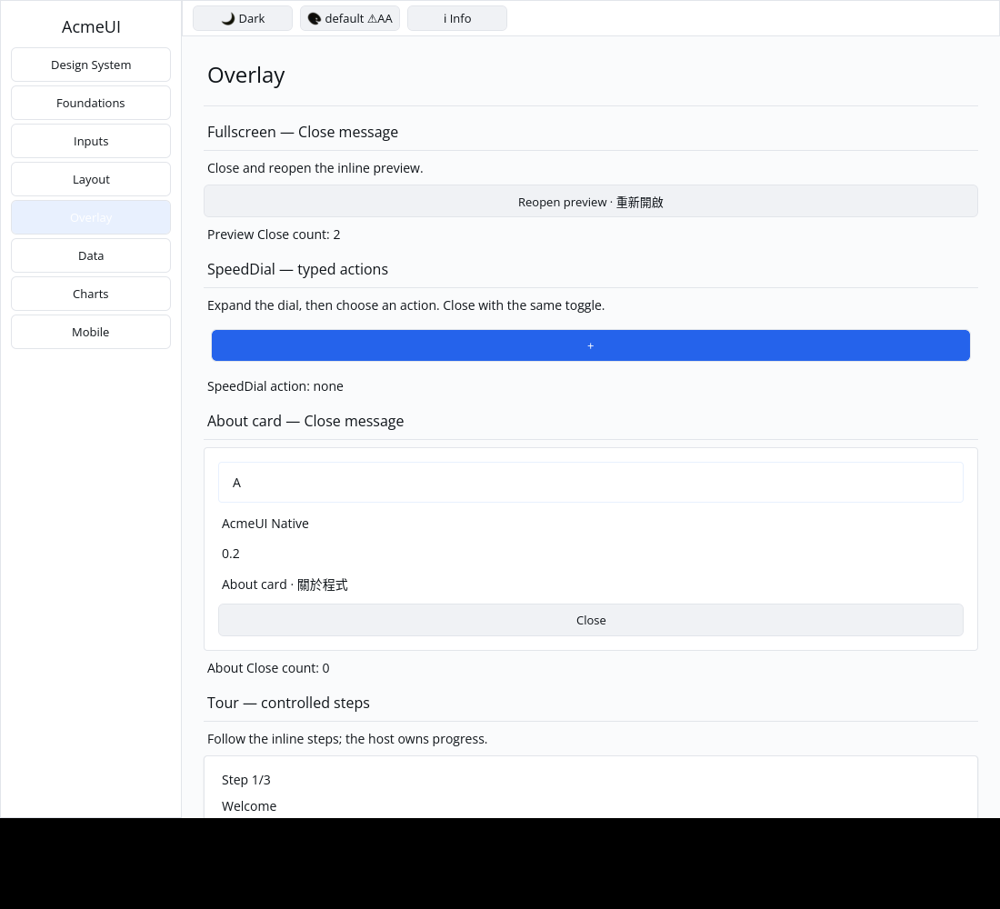

# ROADMAP 048 — Fullscreen Close conversion

2026-11-12 Asia/Taipei. Base `fdae1b9b599b970eb7bf609ecb842cfd28cee310`,
after PR #56 merged with ten hosted checks PASS and GitHub MERGEABLE.
Second and final slice of this run, selected from unfinished P5 builder
conversion coverage. **single-agent-role-passes** (Lead, Architecture, UI/UX,
Verification), sole writer, author self-review; independent review NOT_RUN.
[Brief and exact leases](BRIEF.md).

## Change and boundary

**REPRODUCED:** Fullscreen conversion ignored its configured on_close message,
rendering only a passive ✕ Label. Bind a visible configured close control to an
instance-keyed Button carrying the current message. Missing callbacks retain
the passive Label; close_button(false) emits no close control or action.

**REPRODUCED:** removing the optional unkeyed header remounted the body and
its focused child (NodeIds 6/7 became 8/9 in the retained probe). Key the header
and body independently so body identity/focus survive that transition. Close
identity stays stable across current-message updates while visible; removing
and recreating the close control does not claim to preserve its old identity.

The outer Plain Card, existing keyed content Column, content order, passive
symbol, public fields/signatures and opacity metadata remain compatible.
Only configured close controls gain Button sizing/interaction. Existing viewport
placement, backdrop opacity painting, Escape, focus trap and general overlay
hosting are separate; API docs now make the host responsibility explicit.
No dependencies, manifest, lockfile, Scene or platform changes.

The Gallery has an explicitly inline preview with Close/reopen, an activation
counter and stale-close rejection. Two conversion/focus tests and two Gallery
pointer/theme/scale/clip/layout tests cover current typed messages, optional
controls, focus eligibility/continuity, exactly-once activation and actual
paint/hit slots. Original RED logs and matching GREEN checks are retained.

## Verification

Exact tested source **`ee15fb94022b7598e9c86227b224f928b7cc79e5`**,
Linux x86_64, Rust/Cargo 1.88.0. Documentation/evidence dirty status is recorded
per command. [Evidence](evidence.json) preserves argument vectors, timestamps,
OS/toolchain, source SHA, exits and raw-log hashes. Documentation commits do
not replace that locally tested source; hosted CI checks the final PR head/merge.

| Check | Result |
|---|---|
| Locked all-feature UI / consumer tests | PASS: 831 / 2 |
| Locked Gallery tests | PASS: 84 |
| Touched formatting / strict all-target Clippy | PASS / PASS |
| Workspace all-target check / milestone tests | PASS / PASS |
| Gallery debug / release builds | PASS / PASS |
| Actual CPU profile | PASS: 87 tests; one existing timing ignore |
| Actual X11 CPU pointer Close/reopen/Close | PASS: final counter 2 |

The available `python3` interpreter executed `scripts/verify_sdk.py --profile cpu`
without a dry run; [CPU report](logs/cpu/report.json) retains exact provenance.
The workspace gates ran at the slice milestone. Existing target/ was reused.

## Native evidence and remaining work

Automated Xvfb/X11 CPU-window evidence, not human acceptance. The author
inspected both images: the initial preview and ✕ control are visible; real
Close/reopen/Close clicks leave Reopen preview and Preview Close count: 2.
The [capture script](logs/capture.py) and [record](logs/native-window.json)
retain commands/coordinates, source/status, binary hash, geometry, environment
and image/log hashes. Reproduce with script arguments
`255 237 400 221 255 237` after the recorded debug build.

**NOT_RUN:** human Gallery, Windows 注音 IME/candidate placement, physical
DPI/touch, GPU and screen readers. Fullscreen viewport/backdrop/focus-trap
semantics and other P5 conversions remain open. No project completion or
release-readiness claim. Consult the PR for final hosted checks and merge
record. Next bounded candidate: Collapsible on_toggle/disabled conversion.
