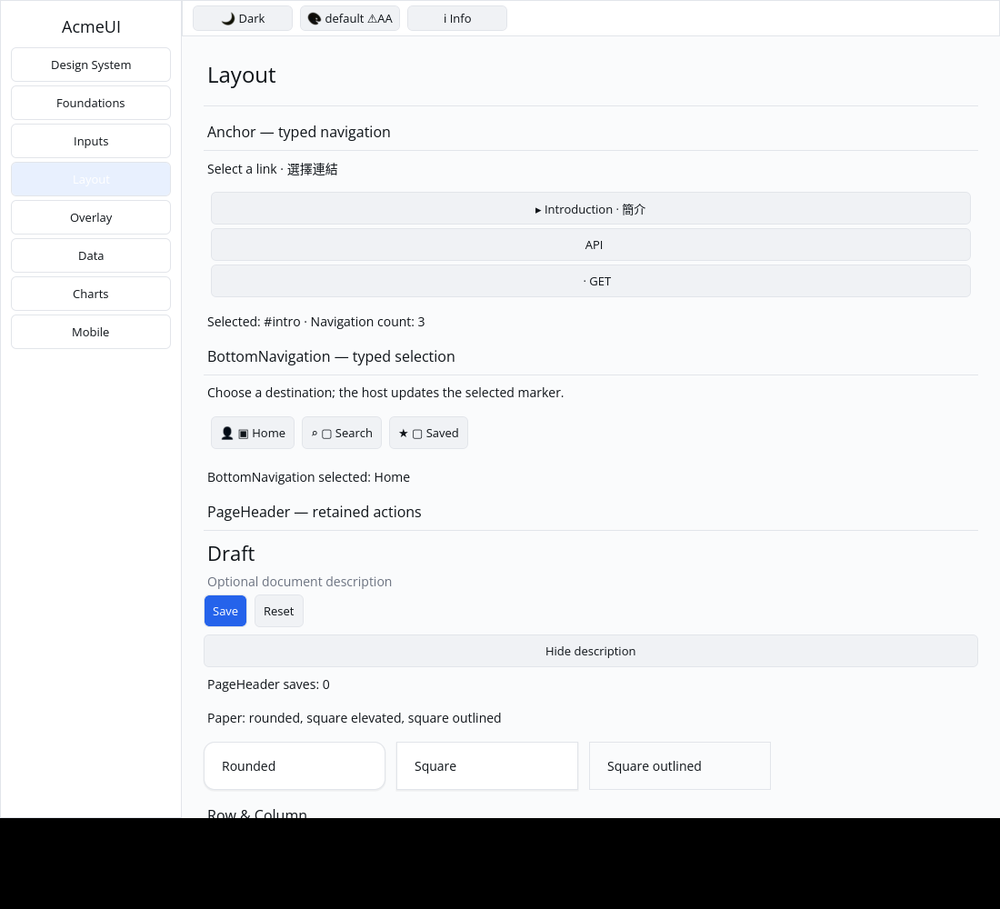

# ROADMAP 049 — Anchor typed navigation conversion

2026-11-12 Asia/Taipei. Base `09d00899ea1fe1ecbeff89999e1b705c9835e18f`,
after PR #57. Selected unfinished P5 builder conversion coverage.
**single-agent-role-passes** (Lead, Architecture, UI/UX, Verification), sole
writer, author self-review; independent review NOT_RUN. [Brief/leases](BRIEF.md).

## Change and boundary

**REPRODUCED:** Anchor conversion ignored on_navigate and emitted only Labels.
Configured parent and immediate-child links now become instance/path-keyed
Buttons carrying the current callback's href message. Without a callback,
existing passive Labels and their text remain compatible. Preserve the keyed
Column, gap/padding, active parent marker, child indentation, public fields and
signatures. The host still owns active_href and target scrolling.

Keys identify rendered list positions, including parent/child path; they do not
promise semantic identity when items themselves reorder. Active href/callback
updates and keyed component-instance reorder retain action identity/focus.
Deeper nesting remains outside the existing two-level rendering boundary.
No new dependencies, manifests, Scene or platform changes.

The Layout Gallery adds a controlled selection/count preview. Two conversion/
focus regressions and two Gallery tests cover current typed hrefs, passive and
empty inputs, independent instance IDs, focus continuity, parent/child pointer
dispatch exactly once, finite nonoverlapping bounds, hit/paint slots and themed
clipped rendering at 1/1.25/2 scales in both light/dark modes.

## Verification

Exact tested source **`96e3dfd5061ead4a8bd62eca682d463b796a4401`**,
Linux x86_64, Rust/Cargo 1.88.0. Documentation/evidence dirty state is recorded
per command. [Evidence](evidence.json) retains arguments, timestamps, source
SHA/status, toolchain/OS, exits and raw-log hashes. Documentation commits do
not replace that tested source; hosted CI checks the final PR head/merge.

| Check | Result |
|---|---|
| Locked all-feature UI / consumer tests | PASS: 833 / 2 |
| Locked Gallery tests | PASS: 86 |
| Touched formatting / strict all-target Clippy | PASS / PASS |
| Workspace all-target check / milestone tests | PASS / PASS |
| Gallery debug / release builds | PASS / PASS |
| Actual CPU profile | PASS: 87 tests; one existing timing ignore |
| Actual X11 CPU parent/child pointer navigation | PASS: final #intro, count 3 |

Initial conversion RED is preserved. Two intermediate failed checks record a
local prefix-name typo, then test-harness assumptions (PointerMoved required
by Gallery before PointerButton, default Button uses secondary rather than
primary). These were corrected; the final focused and full checks pass. The
available python3 interpreter runs the real SDK CPU profile without dry-run.
Workspace gates run only at the slice milestone; target/ is reused.

## Native evidence and remaining work

Automated Xvfb/X11 CPU-window evidence, not human acceptance. The author
inspected both captures: parent and child links are visible, and actual API,
GET, Introduction clicks leave Selected: #intro and Navigation count: 3.
The [capture script](logs/capture.py) and [record](logs/native-window.json)
retain source/status, binary hash, commands/coordinates, geometry, environment
and image/log hashes. Reproduce with `650 270 650 310 650 230` after the recorded
debug build. The initial attempt reached the window but failed on noninteractive
stdin before clicks; its failure record/log are preserved as native-initial.
[Actual CPU report](logs/cpu/report.json) records the SDK profile execution.

**NOT_RUN:** human Gallery, Windows 注音 IME/candidate placement, physical
DPI/touch, GPU and screen readers. Automatic target scrolling, deeper nesting,
semantic navigation roles, generic keyboard hosting and other P5 conversions
remain separate. Consult the PR for final hosted checks and merge record.
Next bounded candidate: Collapsible on_toggle/disabled conversion.
