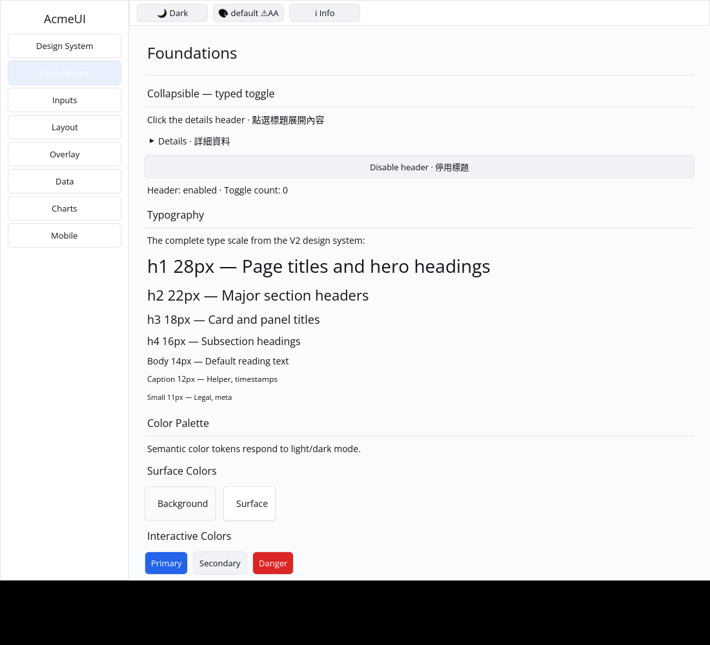
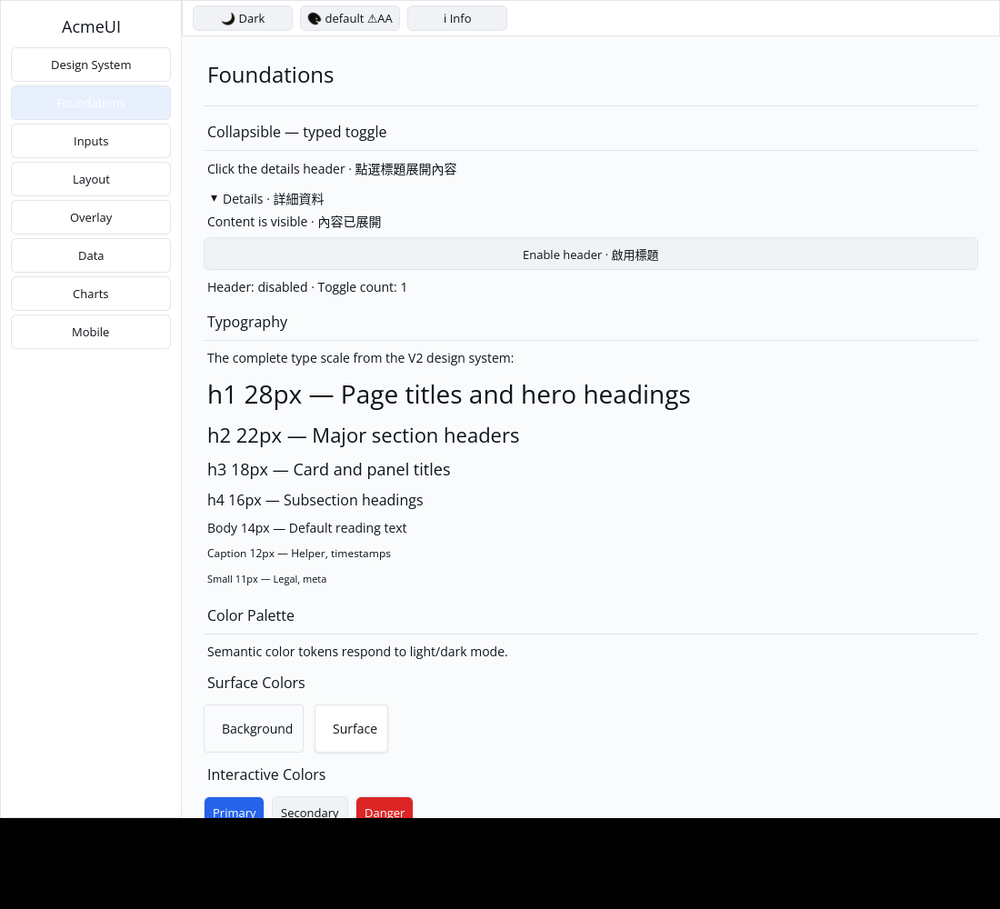

# ROADMAP 050 — Collapsible typed toggle conversion

2026-11-12 Asia/Taipei. Base `6d29095a8d934e1256f10be19755a9e1cb94b482`,
after [PR #58](https://github.com/stevenke1981/AcmeUI-Native/pull/58) merged
with ten hosted checks PASS and GitHub MERGEABLE. Second and final slice of
this run, selected from unfinished P5 builder conversion coverage.
**single-agent-role-passes** (Lead, Architecture, UI/UX, Verification), sole
writer, author self-review; independent review NOT_RUN. [Brief/leases](BRIEF.md).

## Change and boundary

**REPRODUCED:** Collapsible conversion ignored on_toggle. An enabled configured
header now carries its current typed message in the existing Row. Disabled
or unconfigured headers carry no action and are excluded from retained focus.
Header keys derive from the component key; identity/focus survives open/title/
message updates and keyed component-instance reorder. Disabling clears focus
eligibility; re-enabling does not automatically restore previously cleared focus.

Preserve the keyed Column, header Row, chevron and title Labels, gaps/padding
and child visibility controlled by open. The host owns open and disabled state;
setting disabled does not hide already-visible content. The transparent header
remains transparent. No new public API, dependencies, manifests, Scene or
platform changes. Disclosure-specific roles/expanded state, animation and a
generic keyboard host remain separate.

The Foundations Gallery adds an open/close and disable/enable preview, count
and stale-action guard. A private Row routing helper adds CollapsibleToggle
while delegating all existing Mobile actions to the original route; hit and
paint consume the same helper. Two conversion/focus tests and two Gallery
pointer/real-layout/theme/scale/clip tests cover current messages, optional
handlers, focus eligibility/continuity, identity, disabled stale actions and
finite nonoverlapping hit regions with matching paint indices.

The first milestone run **FAILED** an existing Gallery regression that assumed
every action had a background Quad. The new header deliberately preserves the
original transparent Row. Keep every existing button Quad assertion and add
an explicit transparent-header branch requiring exactly two painted text runs
(chevron/title), nonempty glyphs and glyph bounds within its hit rectangle.
The focused transparent-header regression and final full re-verification pass.
Initial RED logs record the missing key, then the ignored callback separately.

## Verification

Exact final tested source **`daa980336a7e2a502adaa68496d6317d8a4ff6ad`**, Linux x86_64,
Rust/Cargo 1.88.0. Documentation/evidence dirty status is recorded per command.
[Evidence](evidence.json) retains arguments, timestamps, source SHA/status,
OS/toolchain, exits and raw-log hashes. Documentation commits do not replace
that tested source; hosted CI checks the final PR head/merge.

| Check | Result |
|---|---|
| Locked all-feature UI / consumer tests | PASS: 835 / 2 |
| Locked Gallery tests | PASS: 88 |
| Touched formatting / strict all-target Clippy | PASS / PASS |
| Workspace all-target check / milestone tests | PASS / PASS |
| Gallery debug / release builds | PASS / PASS |
| Actual CPU profile | PASS: 87 tests; one existing timing ignore |
| Actual X11 CPU open/disable/disabled-header attempt | PASS: open, disabled, count stays 1 |

The available python3 interpreter executes the real SDK CPU profile without
dry-run; workspace gates run only at the slice milestone. Reuse target/.

## Native evidence and remaining work

Automated Xvfb/X11 CPU-window evidence, not human acceptance. The author
inspected both images: the initial right chevron becomes down with visible
content; after disabling and clicking the header again, content remains visible,
Header: disabled and Toggle count: 1. The [capture script](logs/capture.py) and
[record](logs/native-window.json) retain source/status, binary hash, commands,
coordinates, geometry, environment and image/log hashes. Reproduce with
`300 218 650 280 300 218` after the recorded debug build.
The [actual CPU report](logs/cpu/report.json) retains exact SDK execution.

**NOT_RUN:** human Gallery, Windows 注音 IME/candidate placement, physical
DPI/touch, GPU and screen readers. Disclosure roles, animation, generic keyboard
hosting and other builder conversions remain open. Consult the PR for final
hosted checks and merge record. Next bounded candidate: Notification converted
action/Close identity through optional controls.
