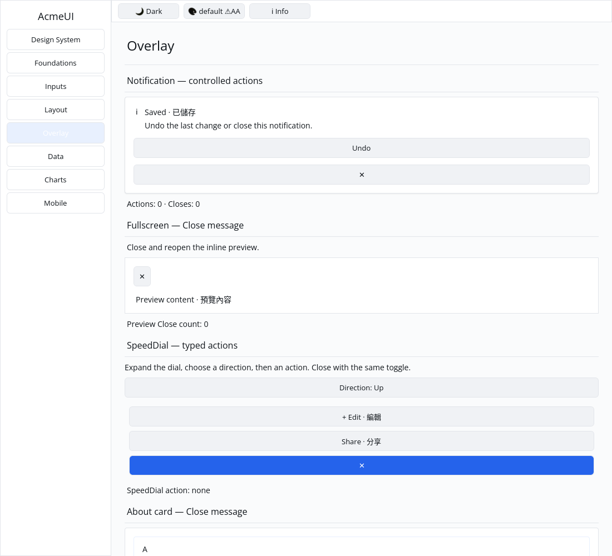
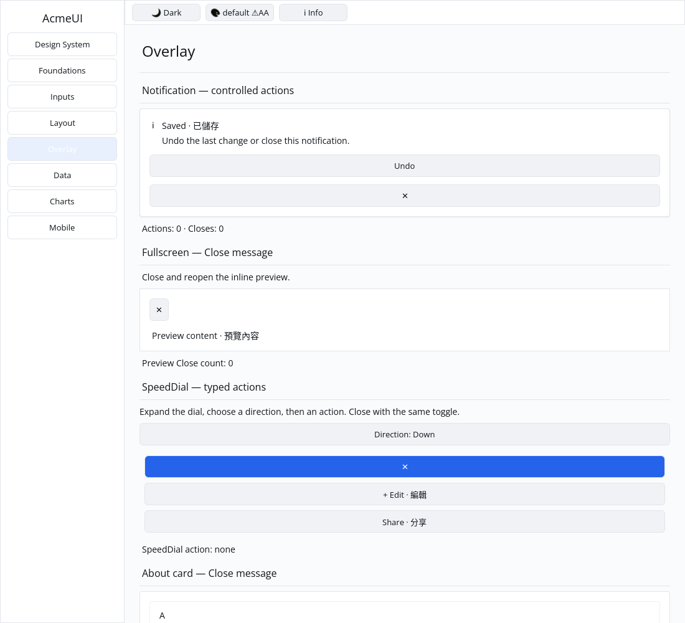
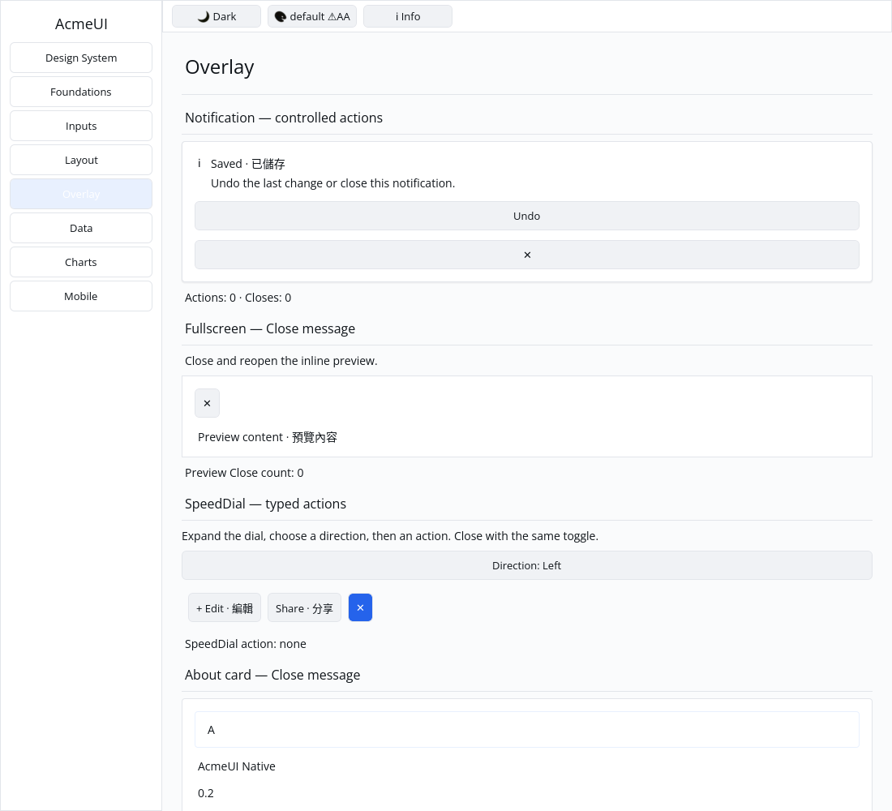
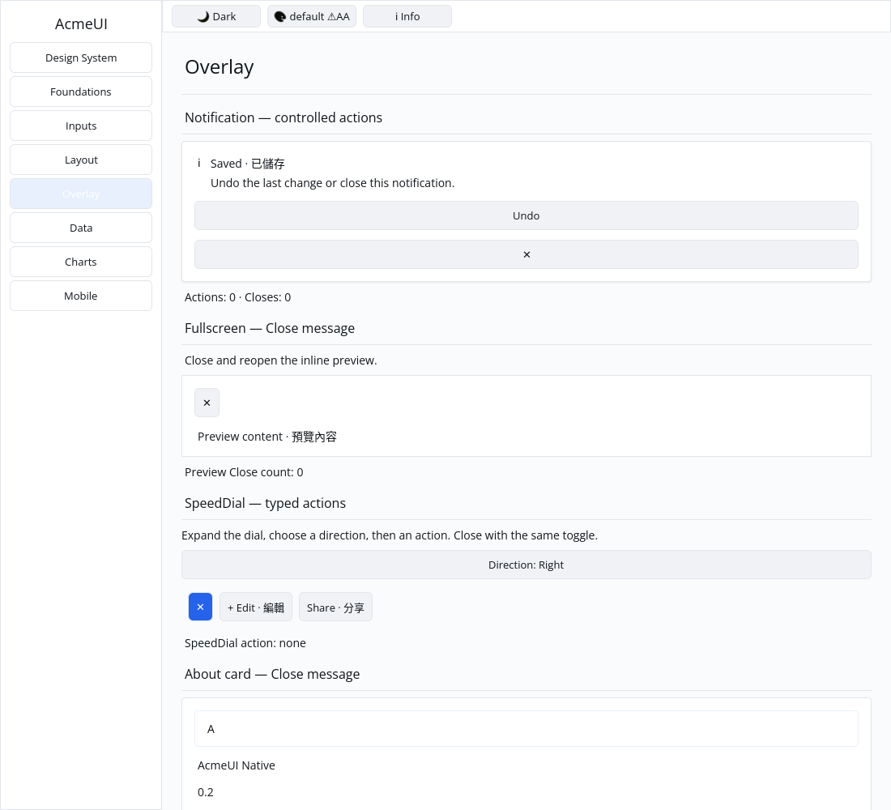
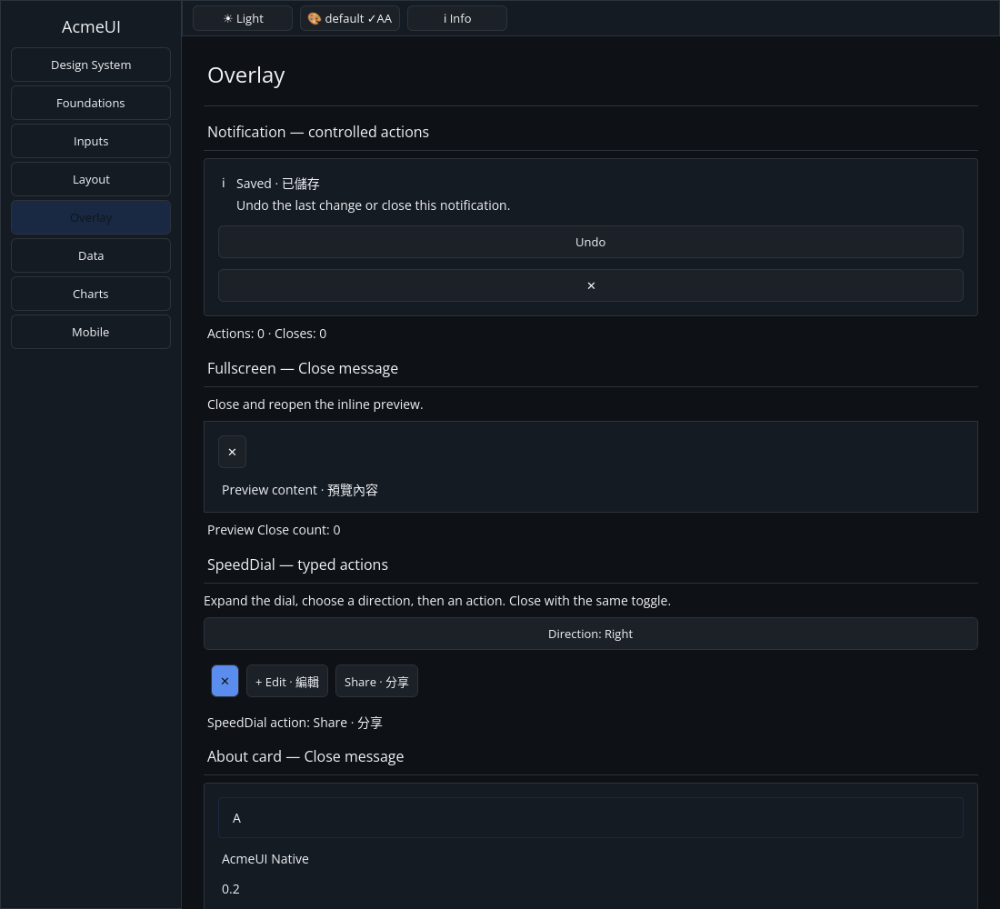

# ROADMAP 053 — SpeedDial directional expansion

2026-11-16 Asia/Taipei. Execution: **single Codex agent, sole writer and author
self-review**; independent review NOT_RUN. Base
`b209174cc73deef860f2f1bc3531eb93f8406e60`. [Acceptance](BRIEF.md).

`SpeedDialDirection` and the builder's `direction` field/setter support Up,
Down, Left and Right. Up preserves the existing Column/actions/toggle layout.
Down puts the toggle first; Left/Right use a Row and intrinsically sized action
Buttons instead of full-width Buttons. The action list retains declaration order
from top to bottom or left to right, and messages retain their original indices.
Keys, passive labels and host-controlled visibility are preserved. Direct builder
struct literals need the new direction field; existing constructor calls retain
the Up default. There are no manifest, dependency, lockfile, Scene or platform edits.

Gallery adds a direction cycle button, wraps its instruction text and cancels
cached hover/press when changing direction. The pointer test now scrolls targets
into the content viewport, as required by the current clipped HitTestLayer.
Three new component regressions cover direction/action/passive/closed contracts,
retained IDs/focus through direction and keyed reorders, and text-measured geometry
at 400/600 px and scales 1/1.25/2. Gallery checks cover pointer selection in all
directions, press cancellation and matching hit/paint slots with both themes,
scales 1/1.25/2 and open/closed states. Existing vertical 240 px coverage remains.

Tested implementation **`2133f7c4191d9ba63a90a8fdc41af4b685abc890`**, Linux x86_64,
Rust/Cargo 1.88.0. Later changes contain only this report and evidence.
[Command records](evidence.json) retain timestamps, exit codes and raw logs;
[CPU runner evidence](logs/cpu/report.json) is an actual run, not a dry run.
The host provides `python3` rather than a `python` command, so that interpreter
ran the unchanged SDK verification script.

| Check | Result |
|---|---|
| Changed Rust file formatting | PASS |
| `cargo test --locked -p acme-ui --all-features -p acme-ui-gallery` | PASS: UI 868 unit + 2 integration, Gallery 95; 2 existing doc ignores |
| Strict all-target UI/Gallery Clippy, all UI features | PASS |
| `python3 scripts/verify_sdk.py --profile cpu` | PASS: 87 tests; 1 existing timing ignore; format/Clippy PASS |
| Locked newer Gallery debug build | PASS |
| Slice milestone: locked workspace all-target check / workspace tests | PASS / PASS |
| Automated native X11 CPU pointer capture | Captured; author inspected all five images |

The initial Gallery checks caught an unwrapped instruction expanding the demo
and off-viewport synthetic clicks rejected by the current clipped hit layer.
The wrapping and target-scrolling changes above resolved these. An intermediate
LabelBuilder call lacked `.build()` and was fixed before the recorded final run.
These are not claims of pre-existing runtime defects.

Native evidence is generated by [capture.py](logs/capture.py), with environment,
exact source, inputs, geometry and image hashes in [the capture record](logs/native-window.json).
The four light captures visibly show actions above, below, left and right of
the toggle. The dark Right capture shows Share selected while the dial stays
open. These are automated real Xvfb/X11 CPU-window captures, inspected by the
author, not human acceptance or GPU evidence.

| Up (default) | Down |
|---|---|
|  |  |

| Left | Right |
|---|---|
|  |  |

Delivery snapshot: local acceptance and evidence complete. The PR records final
hosted CI and merge status; merge is authorized only after every hosted check
passes and GitHub reports MERGEABLE. No Codex code review is awaited.

Viewport anchoring, animation and automatic dismissal remain separate work.
Human Gallery, Windows 注音 IME/candidate placement, physical DPI/touch, GPU
and screen readers are NOT_RUN. No project completion or release claim.
