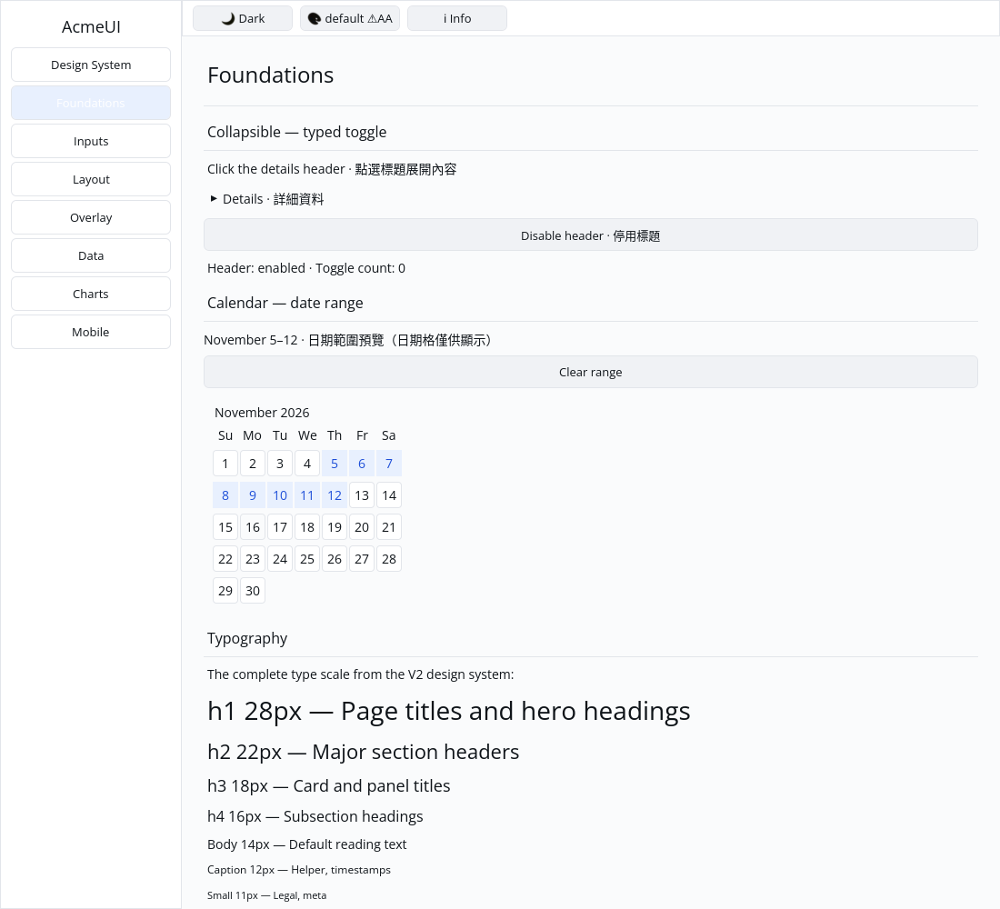
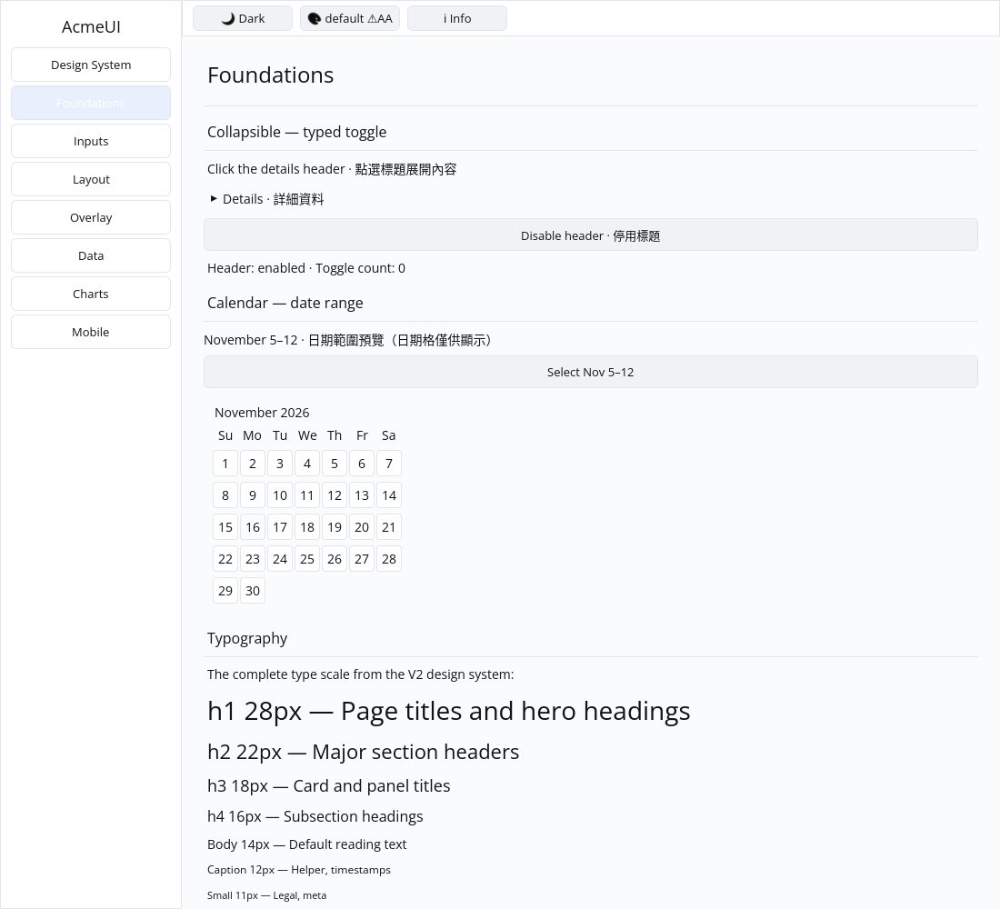
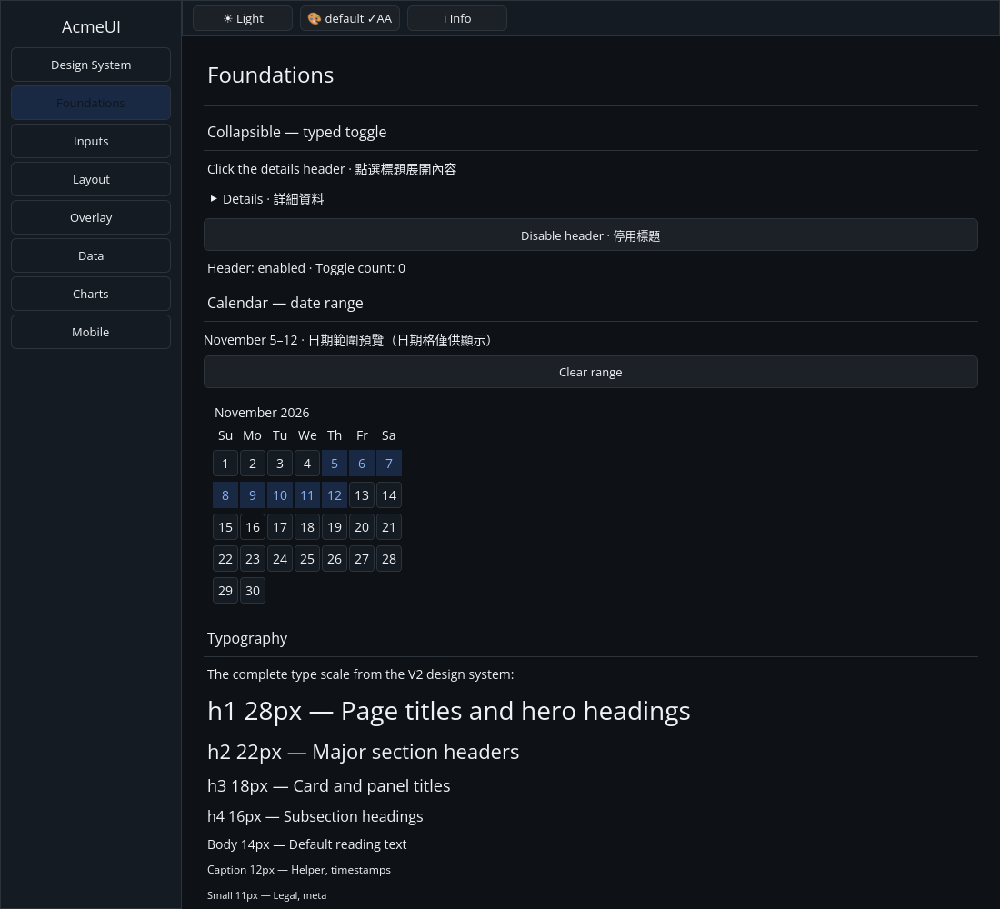

# ROADMAP 054 — Calendar range highlighting

2026-11-16 Asia/Taipei. Execution: **single Codex agent, sole writer and author
self-review**; independent review NOT_RUN. Base
`603730be870a86298c27fc9e2d2811a5bccfadaa`. [Acceptance](BRIEF.md).

`CalendarBuilder::selected_range(start, end)` highlights an inclusive range in
the displayed month. Reversed endpoints are normalized; a range with either
endpoint outside the month's valid days is ignored. Validation uses the current
public year/month fields at build time, including leap-year boundaries. The last
`selected_day`/`selected_range` setter wins. Existing single-day and today Card
variants remain, and date cells remain passive.

Range cells use semantic Accent/AccentForeground tokens on an inner Row surface.
Weekday labels, date Cards and empty slots now share 28 px columns, correcting
the former unequal widths for single/two-digit dates and adjacent-month blanks.
Keys on header, weekday, week and day nodes preserve retained day IDs through
range and optional-header changes. The new setter and private range storage are
the only component API changes; constructor calls remain compatible. No manifest,
dependency, lockfile, Scene or platform changes.

Gallery adds a November 5–12 preview with Clear/Select controls, a separate today
marker and wrapping explanatory text. The host owns the range and clears cached
hover/press when changing it. Four new component regressions cover inclusive,
reversed, singleton, invalid and leap ranges, last-setter precedence, original
single-day/today behavior, retained IDs/passive focus and measured grid alignment
at scales 1/1.25/2 (including six-week months). Two Gallery regressions cover
actual pointer clear/restore and theme/scale/clip/hit-slot painting.

Tested implementation **`a33496abb6adde8577448a01e433df39bda65daa`**, Linux x86_64,
Rust/Cargo 1.88.0. Later changes contain only documentation and evidence.
[Command records](evidence.json) preserve source, dirty status, environment,
timestamps, exit codes and raw-log hashes. The initial run starts with the
untracked initial regression log; the implementation is committed. The host has
`python3` rather than `python`, so that interpreter runs the unchanged SDK script.

| Check | Result |
|---|---|
| Changed Rust file formatting | PASS |
| Locked all-feature UI/Gallery tests | PASS: UI 872 unit + 2 integration, Gallery 97; 2 existing doc ignores |
| Strict all-target UI/Gallery Clippy, all UI features | PASS |
| Actual `scripts/verify_sdk.py --profile cpu` | PASS: 87 tests; 1 existing timing ignore; format/Clippy PASS |
| Locked Gallery debug build | PASS |
| Milestone locked workspace all-target check / workspace tests | PASS / PASS |
| Milestone locked release workspace build | PASS |
| Automated native X11 CPU pointer capture | Captured; author inspected all three images |

The preserved [initial compile failure](logs/initial-regression.txt) shows the
missing range API plus test-helper API mistakes. The test helpers were corrected;
no pre-existing Calendar runtime failure is claimed from that compile attempt.

Native evidence comes from [capture.py](logs/capture.py), with exact source,
environment, commands, geometry and image hashes in
[the capture record](logs/native-window.json). The images show the inclusive
5–12 range crossing a week boundary, clearing it, and restoring it in dark mode.
These are automated real Xvfb/X11 CPU-window captures inspected by the author,
not human acceptance or GPU evidence.

| Range | Cleared |
|---|---|
|  |  |

Delivery: the PR records final hosted CI and merge status. Merge is authorized
only after every hosted check passes and GitHub reports MERGEABLE, using a merge
commit. No Codex code review is awaited.

Cross-month selection, date-cell input, month navigation, localization and full
calendar accessibility semantics remain separate. Human Gallery, Windows 注音
IME/candidate placement, physical DPI/touch, GPU and screen readers are NOT_RUN.
No project completion or release claim.
